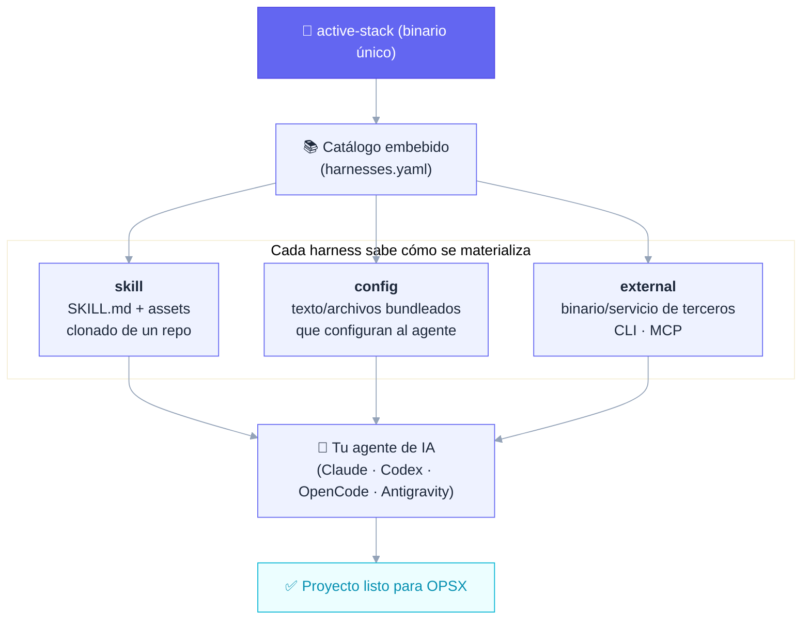
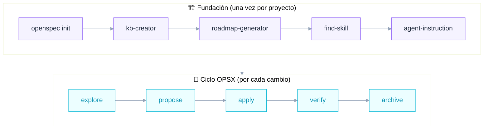

<p align="center">
  
  
  
  
  
  
</p>

<p align="center">
  <b>Un binario. Un catálogo de harnesses. Tu agente de IA listo para trabajar con método.</b>
</p>

---

## ¿Qué es esto?

**Active Stack** es un **instalador _methodology-first_**: un único binario en Go que toma tu agente de IA (Claude Code, Codex, OpenCode, Antigravity…) y le **inyecta, de forma modular y actualizable, todo el sustrato que exige una metodología de desarrollo asistido por IA.**

No es un framework que corre en tu app. Es un **configurador del entorno del agente**. Corrés un comando, elegís un modo, y el stack deja tu proyecto listo para el ciclo **OPSX** (`explore → propose → apply → verify → archive`).

La idea central, en una frase:

> **Active Stack es un harness que instala harnesses.**

Un *harness* es cualquier módulo que prepara o guía el entorno de la IA. Active Stack lleva embebido un **catálogo maestro** de harnesses y sabe cómo materializar cada uno según su tipo.

### ¿Qué NO es?

Para que quede claro el alcance (decisiones firmes de diseño):

- ❌ No es un code-reviewer en commit.
- ❌ No instala themes, statusline ni keybindings (nada cosmético).
- ❌ No es un producto de marketing ni "supercharge any agent".

Es una herramienta enfocada: **instalar y configurar el sustrato metodológico, nada más.**

---

## El concepto: un harness de harnesses



Hay **tres tipos** de harness, y el instalador no instala "repos": instala harnesses, y cada uno declara cómo se baja/configura.

| Tipo | Qué es | De dónde sale | Ejemplos |
|------|--------|---------------|----------|
| **`skill`** | `SKILL.md` + assets, cargada bajo demanda | repo propio o de terceros, se clona al instalar | `kb-creator`, `roadmap-generator`, `active-orchestrator`, `find-skill` |
| **`config`** | Texto/archivos que configuran al agente | bundleado en el binario | `sdd-orchestrator`, `permissions` |
| **`external`** | Binario/servicio de terceros | se instala/configura (no es nuestro) | `OpenSpec`, `Engram`, `Context7` |

---

## 📥 Descargas

<p align="center">
  <a href="https://github.com/Group-Active-IA/active-stack/releases/latest/download/ActiveStack-Setup.exe">
    
  </a>
</p>

| Plataforma | Descarga |
|------------|----------|
| **Windows** (instalador gráfico) | [`ActiveStack-Setup.exe`](https://github.com/Group-Active-IA/active-stack/releases/latest/download/ActiveStack-Setup.exe) — última versión |
| **Windows** (solo CLI) | [`active-stack_windows_amd64.exe`](https://github.com/Group-Active-IA/active-stack/releases/latest/download/active-stack_windows_amd64.exe) |
| **Linux / WSL** (solo CLI) | [`active-stack_linux_amd64`](https://github.com/Group-Active-IA/active-stack/releases/latest/download/active-stack_linux_amd64) |
| Todas las versiones | [Releases](https://github.com/Group-Active-IA/active-stack/releases) |

Cada release publica su [`SHA256SUMS.txt`](https://github.com/Group-Active-IA/active-stack/releases/latest/download/SHA256SUMS.txt) para verificar la integridad de lo descargado.

> ⚠️ **SmartScreen**: el instalador no está firmado digitalmente (todavía). Si Windows muestra la advertencia, hacé click en **"Más información" → "Ejecutar de todas formas"**. Podés verificar el hash SHA256 antes de ejecutar.

---

## Requisitos previos

**Para compilar desde fuente** (`build.bat` / `build.sh`):

| Dependencia | Para qué | Descarga |
|---|---|---|
| **Go 1.26+** | Compila el binario `active-stack` | [go.dev/dl](https://go.dev/dl/) |

**Para que el instalador funcione** (aplica tanto si compilaste desde fuente como si bajaste el binario o el `.exe` de [Releases](https://github.com/Group-Active-IA/active-stack/releases)):

| Dependencia | Para qué | Descarga |
|---|---|---|
| **Git** | El instalador clona harnesses de tipo `skill` | [git-scm.com/install/windows](https://git-scm.com/install/windows) |
| **Node.js** (LTS) | El instalador instala harnesses `external` vía `npm` (ej. OpenSpec CLI) | [nodejs.org/es/download](https://nodejs.org/es/download) |

Además, necesitás tener ya instalado un [agente de IA soportado](#agentes-y-plataformas) (Claude Code, Codex, OpenCode o Antigravity) — sin uno, no hay nada que el instalador pueda configurar.

> 💡 Go **no** hace falta para instalar ni para correr los binarios/`.exe` de Releases — solo para compilar desde fuente.

---

## Quick start

```bash
# 1. Cloná y compilá
git clone https://github.com/Group-Active-IA/active-stack.git
cd active-stack
go build -o active-stack ./cmd/active-stack

# 2. Instalá el stack (TUI interactiva)
./active-stack install
```

### Modos de uso del comando

```bash
active-stack install                 # TUI interactiva (Bubbletea): elegís agente y modo
active-stack install --dry-run       # Muestra el plan de instalación, no ejecuta nada
active-stack install --mode full     # Instalación headless (no interactiva)
active-stack install --agent claude  # Apuntá a un agente concreto (claude, codex, opencode, antigravity)
active-stack install --help          # Todos los flags
active-stack update --check          # Compara la versión del binario con la última release
active-stack update                  # Actualiza binario y reaplica la selección instalada
active-stack update --skills-only    # Refresca solo las skills instaladas
active-stack update --project RUTA   # Incluye un proyecto con starters antiguos
active-stack update --adopt-legacy-skills  # Adopta skills anteriores sin registro, tras revisarlas
active-stack --version               # Muestra la versión integrada en el binario
```

Pasar `--mode` o `--agent` activa el modo **headless** automáticamente (ideal para CI o scripts).

> 💡 **¿Usuario final en Windows?** Una vez que tengas el binario (`active-stack.exe`), hacé **doble-click** para arrancar la TUI: autodetecta tus agentes instalados y te guía paso a paso — sin escribir un solo flag ni abrir una terminal.

### Actualizaciones

Disponible desde **v0.4.0**. Si usás **v0.3.0 o anterior**, descargá una vez el binario nuevo desde [Releases](https://github.com/Group-Active-IA/active-stack/releases): esas versiones todavía no tienen el comando `update`.

El menú de la TUI incluye **Update stack** y ejecuta el mismo flujo que `active-stack update`. Consulta la última release, verifica el SHA256 publicado antes de sustituir únicamente el ejecutable invocado y reaplica los harnesses elegidos para cada agente. Otras copias del binario se actualizan invocándolas por separado. Guarda la selección Full/Lite/Custom y las rutas de skills gestionadas en `~/.active-stack/installation.json` después de una instalación exitosa, con snapshot antes de cada cambio de ese registro. Si se desinstala un agente o parte de sus harnesses, se invalida su selección para evitar reinstalarlos en el próximo update.

En Windows, el reemplazo es asincrónico: un proceso auxiliar espera a que se cierre el ejecutable anterior para sustituirlo y continuar con la actualización del stack. El mensaje de traspaso al auxiliar todavía no confirma que terminó la actualización. Consultá `~/.active-stack/logs/update.log` para comprobar si la actualización completó o falló; el mensaje inicial también muestra esa ruta. El archivo conserva la salida y los errores de las actualizaciones anteriores.

Las skills se comparan como directorios completos: una actualización de assets también se copia y un archivo eliminado upstream deja de quedar instalado. Cada reemplazo toma un snapshot primero. `ref: latest` consulta de nuevo el repositorio; un SHA fijo conserva la revisión aprobada por el catálogo hasta que una nueva versión de Active Stack cambie ese SHA. Las skills embebidas se actualizan con el binario nuevo.

Los proyectos nuevos que reciben `starter add` quedan registrados para actualizar sus skills. Para un proyecto anterior, pasá `--project RUTA`. Las instalaciones anteriores al registro pueden tener skills con el mismo nombre que las del catálogo; `update --skills-only` las enumera pero las omite hasta ejecutar una vez `update --adopt-legacy-skills`, después de revisar esas carpetas. La adopción queda registrada para futuras actualizaciones. Al reaplicar una selección registrada —incluida Full—, una carpeta de skill cuya propiedad no figure en el registro de instalación bloquea la reaplicación antes de instalar; la adopción explícita permite continuar. Para reaplicar configuraciones antiguas sin una selección registrada, ejecutá `install` una vez con tu selección de modo. Los builds locales sin tag de release se conservan y no se sustituyen automáticamente.

---

## Modos de instalación

El catálogo agrupa los harnesses en tres presets. Convención: un harness de Lite también está en Full (Full incluye a Lite); Custom te deja elegir uno por uno.

| Modo | Qué instala | Para qué |
|------|-------------|----------|
| **Lite** | El **sustrato** mínimo: `openspec`, `engram`, `context7`, `sdd-orchestrator`, `permissions` | Empezar a trabajar con la metodología ya |
| **Full** | Sustrato **+ fundación guiada**: `active-orchestrator` y sus skills, incluida la decisión visual por proyecto para Claude, Codex, OpenCode y Antigravity, las skills visuales `emil-design-eng` y `design-taste-frontend-v1` y Playwright MCP | El ecosistema completo, proyecto desde cero |
| **Custom** | Vos elegís cada harness | Control total — con una excepción 👇 |

> 🔒 **`permissions` no es desactivable.** Incluso en Custom, el harness de seguridad (permisos *security-first*) queda forzado. La seguridad no es opcional.

---

## El catálogo de harnesses

Lo que Active Stack puede instalar hoy (fuente de verdad: [`internal/catalog/harnesses.yaml`](internal/catalog/harnesses.yaml)):

| Harness | Tipo | Modo | Qué hace |
|---------|------|------|----------|
| **OpenSpec CLI** | external | lite · full | CLI de Spec-Driven Development; fuente de verdad del estado |
| **Engram** | external | lite · full | Memoria persistente local (SQLite + FTS) vía MCP |
| **Context7** | external | lite · full | Documentación de librerías al día (MCP remoto) |
| **Playwright MCP** | external | full, Claude/Codex/OpenCode/Antigravity | MCP oficial de Microsoft registrado como servidor stdio `playwright` en la config del agente (`npx` con versión pinneada). Requiere Node >= 18 y **no instala navegadores** (Playwright MCP los gestiona en runtime). Sirve para mostrar el sistema visual y los mockups, y verificar luego la UI implementada. Desinstalar no remueve la entrada MCP, igual que los otros MCP |
| **SDD Orchestrator** | config | lite · full | Orquestador SDD componible por toggles (TDD, Engram, model-routing, delegación, governance) |
| **Permissions** | config | lite · full | Permisos seguros por defecto (bloquea `.env`, confirma git destructivo) — **no opcional** |
| **Design System + Mockups** | config | full automático · custom seleccionable; Claude/Codex/OpenCode/Antigravity | Respeta la política visual guardada durante la fundación. Si se eligieron mockups, cada change visual presenta HTML/CSS para aprobar antes de `apply`; si se eligió `off`, no vuelve a pedirlos |
| **design-system** | skill embebida | full automático · custom seleccionable; Claude/Codex/OpenCode/Antigravity | Define una sola vez `system-and-mockups`, `system-only`, `off` o `deferred`; crea y presenta el sistema visual si corresponde |
| **active-orchestrator** | skill | full | Orquestador delgado de la fase de fundación |
| **kb-creator** | skill | full | Genera la knowledge-base canónica del dominio |
| **roadmap-generator** | skill | full | Genera `CHANGES.md` (backlog técnico) desde la KB |
| **agent-instruction** | skill | full | Genera `AGENTS.md`/`CLAUDE.md` con todas las referencias |
| **skill-registry** | skill | full | Crea/actualiza el registro de skills del proyecto |
| **find-skill** | skill (terceros) | full | Busca y recomienda skills relevantes |
| **skill-creator** | skill (terceros) | full | Crea nuevas skills siguiendo la spec de Agent Skills |
| **emil-design-eng** | skill (terceros) | full, Claude/Codex/OpenCode/Antigravity | Principios de ingeniería de diseño de Emil Kowalski (pineada a un commit) |
| **design-taste-frontend-v1** | skill (terceros) | full, Claude/Codex/OpenCode/Antigravity | Criterio de diseño frontend (taste skill v1, pineada a un commit) |

### Cómo ves y aprobás un mockup

En la fundación, Active Orchestrator invoca la skill `design-system` y te pide elegir una política del proyecto: sistema con mockups por change, solo sistema, ninguna etapa visual, o diferir la decisión si todavía no habrá UI. Guarda esa elección en `.active-orchestrator-state.json` y `design-system/README.md`. Si elegís `off`, los cambios posteriores no vuelven a ofrecer mockups por rutina. En una fundación anterior, la política se agrega al primer cambio visual sin rehacer etapas completadas.

Si elegís un sistema visual, la skill crea o releva `design-system/`: `README.md` (revisión y aprobación), `brand.md`, `brand.js` (nombre mostrado desde un solo lugar), `tokens.css`, `components.html`, `assets/` (logo en ruta estable) y `previews/`. El agente te muestra el sistema y espera aprobación. Nombre, logo e imágenes pueden quedar `(TBD)` como provisionales documentados para reemplazarlos con poco trabajo. En cambios posteriores reutiliza la revisión aprobada.

Con `system-and-mockups`, cada change visual produce archivos HTML/CSS locales antes de modificar la UI real. Claude, Codex, OpenCode y Antigravity muestran capturas móvil/escritorio cuando disponen de navegador y enlazan los HTML. Si no pueden renderizarlos, dan los archivos y pasos concretos para abrirlos, y lo indican expresamente. El flujo no requiere Artifact Design ni una cuenta de Figma o Stitch.

El agente espera tu aprobación explícita de esa revisión antes de `apply`. Si pedís cambios, actualiza el mockup, vuelve a mostrártelo y la aprobación anterior deja de valer. En `verify` compara la UI implementada con la versión aprobada.

El **`sdd-orchestrator`** es el harness clave: es de tipo `config` y se compone a partir de **toggles modulares** (`tdd`, `engram`, `model-routing`, `delegation`, `governance`). El resultado es el bloque de instrucciones del orquestador que se inyecta en el `AGENTS.md` / `opencode.json` de tu proyecto. **Claude es la excepción**: ahí el coordinador se entrega como skill (ver más abajo).

#### Claude: el coordinador es una skill (`/sdd-orchestrator`)

> **BREAKING.** En Claude Code la sesión normal ya no es coordinadora. El coordinador OPSX es la skill `/sdd-orchestrator`, que la invocás vos; las sesiones normales sólo conservan un bloque de reglas universales en `CLAUDE.md` (`active-stack:universal-rules`).

- **Invocarlo:** escribí `/sdd-orchestrator` en la sesión. Entra en la conversación actual (no abre una sesión aparte) y el modelo no puede invocarlo solo (`disable-model-invocation: true`).
- **Salir del modo coordinador:** no hay una salida dentro de la sesión; abrí una sesión nueva o usá `/clear`.
- **Después de compactar:** el cuerpo de la skill **no** se reengancha tras `/compact` (medido con Claude Code 2.1.318, Linux, terminal, `claude -p`). Volvé a invocar `/sdd-orchestrator` antes de seguir con trabajo OPSX; el bloque universal también lo recuerda. Con `--resume` sin compactar la skill sigue activa. La reanudación en otras interfaces queda por medir.
- **Módulos:** la skill lee `modules/<módulo>.md` sólo para la acción en curso (`artifacts`, `tdd`, `delegation`, `model-assignments`, `engram-opsx`; cada uno existe sólo con su toggle activo, `artifacts` siempre) y los pega en el encargo cuando delega, porque un subagente no ve las skills del padre.
- **Tu contenido en `CLAUDE.md`:** llega a todas las sesiones y subagentes (con la excepción de Explore y Plan, que arrancan sin `CLAUDE.md`); Active Stack no lo puede filtrar y sólo administra sus secciones marcadas. `install --help` lo recuerda.
- **Dónde se instala:** según el target, `~/.claude/skills/sdd-orchestrator/` (Machine) o `<proyecto>/.claude/skills/sdd-orchestrator/` (Project, vía `starter add`). Si existe una skill personal con el mismo nombre, Claude Code da prioridad a la personal sobre la del proyecto ("personal over project") y el instalador lo avisa con las dos rutas; la medición con testigos de ese orden está pendiente (tarea 1.5 del change). Un directorio `sdd-orchestrator` sin la marca de propiedad (`active-stack-managed: true` en su `SKILL.md`) nunca se pisa: el install falla nombrando la ruta.
- **Modo legado por versión:** la entrega por capas pide Claude Code **2.1.110 o superior** (desde 2.1.69 existe `${CLAUDE_SKILL_DIR}` y 2.1.110 corrige `disable-model-invocation` al invocar `/<skill>`). Con una versión menor o no parseable, el coordinador queda como bloque único en `CLAUDE.md` y `verify` informa "legacy mode by version" como advertencia. Sin el binario `claude` en el PATH (CI, Docker) se escribe la entrega por capas con la advertencia "version not verified".
- **Migración:** `install` y `update` sobre un `CLAUDE.md` con el bloque legado lo reemplazan por el bloque universal y la skill, con un snapshot previo bajo `~/.active-stack/backups/` y sin tocar tu texto. El primer snapshot de esa migración (el *manifiesto de migración*, fijado para que la poda no lo borre) y los hashes resultantes quedan registrados en `~/.active-stack/claude-migration.json`. `update --sync` migra la instalación Machine registrada; los proyectos registrados con el bloque legado no se reescriben: reciben un aviso con el comando `active-stack starter add <starter> --project RUTA`. Una instalación sin registro de selección no modifica `CLAUDE.md` y el aviso nombra el cambio BREAKING y `active-stack install`.
- **Revertir:** `active-stack uninstall --agent claude --mode full` (sin `--strategy restore`) quita sólo el bloque universal y el directorio de la skill con marca. Con `--strategy restore --restore-manifest <manifiesto de migración>` devuelve `CLAUDE.md` byte a byte y borra la skill, sin tocar `settings.json`. Si editaste `CLAUDE.md` o un archivo de la skill después de migrar, el restore no escribe nada, guarda tu contenido actual en un snapshot nuevo (`*-uninstall-edited`) y termina con error; `--overwrite-edited` restaura igual después de guardar ese snapshot. `--yes` no reemplaza a `--overwrite-edited`.
- **Limpieza manual en target Project:** el uninstall es sólo Machine (DEUDA registrada). Para quitar una instalación de proyecto, borrá `<proyecto>/.claude/skills/sdd-orchestrator/` y la sección `<!-- active-stack:universal-rules -->` de `<proyecto>/.claude/CLAUDE.md`. La salida de `starter add` nombra esas rutas.
- **Permisos de archivos:** el install conserva el modo de `CLAUDE.md`, de `~/.claude` y de `~/.claude/skills`; a un directorio sin escritura del dueño sólo le agrega ese bit.

---

### OPSX bajo demanda en Codex

La entrega Machine de Codex instala la skill `$sdd-orchestrator`. Invocala
explícitamente dentro de tu sesión para coordinar un change. El bloque universal
de `AGENTS.md` conserva las reglas generales y la skill carga los módulos de la
acción elegida.

La migración respalda las piezas administradas y detecta colisiones antes de
escribir. La actualización con selección registrada vuelve a usar el instalador.
El retiro conserva archivos propios del usuario. Una restauración protegida que
encuentra ediciones posteriores informa el conflicto y la ubicación del respaldo.

Project conserva su entrega anterior. Si el proyecto todavía contiene coordinación
legada, esa fuente debe tratarse explícitamente al evaluar una sesión normal.
Los resultados de CLI y extensión IDE en Windows/Linux se registran por separado
en el [change 04](openspec/changes/codex-native-opsx/). Las acciones que requieren
captura y evidencia corroborada esperan los contratos de 05/06; una protección o
módulo obligatorio ausente detiene la acción afectada.

## Cómo funciona la instalación

`active-stack install` no copia archivos a lo bruto. Resuelve dependencias, hace backup, inyecta con markers idempotentes y verifica:

```mermaid
%%{init: {'theme':'base','themeVariables':{'primaryColor':'#eef2ff','primaryBorderColor':'#6366f1','primaryTextColor':'#1e293b','lineColor':'#94a3b8','fontFamily':'sans-serif'}}}%%
flowchart LR
    A["1 · Detectar<br/>OS · arch · agentes · deps"] --> B["2 · Elegir<br/>agente(s)"]
    B --> C["3 · Elegir modo<br/>Lite · Full · Custom"]
    C --> D["4 · Resolver catálogo<br/>árbol de dependencias"]
    D --> E["5 · Backup<br/>de configs existentes"]
    E --> F["6 · Instalar<br/>externals + harnesses"]
    F --> G["7 · Inyectar configs<br/>merge por markers"]
    G --> H["8 · Verificar<br/>health checks"]

    classDef safe fill:#fef2f2,color:#b91c1c,stroke:#f87171;
    class E,G safe;
```



Tres garantías **no negociables** del instalador (los pasos marcados arriba en rojo):

- 🛟 **Nunca pisa tu config sin backup** — snapshot antes de escribir, con restore.
- 🧩 **Inyección idempotente por markers** — reinstalar no duplica bloques.
- ↩️ **Rollback por etapas** — si un paso falla, deshace lo hecho (sin tocar lo que ya existía).

---

## De la instalación al código

Una vez instalado el stack, hay **una fase de fundación** (una vez por proyecto) y después el **ciclo iterativo** (una vez por cambio):



El `active-orchestrator` coordina la fundación con lazy-loading de skills; durante el ciclo, **OpenSpec CLI es la fuente de verdad del estado** y el orquestador delega el trabajo pesado a sub-agentes.

---

## Agentes y plataformas

**Agentes soportados hoy** (con adapter funcional):

| Agente | Estado |
|--------|--------|
| **Claude Code** | ✅ Soportado |
| **Codex** | ✅ Soportado |
| **OpenCode** | ✅ Soportado |
| **Antigravity** | ✅ Soportado |
| Gemini · Cursor · VS Code · Windsurf | 🔜 En el modelo de dominio, adapter en roadmap |

> Agregar un agente es deliberadamente barato: un sub-paquete con el adapter + una entrada en el registry. Ningún installer ni interfaz existente cambia.

**Plataformas:** Windows · macOS · Linux · WSL · Termux — binario único cross-platform.

---

## Arquitectura

Active Stack es Go 1.26 + [Bubbletea](https://github.com/charmbracelet/bubbletea)/Lipgloss para la TUI, con el catálogo embebido en el binario vía `//go:embed`.

```
cmd/active-stack/        entrypoint CLI
internal/
  system/                detección OS/arch/WSL/Termux, deps, guards
  catalog/               parseo del harnesses.yaml embebido
  model/                 tipos de dominio (harness, agente, modo)
  planner/               grafo de dependencias, orden de instalación
  agents/                adapters por agente (claude/opencode/…)
  harness/               install/inject por tipo (skill · config · external)
  filemerge/             merge por markers (inyectar sin pisar)
  backup/                snapshot + restore de configs
  pipeline/              ejecución por etapas + rollback
  verify/                health checks post-install
  tui/                   Bubbletea
assets/                  catálogo + configs bundleadas
```

El blueprint completo del diseño vive en **[ARCHITECTURE.md](ARCHITECTURE.md)**. El roadmap de cambios, en **[CHANGES.md](CHANGES.md)**.

---

## Build desde fuente

```bash
git clone https://github.com/Group-Active-IA/active-stack.git
cd active-stack
go build -o active-stack ./cmd/active-stack   # binario
go test ./...                          # suite completa
```

---

## Estado del proyecto

🟢 **Activo.** El núcleo del instalador (catálogo, modelo, adapters P0, backup/rollback, merge por markers, pipeline, verify y la TUI) está implementado. El [roadmap actual](CHANGES.md) reúne las propuestas de mejoras de OPSX y los seguimientos de etapas anteriores.

## Licencia

Distribuido bajo licencia **MIT**. Usalo, forkealo, modificalo — ver [`LICENSE`](LICENSE) para los detalles.

---

<p align="center">
  <sub>Construido con Go + Bubbletea · methodology-first · made by <a href="https://github.com/JuanCruzRobledo">Juan Cruz Robledo</a></sub>
</p>
