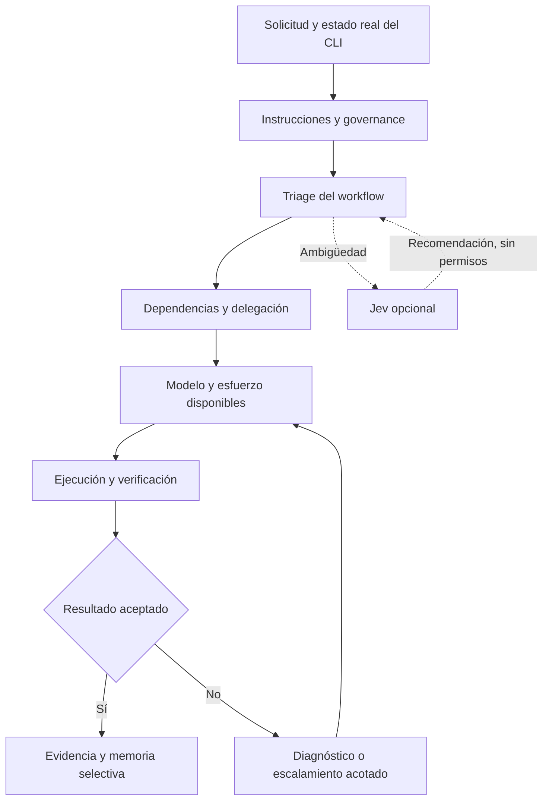

# Routing y optimización del desarrollo con IA

Investigación al **2 de noviembre de 2026**. Complementa el [informe de harnesses por agente](harnesses-ia-por-agente-2026-11-02.md). Las propuestas de Active Stack de este documento son diseños para evaluar, no funcionalidades implementadas. No se instalaron proxies, modificaron credenciales ni ejecutaron builds.

## Recomendación para Active Stack

Conviene incorporar primero una política de clasificación de tareas, perfiles nativos de modelo y contratos de delegación. Un juez como Jev puede complementar esa política donde hay ambigüedad. El gateway multimodelo debería ser una opción avanzada, respaldada por evaluación propia. Ningún candidato investigado demuestra por sí solo que una tarea de este proyecto deba usar OPSX, delegarse o ejecutarse con un modelo determinado.

El objetivo debe ser reducir el costo de una **tarea terminada y aceptada**. Bajar el precio de una llamada puede aumentar reintentos, correcciones, latencia o intervención humana.

## 1. Cinco decisiones que no deben confundirse

| Decisión | Pregunta | Quién debería resolverla |
|---|---|---|
| Flujo metodológico | ¿Consulta, cambio directo, explorar o trabajar sobre un change OPSX? | Política del proyecto y orquestador |
| Delegación | ¿Inline, especialista o subtareas independientes? | Orquestador y capacidades del runtime |
| Modelo y esfuerzo | ¿Qué capacidad necesita esta etapa? | Perfil nativo o router evaluado |
| Deployment/proveedor | ¿Qué endpoint tiene cuota, disponibilidad o menor latencia? | Gateway y restricciones de datos |
| Recuperación | ¿Qué hacer ante error, cuota o contexto incompatible? | Runtime/gateway con límites explícitos |

Load balancing reparte tráfico. Fallback recupera una solicitud fallida. Routing semántico clasifica contenido o estado para seleccionar capacidad. Routing de workflow elige cómo trabajar. Un proxy puede resolver parte de las tres primeras capas técnicas sin conocer las reglas de OPSX ni la autorización del usuario.

## 2. Jev: juez de decisiones, no agente ejecutor

Jev, de TypeSafe, consume un estado y preguntas tipadas. `Choice` selecciona opciones, `Score` aplica una escala y `Noul` evalúa una proposición con valor entre cero y uno. Sus salidas sirven para que **otro programa** decida qué hacer. No escribe código ni crea subagentes por sí mismo. Las preguntas independientes favorecen separar flujo, delegación y modelo en vez de pedir una decisión única que mezcle todo. [Introducción oficial](https://docs.typesafe.ai/introduction).

`Choice` y `Score` devuelven `confidence` derivada de la distribución de opciones. Ese número no es una tasa empírica de aciertos medida sobre tareas del proyecto. `Noul` no devuelve ese campo. Los umbrales de actuación deben calibrarse con ejemplos separados de los usados para ajustarlos. [Confidence](https://docs.typesafe.ai/confidence).

La documentación consultada publica `jev-1.14.0`, **USD 0,042 por millón de tokens de entrada**, salida gratuita y límites predeterminados de 64k por solicitud y 32k por pregunta. Es una fotografía de la fecha del informe: precio, límites y disponibilidad pueden cambiar. Para reproducibilidad conviene fijar versión en una prueba y evitar que un alias móvil cambie el clasificador inadvertidamente. [Modelos y precios](https://docs.typesafe.ai/models).

Un caso especialmente relevante es selección de skills: el cookbook clasifica un catálogo, reevalúa tres candidatos y puede devolver ninguno. El autor evaluó 452 solicitudes con Hermes y Haiku; es una prueba específica de selección, no evidencia de ahorro o calidad final de Active Stack. Es un buen patrón para un catálogo grande, sujeto a repetir la evaluación con nuestras skills y solicitudes. [Skill suggestion](https://docs.typesafe.ai/cookbooks/skill_suggestion).

### Routers comunitarios que utilizan Jev

| Proyecto | Compatibilidad declarada | Qué aporta | Estado para el stack |
|---|---|---|---|
| [FrancoisChastel/jev-router](https://github.com/FrancoisChastel/jev-router) | Claude Code, Codex, OpenCode, Gemini CLI y Pi; relay específico para otras superficies | Proxy por turnos, señales de ejecución, shadow/replay y contabilidad | Piloto; no hay benchmark propio de Active Stack |
| [drmaas/jev-router](https://github.com/drmaas/jev-router) | Plugin OpenCode V2; hooks y skill para Cursor | Decide relevancia de skills/tools y otros puntos del flujo | Experimental; selección de subagentes implementada pero sin evaluación suficiente |
| [dirien/jev-router](https://github.com/dirien/jev-router) | Claude Code y Codex CLI; macOS/Linux | Clasifica por turno humano y mantiene escalamiento de sesión para continuidad | Piloto; no equivale a routing por cada llamada de herramienta |

En FrancoisChastel, la [documentación de harnesses](https://github.com/FrancoisChastel/jev-router/blob/main/docs/harnesses.md) distingue relay de compatibilidad nativa: para Cursor no cubre Tab ni toda la CLI. Node y el servicio local también son dependencias; soporte operativo Windows requiere validación. Los claims de conservar login o cuota son del proyecto comunitario, no una garantía del proveedor. No se verificaron instalaciones reales.

En drmaas, mantener `autoPermission` apagado: la selección de herramienta no debe autorizar acciones. Tampoco incorporar componentes de review en commit que contradigan la exclusión de GGA del stack. Estos proyectos comparten nombre, pero no son el SDK oficial de TypeSafe ni implementaciones intercambiables. Para documentación oficial usar `docs.typesafe.ai` y la organización enlazada desde allí.

## 3. Alternativas concretas de routing

### RouteLLM

[RouteLLM, de LMSYS](https://github.com/lm-sys/RouteLLM), aprende a seleccionar entre un modelo fuerte y uno económico. Ofrece servidor compatible con OpenAI y umbrales que controlan la mezcla costo/calidad; recomienda calibrarlos con la distribución de solicitudes recibidas. Es una alternativa para experimentar con clasificación aprendida sin diseñar todo un gateway.

Su fortaleza es el problema acotado fuerte/débil. No administra ownership de archivos, permisos ni changes OPSX. Para coding con herramientas habría que evaluar trayectorias completas: un resultado en preguntas de chat no demuestra que el modelo elegido pueda editar, usar herramientas y terminar el cambio. Requiere operación Python y del router; fijar dependencias y comprobar mantenimiento antes de incorporarlo.

### LiteLLM: infraestructura y selección semántica son capas distintas

El [Router tradicional](https://docs.litellm.ai/docs/routing) aporta balanceo entre deployments, retries, cooldowns, cuotas y fallbacks. Permite estrategias de latencia o costo. Sirve para disponibilidad y distribución; no basta para afirmar que comprende la complejidad del cambio.

La documentación actual también ofrece [Auto Routing beta](https://docs.litellm.ai/docs/proxy/auto_routing), desde v1.94.0: heurísticas, clasificador LLM, Jev, reglas léxicas/semánticas y plugins. Los tiers pueden usar modelo fijo, pool aleatorio o selección adaptativa. Incluye afinidad opcional por sesión y razones de decisión en logs. El Semantic Auto Router anterior está deprecado. Por eso sería incorrecto describir todo LiteLLM como simple balanceador.

**Encaje propuesto:** gateway opt-in para equipos que necesitan observabilidad, límites y múltiples proveedores. No instalarlo universalmente: agrega servicio, credenciales, actualizaciones y operación. Las claves beta pueden cambiar. Primero probar el mismo flujo del agente con tool calls reales y verificar el modelo que respondió.

### vLLM Semantic Router

La [documentación estable v0.4](https://vllm-sr.ai/docs/intro/) describe una capa programable de selección o composición de modelos, con endpoints compatibles OpenAI/Anthropic. El [repositorio oficial](https://github.com/vllm-project/semantic-router) distingue responsabilidades: el harness mantiene loop, herramientas y estado; el router elige backends locales, privados o cloud.

Es candidato para infraestructura híbrida y políticas propias. No requiere que todos los backends sean el mismo modelo, pero aumenta la complejidad de despliegue y evaluación.

La [guía de conexión next](https://vllm-sr.ai/docs/next/installation/agent-harness/) está marcada **unreleased**. Advierte comprobar protocolos, límites comunes del pool y continuidad de herramientas. Un HTTP 200 no prueba compatibilidad; recomienda comprobar receipts del modelo seleccionado y un ciclo real herramienta→resultado→continuación. No extrapolar esa guía a toda versión estable. Para Active Stack sería experimental, con versión y receta fijadas.

### OpenRouter Auto

[OpenRouter Auto](https://openrouter.ai/docs/guides/routing/routers/auto-router) es selección alojada, accesible con un ID de modelo. La documentación actual describe clasificación de tipo de tarea y ranking basado en gasto agregado reciente de la comunidad, filtrado por capacidades y restricciones. Ofrece bandas de costo; una banda no es un techo duro de presupuesto.

Reduce infraestructura propia y facilita probar varios proveedores. La preferencia agregada de mercado no demuestra cuál modelo termina mejor los cambios de este repositorio. Tampoco crea especialistas ni decide SDD. La compatibilidad depende de que la superficie permita configurar proveedor, endpoint y protocolo; soporte MCP no implica poder reemplazar el modelo de un IDE.

### Claude Code Router (CCR)

El [CCR actual](https://github.com/musistudio/claude-code-router) es un gateway local multiagente: declara perfiles para Claude Code, Codex y OpenCode, entre otros, con condiciones, rewrites, retries, fallback y logs. Su CLI requiere Node 22 o superior. No asumir que tutoriales antiguos con `background/think/longContext` describen la arquitectura actual.

Su [documentación de routing](https://ccrdesk.top/routing/) explica selección para subagentes Claude mediante descripciones de modelos y etiquetas en prompts; también admite reglas JavaScript y un ejemplo opcional Jev. Eso permite control flexible, pero la selección por instrucciones sigue necesitando verificación. Un error de scripts puede continuar con otras reglas: no usar una regla de routing como frontera única de autorización. Candidato a laboratorio individual, no sustituto de governance.

### NVIDIA NeMo Switchyard

[Switchyard](https://github.com/NVIDIA-NeMo/Switchyard) ofrece una biblioteca Rust, `libsy`, para incorporar decisiones de routing a un harness o gateway. El cliente, servicio y credenciales siguen siendo responsabilidad del integrador. Sus componentes SDK/cliente/runner están en alpha; el servidor demo no es un servidor de producción soportado. La integración experimental de login Claude tiene restricciones de plataforma: no prometer paridad Windows.

El [Stage Router](https://github.com/NVIDIA-NeMo/Switchyard/blob/main/docs/routing_algorithms/stage_router_routing.md) utiliza resultados de herramientas y progreso: errores o estancamiento pueden elevar capacidad; producción sin errores favorece el tier eficiente. Un clasificador opcional resuelve ambigüedad. Es un antecedente valioso para routing por estado de ejecución, distinto de clasificar solo el primer mensaje. Encaje: evaluación avanzada o integración futura; no paquete universal listo para agregar.

### Perfiles nativos antes de agregar un proxy

Claude Code permite `opusplan`, modelo por especialista y niveles de esfuerzo: la configuración nativa ya separa planificación y ejecución sin un servicio adicional. [Configuración de modelos](https://code.claude.com/docs/en/model-config). OpenCode admite modelo y permisos por agente principal o subagente. [Agentes](https://opencode.ai/docs/agents/).

Para Codex y las demás superficies, usar exclusivamente los controles disponibles en la versión y cuenta verificadas. Un prompt que dice “usá un modelo barato” no cambia el modelo si el runtime no ofrece esa facultad. Las restricciones de cuenta, permisos heredados y allowlists siguen aplicando.

## 4. Compatibilidad práctica de las opciones

Esta tabla expresa lo documentado por los proyectos, **no pruebas de instalación** ni soporte actual del catálogo Active Stack.

| Opción | Claude Code | Codex | OpenCode | Cursor / VS Code / Windsurf / Antigravity |
|---|---|---|---|---|
| Perfiles nativos | Sí, modelos/esfuerzo por roles | Según controles del host | Sí, por agente | Depende de superficie; no trasladar capacidades entre IDE y CLI |
| Jev directo como juez | Adaptación mediante código/hook/tool | Adaptación mediante código/hook/tool | Plugin o código | Skill/hook/tool cuando estén disponibles; no reemplaza modelo |
| RouteLLM | Gateway/protocolo adicional | Requiere protocolo y tool loop compatibles | Proveedor compatible configurable | No asumir acceso al transporte del IDE |
| LiteLLM | Guías específicas | Guías específicas, incluyendo Responses | Configuración de proveedor | Validar integración de cada producto y plan |
| CCR | Perfil explícito | Perfil explícito y bridge declarado | Perfil explícito | Sin equivalencia universal declarada |
| vLLM SR | Endpoint compatible, evaluar loop | Especial atención Responses/freeform tools | Endpoint configurable | Depende del proveedor configurable y capacidades |
| Switchyard | Experimento documentado | Integración propia a evaluar | Integración/gateway a evaluar | Biblioteca, no plugin universal |

Gemini CLI y Antigravity requieren validación separada de la migración y de la superficie vigente; el informe principal detalla esa distinción. No se considera que un alias de proveedor garantice capacidad, cuota o soporte del instalador.

## 5. Suscripción, API, caché y esfuerzo

Una API suele cobrar tokens, clasificación y reintentos. Con suscripción importan cuota, latencia y límites de uso, además del costo mensual. Un proxy no transforma automáticamente un plan personal en API ilimitada.

LiteLLM documenta [forwarding con suscripciones](https://docs.litellm.ai/docs/subscriptions) de Claude y ChatGPT/Codex, conservando login en cliente. Es una capacidad declarada por el gateway; requiere verificar versiones, cuenta y condiciones del proveedor antes de implementarla. No afirmar que cualquier router comparte esa capacidad.

Su [guía Claude](https://docs.litellm.ai/docs/tutorials/claude_code_max_subscription) diferencia facturación del plan de los importes API-equivalentes de logs. Su [guía Codex](https://docs.litellm.ai/docs/tutorials/openai_codex_byok) documenta fallback a API cobrado por separado. La medición debe registrar qué credencial y deployment sirvieron cada solicitud; un número de dashboard puede ser estimación, no factura.

La [guía de prompt caching de LiteLLM](https://docs.litellm.ai/docs/auto_router/prompt_caching) señala que volver a un modelo puede reutilizar caché todavía vigente, pero las escrituras frías y cambios de formato cuentan. Afinidad por modelo y por deployment son decisiones distintas. Entre proveedores puede ser necesario preservar continuidad de thinking blocks o tool calls. Sus porcentajes publicados son resultados del autor en conjuntos específicos; no se proyectan automáticamente al stack.

Modelo y esfuerzo son ejes distintos. Usar un modelo económico con mucho razonamiento puede costar más que otro resolviendo directamente; el extremo inverso puede generar retrabajo. Evaluar tokens de razonamiento/salida, tiempo total y aceptación. No cambiar modelo a mitad de un ciclo de herramientas sin demostrar que conserva estado y contratos.

## 6. Diseño propuesto: task-triage portable

**Propuesta propia**, sin integración realizada. Un harness `task-triage` de configuración + skill podría devolver tres decisiones independientes:

```json
{
  "workflow": "direct | opsx-existing | opsx-new | explore",
  "execution": "inline | specialist | parallel-disjoint",
  "model_policy": { "tier": "fast | standard | deep", "effort": "(TBD)" },
  "reason": "evidencia breve y verificable",
  "uncertainty": "datos faltantes o contradicciones"
}
```

Orden recomendado:

1. Aplicar instrucciones explícitas, governance, permisos y restricciones de build/commit. Ningún clasificador las puede revocar.
2. Consultar el CLI para saber qué changes existen antes de elegir `opsx-existing`; no inferirlos de memoria.
3. Resolver casos evidentes mediante reglas pequeñas: consulta sin cambios, tarea acotada, exploración incompleta o contrato transversal.
4. Consultar Jev u otro clasificador solo para la decisión ambigua, con contexto mínimo suficiente.
5. Validar que la acción elegida exista en el agente y que no exceda permisos. Si falta capacidad, conservar el flujo/modelo disponible o pedir el dato imprescindible.
6. Registrar la decisión en modo sombra antes de permitir que cambie ejecuciones reales.

Criterios de ejemplo para evaluar: una corrección textual acotada puede ir directa; un cambio de contrato entre paquetes puede justificar OPSX; una investigación incierta puede empezar por explore. Son ejemplos de política, no reglas universales. Umbrales y límites de complejidad: **(TBD) mediante evaluación**. La cantidad de líneas por sí sola no mide riesgo.

Delegar solo si hay una frontera útil. Paralelizar investigación independiente o archivos con ownership disjunto. Un contrato compartido debe acordarse antes; cada worker devuelve archivos, evidencia, decisiones y bloqueos. Un router de modelo no resuelve conflictos de edición ni comunica automáticamente entre subagentes.

## 7. Cómo demostrar que sirve

Un [estudio independiente de modelos System-1](https://arxiv.org/abs/2610.02267) encontró que los dos evaluados no superaban el azar en su prueba de routing zero-shot. También corrigió conclusiones afectadas por costos omitidos y umbrales ajustados sobre los mismos datos. Es una advertencia metodológica de ese benchmark, no prueba de que todo routing falle.

Piloto recomendado para Active Stack:

- Conjunto de tareas reales de búsqueda, documentación, bugfix, cambio entre paquetes y recuperación de errores, sin secretos.
- Baseline de modelo fijo y perfiles nativos; comparar contra routing usando las mismas entradas y criterios de aceptación.
- Separar ajuste y evaluación. Medir por clase de tarea, no solo un promedio.
- Registrar decisiones erróneas de SDD, llamadas, caché, costo de juez, reintentos, tiempo humano, regresiones y costo por tarea aceptada.
- Evaluar fallos del juez, timeout, JSON inválido, falta de capacidad y diferencias de protocolo. Fallback conservador que preserve autorización y no produzca un bloqueo infinito.
- Medir estabilidad tras actualizar modelos/router y fijar versiones para reproducir resultados.

La decisión de adoptar debería fijar una tolerancia a errores y una mejora mínima aceptable **(TBD)**. Primero `task-triage` y perfiles nativos; después Jev en sombra; luego un gateway elegido por necesidad concreta. Instalar varios routers a la vez dificulta atribuir ahorro, fallos y cambios de comportamiento.

## 8. Memoria, retrieval y compresión: optimizar cosas diferentes

| Categoría | Qué reduce o mejora | Qué no garantiza |
|---|---|---|
| Memoria persistente | Recuperar decisiones y contexto entre sesiones | Que todo recuerdo sea vigente o correcto |
| Retrieval documental | Encontrar fragmentos de un corpus sin leerlo entero | Captura automática de decisiones |
| Compresión de tool output | Menos salida repetitiva dentro del contexto | Preservar automáticamente todos los errores relevantes |
| Prompt caching | Reutilización de prefijos y menor cómputo/costo | Más espacio en la ventana de contexto |
| Selección de skills/tools | Menos elecciones irrelevantes | Autorizar herramientas o ejecutarlas |

El caching conserva la solicitud lógica: no equivale a resumirla ni liberar ventana. Conviene mantener prefijos estables y medir cache hits; cambios de modelo, proveedor o estructura pueden alterar la reutilización. [OpenAI: prompt caching](https://developers.openai.com/api/docs/guides/prompt-caching), [Anthropic: prompt caching](https://platform.claude.com/docs/en/build-with-claude/prompt-caching).

### Candidatos y lugar que ocuparían

| Candidato | Función | Compatibilidad documentada y límites | Incorporación propuesta |
|---|---|---|---|
| [Engram](https://github.com/Gentleman-Programming/engram) | Memoria local Go + SQLite/FTS5, CLI/MCP/HTTP | Multicliente; captura e identidad de sesión dependen del adapter | Mantener como autoridad de memoria predeterminada ya presente |
| [RTK](https://github.com/rtk-ai/rtk) | Filtrar salidas de comandos de desarrollo | Hooks/adapters específicos; no filtra por arte de magia herramientas nativas de lectura | Piloto de compresión, con bypass raw |
| [context-mode](https://github.com/mksglu/context-mode) | Ejecutar/procesar fuera del contexto, indexar y buscar resultados; funciones de sesión | MCP común, automatización diferente por cliente | Alternativa de piloto a RTK, no ambos interceptando lo mismo |
| [Claude-Mem](https://github.com/thedotmack/claude-mem) | Captura de actividad, síntesis y recuperación | Ya documenta varios agentes, pese al nombre | Memoria alternativa, no duplicar captura con Engram |
| [Mem0](https://docs.mem0.ai/integrations/codex) | Memoria con captura/recall en integraciones específicas | Plugin/hooks y MCP no ofrecen la misma automatización | Custom para quien elija ese backend |
| [QMD](https://github.com/tobi/qmd) | Búsqueda local BM25/vector/reranking sobre documentos | CLI/MCP, modelos locales y consumo de recursos | Complemento opt-in para `knowledge-base/` y specs |
| [mcp-memory-service](https://github.com/doobidoo/mcp-memory-service) | Memoria semántica, grafo y consolidación | Servicio Python y adapters específicos | Alternativa avanzada de memoria |
| [Letta hosted MCP](https://docs.letta.com/platform/hosted-mcp) | Delegar a agentes remotos con estado | No es solo almacén de memoria | Experimental separado del perfil base |

**RTK.** Filtra resultados de comandos como Git, búsqueda y tests. El porcentaje de reducción anunciado corresponde a output de comandos, no al costo total de una sesión; su estimación de tokens no sustituye la contabilidad del proveedor. Los adapters actuales incluyen hooks de Codex y plugin Antigravity; no asumir que Codex solo recibe reglas. Tiene instalación Windows nativa. La edición completa combina componentes con licencias diferentes; `rtk-oss` ofrece otra composición. Ambas usan el mismo nombre de binario: no coinstalar sin resolver colisión. Revisar licencia y versión fijada antes de distribuir. [Repositorio RTK](https://github.com/rtk-ai/rtk).

**context-mode.** El [proyecto](https://github.com/mksglu/context-mode) combina herramientas MCP y gestión de resultados/sesión. Requiere runtime y SQLite; Windows está documentado pero necesita smoke test real. Su [matriz](https://raw.githubusercontent.com/mksglu/context-mode/main/docs/platform-support.md) separa hooks JSON, plugins TypeScript y MCP-only. En Antigravity IDE no equivale a interceptar herramientas; la CLI tiene otro adapter. Windsurf no figura en esa matriz. Algunas capacidades de mutar argumentos o salidas difieren entre clientes. Si la documentación de un adapter discrepa con otra versión del runtime, comprobar la capacidad instalada; nunca ampliar automáticamente el alcance del hook por inferencia.

**Claude-Mem.** La [fuente actual](https://github.com/thedotmack/claude-mem) ya presenta integraciones multiagente. Capturar, resumir y reinyectar puede mejorar continuidad, pero agrega procesamiento y costo del observador. Instalar un SDK no prueba que los hooks estén activos. El [instalador documentado](https://docs.claude-mem.ai/installation) y su runtime deben verificarse por separado en Windows. Es una opción alternativa a Engram: elegir responsable único de decisiones y evitar dos memorias reinyectando resúmenes contradictorios.

**Mem0.** La [integración Codex](https://docs.mem0.ai/integrations/codex) ofrece captura/recall y skills; el [MCP o integración Antigravity](https://docs.mem0.ai/integrations/antigravity) requiere verificar qué automatización incluye. La [edición open source](https://docs.mem0.ai/open-source/overview) no implica inferencia gratuita ni completamente local: LLM y embeddings dependen del proveedor configurado. Validar Python, credenciales y PowerShell; no copiar instrucciones Bash como si probaran soporte nativo Windows.

**QMD.** Es retrieval documental local, no captura automática de conversaciones. Necesita modelos y recursos para embeddings/reranking. El launcher actual es Node y contempla plataformas distintas: no repetir como limitación universal un launcher Bash de una versión vieja. El [launcher](https://raw.githubusercontent.com/tobi/qmd/main/bin/qmd) y [manifiesto](https://raw.githubusercontent.com/tobi/qmd/main/package.json) son evidencia de implementación, no prueba ejecutada Windows. Indexar colecciones del proyecto, no el home completo. [Repositorio](https://github.com/tobi/qmd).

**mcp-memory-service.** Aporta más funciones semánticas/grafo que una memoria FTS ligera, a cambio de dependencias y operación adicionales. Comprobar la versión de Python del release: la [guía](https://raw.githubusercontent.com/doobidoo/mcp-memory-service/main/docs/setup-guide.md) y el [manifiesto de main](https://raw.githubusercontent.com/doobidoo/mcp-memory-service/main/pyproject.toml) no deben mezclarse como si describieran el mismo contrato. [Proyecto](https://github.com/doobidoo/mcp-memory-service).

**Letta.** El [MCP alojado](https://docs.letta.com/platform/hosted-mcp) crea agentes con estado e intercambia mensajes. Sus agentes cloud pueden ejecutar herramientas con un modelo de permisos diferente al del cliente local. Por eso no lo trataría como reemplazo transparente de una base de recuerdos: necesita decisión explícita sobre datos, herramientas remotas, autonomía y costo.

### Compatibilidad de memoria y compresión por agente

`Adapter` significa integración declarada por el proveedor, no probada en esta investigación. `MCP` significa acceso a herramientas, no captura o compresión automática. Ante versiones o superficies distintas, ejecutar probe y conservar resultado **(TBD)** hasta validarlo.

| Agente/superficie | RTK | context-mode | Opciones de memoria/retrieval |
|---|---|---|---|
| Claude Code | Hook/adapter | Hooks + MCP | Engram; memorias alternativas con integración propia; QMD |
| Codex CLI | PreToolUse/reescritura según versión | Adapter hooks + MCP con límites de mutación documentados | Engram y binding de sesión; Claude-Mem/Mem0 declarados; QMD |
| Codex app | Verificar hooks/runtime disponibles | No trasladar automáticamente validación CLI | Usar MCP/plugins realmente expuestos; no asumir paridad CLI |
| OpenCode | Plugin TS; versión mínima del adapter | Plugin TS + MCP | Engram/QMD por MCP; alternativas con plugin propio |
| Gemini CLI | Hooks | Hooks + MCP | Integración dependiente de versión/migración; MCP no captura solo |
| Cursor | Hooks | Hooks + MCP | Engram/QMD por MCP; Mem0/Claude-Mem según adapter |
| VS Code/Copilot | Adapter correspondiente | Hooks + MCP | MCP y herramientas de memoria según superficie |
| Windsurf | Reglas legacy declaradas | No listado en matriz consultada | MCP compatible; automatización debe demostrarse |
| Antigravity IDE | Plugin específico declarado | MCP-only | Memoria por MCP; no asumir lifecycle capture |
| Antigravity CLI | Validar adapter separado | Hooks con limitaciones/best-effort | Memorias con adapter CLI declarado; no confundir con IDE |

Fuentes de las capacidades de compresión: [RTK](https://github.com/rtk-ai/rtk), [matriz context-mode](https://raw.githubusercontent.com/mksglu/context-mode/main/docs/platform-support.md). La presencia de un nombre en una matriz upstream no actualiza por sí sola los adapters de Active Stack.

## 9. Receta de incorporación sin inflar el stack

La siguiente es una **propuesta de distribución**, no una edición del catálogo ni de `CHANGES.md`:

| Perfil | Harnesses/capacidades propuestos | Motivo |
|---|---|---|
| Lite | Mantener Engram + OPSX existentes; contrato de delegación y triage por reglas | Mejora método con pocas dependencias; usar perfiles nativos disponibles |
| Full | Añadir evaluación de harnesses y perfiles de especialistas; ofrecer compresión tras prueba del agente | Complementar método con evidencia y observabilidad sin activar proxy universal |
| Custom | Jev, gateway, QMD o memoria alternativa explícitamente elegidos | Integraciones con costos, dependencias o restricciones propias |
| Experimental | Routers comunitarios, Switchyard alpha, integración entre protocolos y agentes remotos | Mantener fuera de promesas de soporte estable |

Antes de convertir un candidato en harness: fijar versión y licencia, comprobar backup/markers, resolver paths con adapter, producir `doctor` y rollback/desinstalación, y probar Windows PowerShell, WSL y Unix por separado. La aprobación de un informe no autoriza modificar dotfiles ni instalar servicios.

Flujo ilustrativo de la propuesta:



| Tarea ilustrativa | Workflow | Ejecución/modelo a evaluar |
|---|---|---|
| Corregir un typo en documentación | Directo | Inline; perfil rápido si está disponible |
| Cambiar contrato de API entre paquetes | OPSX existente o nuevo según CLI | Diseño y pruebas; especialista cuando haya frontera clara |
| Investigar un incidente sin causa conocida | Explore/diagnóstico | Empezar con evidencia; elevar capacidad si hay estancamiento |
| Modificar restore/rollback de configuración | Governance ALTO | Proponer cambio concreto y esperar aprobación conforme a reglas |
| Verificar tres módulos independientes | Según change/alcance | Paralelo solo con recursos y ownership disjuntos |

Estos ejemplos no habilitan builds ni commits, no sustituyen TDD y no crean una obligación de usar SDD para toda tarea pequeña. La política exacta debe acordarse y medirse.

La medición económica debería incluir:

```text
costo_total = juez + agente(input sin caché + input cacheado + output)
            + reintentos + retrieval/embeddings/observador + infraestructura
```

Medir además exactitud y tiempo humano. No multiplicar porcentajes publicados por RTK, context-mode y un router: pueden estar reduciendo las mismas entradas y usar baselines incompatibles. Para comparar, ejecutar por separado baseline, compresor A, compresor B y routing; después evaluar combinaciones justificadas. Confirmar que el bypass raw conserve errores de tests y que la recuperación de memoria no mezcle proyectos.

## 10. Lista de decisión para una futura propuesta OPSX

Prioridades sugeridas por este informe; no son compromisos de implementación.

| Prioridad | Candidato | Mecanismo | Agentes a validar primero | Encaje |
|---|---|---|---|---|
| P1 | `task-triage` propio | Config + skill; reglas y decisión explicable | Los ocho adapters del catálogo, con capacidades distintas | Portable; separa flujo, delegación y modelo |
| P1 | `agent-handoff-contract` propio | Plantillas + perfiles nativos | Claude/Codex/OpenCode; fallback manual en otros | Concreto sin servicio adicional |
| P1 | `harness-evaluation` propio | Dataset + runner de comparación + reporte | Cualquier agente con ejecución autorizada | Necesario antes de prometer ahorro |
| P2 | RTK **o** context-mode | Hook/plugin/MCP según cliente | CLI con integración documentada; Windows por separado | Piloto comparativo de compresión |
| P2 | Jev en modo sombra | API de decisiones detrás del triage | Cliente con herramientas/hooks disponibles | Aconseja sin cambiar permisos ni modelo inicialmente |
| P2 | QMD | External CLI/MCP con colecciones explícitas | Clientes MCP y equipo con recursos suficientes | Retrieval complementario a Engram |
| P3 | LiteLLM Auto | Gateway beta + clasificador | Equipo con varias cuentas/deployments | Cuando hay necesidad operativa demostrable |
| P3 | CCR/OpenRouter/RouteLLM | Gateway o router especializado | Superficies con proveedor configurable | Elegir uno por caso, no apilarlos |
| Experimental | Switchyard/vLLM SR avanzado | Biblioteca o serving programable | Infraestructura administrada con evaluación | Investigación híbrida y control de backends |
| Alternativa, excluyente | Claude-Mem/Mem0/mcp-memory-service | Memoria y adapters propios | Agentes realmente documentados por release | Sustituir responsabilidad de memoria, no duplicarla |

Las fuentes consultadas demuestran que existen mecanismos y proyectos. **No se ejecutaron instalaciones, benchmarks, pruebas de login, consumo real ni cambios del instalador.** La compatibilidad de producción y el ahorro permanecen **(TBD)** hasta el piloto; los archivos creados son únicamente informes Markdown.
