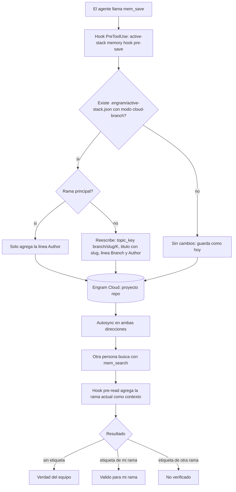

# Plan de integración: Engram Cloud con memoria etiquetada por rama (harness `engram-cloud`)

> **Este documento es un PLAN, no una implementación verificada.**
> - Lo que dice la documentación oficial está citado en la sección 2.2. Lo que **no se probó** está marcado como **No verificado** en la sección 4.2 y **no debe tratarse como cierto**.
> - Lo implementa **el equipo** (no quien escribió el plan). Cada punto no verificado se prueba en la Fase 0.
> - **Si algo no funciona** (por ejemplo, el hook en Claude o en Codex), **se detiene la fase y se avisa al grupo** siguiendo el protocolo de la sección 4.1. **Nadie cambia el diseño por su cuenta.**
> - Ninguna fase se da por cerrada sin evidencia (comando, salida y versión).
> - Este plan es **insumo de un plan definitivo** que el responsable armará con reglas adicionales.

**Estado:** propuesta lista para implementar · **Fecha:** 2026-11-19 · **Revisión 6** (D1 a D13 cerradas)
**Naturaleza:** es un **plan de integración** de Engram en Active Stack. El comportamiento de Engram **no se inventa ni se supone**: se cita su documentación oficial (sección 2.2) y lo que esa documentación no dice se **prueba** en la Fase 0.
**Modo de entrega:** criterios cortos por ficha y TDD estricto, **sin SDD** (decisión del responsable, 2026-11-19). Los tests `T-*` de cada fase son los criterios de aceptación. Se ejecuta con la [guía de implementación en equipo](guia-implementacion-equipo.md) y el [roadmap integrado](roadmap-implementacion-equipo.md). Al citarlo desde otros documentos, usar el prefijo **[EN]**.
**Governance:** MEDIO en general; **ALTO** en las Fases 6 y 7 (escriben configuración del usuario y del proyecto).
**OpenSpec:** no se usa para este trabajo salvo que un change ya esté iniciado o el responsable lo pida.
**Rama:** una por ficha del roadmap integrado (`feat/R-xx-slug`). **Partir de `main`.**

**Historial.** Rev. 1 promoción directa del agente · rev. 2 promoción por PR + CI · rev. 3 disparador en el cierre de ficha · rev. 4 memoria como archivos en Git · rev. 5 Cloud como canal único con etiquetas por rama, guiado solo por el protocolo · **rev. 6 (esta): el etiquetado lo hace un *hook* (determinista, sin tokens) en Claude y Codex; un marcador por proyecto distingue los proyectos Cloud; la configuración de Engram la crea la fundación.**

---

## 1. Objetivo y no-objetivos

**Problema.** En Engram Cloud todas las memorias de un proyecto caen en la misma bolsa. Lo guardado desde una rama sin mergear se ve igual que lo verdadero en `main`, y el agente lo usa con seguridad. Engram tampoco muestra el autor de cada memoria.

**Solución.** Un único proyecto Cloud compartido, sin pasos manuales por sesión:

1. **Un hook intercepta cada `mem_save`** y, si el proyecto es "Cloud con ramas", reescribe la memoria: en una rama le agrega **etiqueta de rama y autor**; en la principal, **solo el autor**. No depende de que el agente se acuerde, y no gasta tokens del modelo.
2. **Un marcador por proyecto** (`.engram/active-stack.json`) le dice al hook, al CLI y al agente si el proyecto usa este modo. Sin marcador, nada cambia.
3. **El protocolo** (una sección propia, ligada al protocolo de Engram) enseña al agente a **leer**: sin etiqueta es verdad del equipo; con etiqueta de otra rama es "no verificado".
4. **La fundación** crea la configuración de Engram del proyecto (nombre fijo + marcador) al arrancar.

**No-objetivos (decisión firme):**

- No hay `memory import`, archivos de memoria en Git, PR extra ni workflows de promoción.
- No instalar ni administrar el servidor Cloud: se documenta (Apéndice B).
- No escribir tokens ni secretos en ningún archivo.
- **No editar `engram-protocol.md`**: lo comparten los cuatro agentes y los equipos sin Cloud.
- Sin el harness, instalar da un resultado **byte a byte idéntico** al actual.
- No reintroducir GGA, themes ni persona-marketing (CLAUDE.md §3).
- Sin barrido automático de ramas abandonadas en esta versión (D10).

---

## 2. Base de hechos

### 2.1 Hallazgos verificados en el repo (leídos el 2026-11-19; reverificar antes de editar)

| # | Hallazgo | Dónde |
|---|---|---|
| H1 | `engram` es un harness `external` (Homebrew), registra el MCP `engram mcp`. Modos `lite` y `full`, sin campo `agents`. | `internal/catalog/harnesses.yaml:24` |
| H2 | `sdd-orchestrator` es `config`, `toggles: [tdd, engram, model-routing, delegation, governance]`, agentes `claude, codex, opencode, antigravity`. | `harnesses.yaml:65` |
| H3 | El toggle `engram` agrega `assets/engram-protocol.md` **dentro** del bloque `sdd-orchestrator` de **todas** las variantes (Compose, función pura). | `internal/harness/config/compose.go:78` |
| H4 | `engram-protocol.md` ordena `mem_save` proactivo, `topic_key: "opsx/{change}/{phase}"`, `mem_session_summary` y trae una sección **GIT SYNC** (líneas 93-117) que contradice el modo Cloud. **No existe un "módulo `engram-opsx-git-sync`"** en este repo. | `engram-protocol.md` |
| H5 | Cada variante trae su propia sección Engram y una línea para **briefar sub-agentes** (claude:127-128, opencode:126-127). | `internal/harness/config/assets/*/sdd-orchestrator.md` |
| H6 | **Patrón de sección propia:** registrar el ID en `sectionFragments` (`assets.go:29`) hace que `Install` lo inyecte como `active-stack:<id>` solo para los agentes que el harness declara, y que `isOwnedSection` lo proteja del purge. Hoy solo lo usa `design-mockups`. | `assets.go`, `inject.go:45`, `install.go:97-132` |
| H7 | Archivos de instrucciones **globales**: Claude `~/.claude/CLAUDE.md`; Codex `~/.codex/AGENTS.md`; Antigravity `~/.gemini/config/AGENTS.md`; OpenCode `~/.config/opencode/AGENTS.md`. Aplican a **todos** los proyectos del usuario. | `internal/agents/*/adapter.go` |
| H8 | Configuración de agentes: Claude `~/.claude/settings.json`; Codex `~/.codex/config.toml` (MCP en TOML, estrategia `MergeIntoTOML`). **OpenCode** entrega por agente primario (`opencode.json`, prompt propio). | `internal/agents/*/adapter.go` |
| H9 | `verify.checkConfig` exige el marker `<!-- active-stack:<id> -->` exactamente una vez por agente **soportado por el harness**. | `internal/verify/harness_checks.go:97` |
| H10 | **Permisos:** en `estricto` no hay lista de permitidos; en `balanceado` Claude permite `git status`, `git diff:*`, `go test:*`, `go build:*`. No permite `git branch` ni `active-stack ...`: llamarlos desde el agente **pediría confirmación**. | `internal/harness/config/permissions/overlays.go:53-84` |
| H11 | Ya existe merge de `settings.json` (permisos) y de `config.toml` (MCP) con backup. | `internal/filemerge/json_merge.go`, `toml.go` |
| H12 | `mem_save` acepta `title`, `content` (alias `observation`), `type`, `scope`, `topic_key`, `project`, `session_id`, `org`; **no** acepta `review_after` ni `expires_at`. `mem_search` filtra por `project`, `scope`, `type`, `org`. `mem_update` cambia `title`, `topic_key`, `type`, `scope`, contenido y exige `expected_project`. | esquema MCP de Engram en esta sesión |
| H13 | El instalador tiene destino `Machine` y `Project`. El binario despacha subcomandos (`update.go`, `starter_add.go`, `main.go`, `routing_test.go`). | `internal/install/types.go`, `cmd/active-stack/` |
| H14 | `active-orchestrator`, `agent-instruction`, `active-delivery` y `kb-creator` viven en **otros repos**, fijados por SHA. | `harnesses.yaml:97` |
| H15 | En esta máquina las herramientas de Engram aparecen **con dos nombres**: `mcp__engram__*` y `mcp__plugin_engram_engram__*` (el plugin de Engram). El matcher del hook debe cubrir ambos. | sesión actual |

### 2.2 Documentación oficial de Engram y de los agentes (consultar antes de implementar)

> Regla: antes de cada fase, el implementador **lee la documentación vigente** de lo que toca, anota la versión de Engram, Claude Code y Codex usada, y registra cualquier diferencia con esta tabla. Lo marcado "no documentado" se prueba en la Fase 0, no se supone.

| Recurso | Enlace |
|---|---|
| Repositorio de Engram | https://github.com/Gentleman-Programming/engram |
| README | https://github.com/Gentleman-Programming/engram/blob/main/README.md |
| Referencia completa (esquema, CLI, sync, MCP tools) | https://github.com/Gentleman-Programming/engram/blob/main/DOCS.md |
| Uso en equipo | https://github.com/Gentleman-Programming/engram/blob/main/docs/TEAM-USAGE.md |
| Arquitectura (topic keys, higiene de memoria) | https://github.com/Gentleman-Programming/engram/blob/main/docs/ARCHITECTURE.md |
| Setup de agentes (Claude Code, Codex, hooks, autosync, conflictos) | https://github.com/Gentleman-Programming/engram/blob/main/docs/AGENT-SETUP.md |
| Engram Cloud | https://github.com/Gentleman-Programming/engram/blob/main/docs/engram-cloud/README.md |
| Issues del repo (para proponer mejoras) | https://github.com/Gentleman-Programming/engram/issues |
| Hooks de Claude Code | https://code.claude.com/docs/en/hooks |
| Hooks de Codex | https://developers.openai.com/codex/hooks (redirige a https://learn.chatgpt.com/docs/hooks) |

**Hechos leídos en esa documentación el 2026-11-19:**

| Tema | Lo que dice la documentación | Fuente |
|---|---|---|
| Autosync | `ENGRAM_CLOUD_AUTOSYNC=1` activa una "replicación continua en segundo plano" en **ambas direcciones** (push y pull). Intervalo: *no documentado en lo leído*. | AGENT-SETUP.md, "Cloud Autosync toggle" |
| Autor | **No hay columna de autor por observación.** El servidor registra el nombre del principal autenticado a nivel de mutación/chunk; hay rutas `/dashboard/contributors`. No consta que se vea en `mem_search`. | DOCS.md, "Mutation materialization attribution" |
| `.engram/config.json` | Solo se documenta `project_name`. **Otras claves (incluida `org`) y si se toleran claves desconocidas: no documentado.** `engram init [name]` lo crea. | AGENT-SETUP.md, "Project auto-detection"; DOCS.md |
| `org` | Existe el filtro `org` en la búsqueda HTTP local. Si viaja por el sync y filtra en Cloud: *no documentado*. | DOCS.md, "Search" |
| Token de Cloud | Se lee de la variable de entorno `ENGRAM_CLOUD_TOKEN` (con `ENGRAM_CLOUD_SERVER`). `engram cloud config --server <url>` fija el servidor. | AGENT-SETUP.md, "Cloud Autosync toggle" |
| Integración con Claude Code | El plugin instala hooks: un **`PreToolUse`** (`engram hook claude-pre-tool-use`, niega herramientas de escritura si la sesión no está confirmada) y un `UserPromptSubmit`. `engram setup claude-code` registra el MCP como `mcp --tools=agent`. | AGENT-SETUP.md, "Claude Code" |
| Integración con Codex | `engram setup codex` escribe `[mcp_servers.engram]` en `config.toml` e instala un plugin con hooks de arranque, reanudación, limpieza y post-compactación; su `PreToolUse` **vincula el ID de sesión** en las herramientas de escritura. | AGENT-SETUP.md, "Codex" |
| Claude Code, `PreToolUse` | Puede **modificar la entrada** de la herramienta con `updatedInput` (reemplaza el objeto entero). Cubre herramientas MCP con nombre `mcp__<servidor>__<herramienta>`. Corre también dentro de sub-agentes. Puede negar con exit 2 o `permissionDecision: deny`. `additionalContext` agrega contexto visible al modelo. | hooks de Claude Code: "PreToolUse decision control", "Match MCP tools", "Configuration" |
| Claude Code, eventos | Hay `SessionStart` (con `additionalContext`), `CwdChanged` (solo cuando un comando de shell hace `cd`), `FileChanged`, `WorktreeCreate`. **No hay evento de cambio de rama.** | hooks de Claude Code: "Hook lifecycle" |
| Claude Code, ubicación | `~/.claude/settings.json` (usuario), `.claude/settings.json` (proyecto, versionable). Forma `hooks.PreToolUse[].{matcher, hooks[].{type, command}}`. | hooks de Claude Code: "Hook locations" |
| Codex, `PreToolUse` | Soporta **`updatedInput`** (solo con `permissionDecision: "allow"`) y herramientas MCP (matcher sobre `tool_name`, p. ej. `mcp__fs__read`). Negar con JSON o exit 2. `additionalContext` disponible. | hooks de Codex: "PreToolUse", "Tool coverage" |
| Codex, configuración | `~/.codex/hooks.json`, `.codex/hooks.json` del proyecto, o `[[hooks.PreToolUse]]` inline en `config.toml`. **Los hooks no administrados exigen revisión y confianza (`/hooks`)**; si cambian, se omiten hasta revisarlos. | hooks de Codex: "Where Codex looks for hooks", "Review and trust hooks" |
| Codex, otros | `SessionStart` con `additionalContext`. **No hay evento de cambio de rama ni de directorio.** Varios hooks del mismo evento corren **en paralelo**; el orden y qué `updatedInput` gana **no están documentados**. Sub-agentes: implícito, no explícito. | hooks de Codex: "How hooks run", "Hooks" |

**Vacíos importantes:** la sección de herramientas MCP de `DOCS.md` (comportamiento de `mem_update` con una `topic_key` existente, sincronización del borrado suave), la tabla de fases del autosync y el comando de CLI de Cloud no se alcanzaron a leer. **El implementador debe leer `DOCS.md` completo** antes de la Fase 0.

---

## 3. Diseño

### 3.1 Flujo



### 3.2 Cómo se distingue un proyecto "Cloud con ramas" de uno común

Tenés razón en que **la rama sola no alcanza**: las instrucciones son globales (H7) y se aplicarían a todos los proyectos Git del usuario. Se resuelve **por proyecto**, sin editar el protocolo:

- **Marcador:** `.engram/active-stack.json` con `{"memory_policy": "cloud-branch"}`. Es un archivo **propio** y no una clave nueva en `.engram/config.json`, porque la documentación no dice si Engram tolera claves desconocidas allí.
- **Quién lo lee:** el hook, `active-stack memory branch` y el hook de `SessionStart`. Si no existe, **no hacen nada**. Es la diferencia entre un proyecto Cloud y uno común.
- **Qué ve el agente:** el hook de `SessionStart` agrega al contexto una línea ("Team memory: cloud-branch…") **solo** en proyectos con marcador. La sección global del protocolo dice "aplica solo si el contexto de la sesión lo indica". En proyectos comunes no se agrega nada.

**Cómo queda "ligada" al protocolo de Engram:** la sección `active-stack:engram-cloud` (a) nombra el bloque del protocolo y declara qué parte sobrescribe, (b) depende por catálogo de `engram` y `sdd-orchestrator`, de modo que se inyecta **después** del bloque, y (c) un test exige ese orden. El archivo `engram-protocol.md` no se toca.

### 3.3 Esquema de etiquetas y autor

Dado `<slug>` (sección 3.5) y una memoria que, sin rama, se guardaría con `topic_key = K` y `title = T`:

| Campo | En la rama principal | En una rama |
|---|---|---|
| `topic_key` | `K` | `branch/<slug>/K` (también `opsx/...`). Si el agente no dio `K`, **se deja vacío** (no se inventa una clave que provoque *upserts* cruzados) |
| `title` | `T` | `[<slug>] T` |
| primera línea de `content` | `Author: <nombre>` (solo en proyectos con marcador) | `Branch: <rama> · Author: <nombre>` |
| `scope` y demás campos | sin cambios | sin cambios (se **copian todos**, incluidos `session_id`, `project` y `capture_prompt`) |

**Autor.** Engram no lo guarda por observación (sección 2.2), así que lo agrega el hook: `git config user.name` (si falta, el usuario del sistema). **Nunca el correo.** Adicionalmente el servidor registra el principal del token a nivel de chunk (se ve en el dashboard), lo que complementa la auditoría pero no aparece en las búsquedas.

**Autor también en `main` (D13, cerrada):** en proyectos con marcador, el hook agrega en la rama principal **solo** la línea `Author: <nombre>`, sin prefijo de clave, sin cambio de título y sin línea `Branch:`. En proyectos sin marcador no toca nada. Como Engram hace *upsert* por clave, el autor visible es **el último que editó** esa memoria.

### 3.4 La garantía: hook en lugar de confiar en el agente

El hook es código del stack que corre **fuera del modelo**: no cuesta tokens y no se "olvida". Funciona así en los dos agentes:

| | Claude Code | Codex |
|---|---|---|
| Evento | `PreToolUse` sobre las herramientas de escritura de Engram | `PreToolUse` sobre las mismas |
| Reescritura | `updatedInput` (objeto completo) | `updatedInput` (requiere `permissionDecision: "allow"`) |
| Sub-agentes | Corre también dentro de sub-agentes (documentado) | Implícito: **se prueba** (Q6) |
| Dónde se configura | `~/.claude/settings.json` (clave `hooks`) | `~/.codex/config.toml` inline `[[hooks.PreToolUse]]` |
| Condición extra | Ninguna documentada | **Revisión y confianza del hook (`/hooks`) una vez**; si el hook cambia, se omite hasta revisarlo |

**Cuándo la garantía vale** (y `verify` lo comprueba): el hook está instalado en el agente, `active-stack` está en el `PATH`, la herramienta de escritura está en el *matcher* y, en Codex, el hook fue confiado. **Fuera de eso rige el respaldo por protocolo**, que es solo una convención.

**Riesgos reales a probar antes de prometer nada (Fase 0):**

- **Coexistencia con los hooks propios de Engram.** El plugin de Engram ya instala un `PreToolUse` sobre las herramientas de escritura (en Claude las niega si la sesión no está confirmada; en Codex **vincula el ID de sesión**). Ambos hooks corren **en paralelo** y el orden y el reparto de `updatedInput` **no están documentados**: si los dos reescriben, uno podría pisar al otro y **perder el `session_id`**. Es el riesgo principal (Q3).
- **Auto-aprobación.** Para reescribir hay que devolver `allow`, que en Claude **omite el aviso de permiso** de esa llamada (las reglas `deny` y `ask` siguen vigentes). Aplica solo a las herramientas de escritura de Engram.
- **Dos nombres de herramienta** (`mcp__engram__*` y `mcp__plugin_engram_engram__*`, H15): el *matcher* debe cubrir ambos. La sintaxis del matcher difiere entre agentes (Codex usa expresiones regulares como `^Bash$`).
- **No hay evento de cambio de rama**, pero **no hace falta**: la rama se calcula **en cada guardado**, así que un cambio de rama a mitad de sesión se detecta solo.

#### 3.4.1 Verificación obligatoria de la garantía

Este plan **no promete una garantía absoluta: promete comprobarla**. La documentación oficial indica que el mecanismo es posible (2.2), pero que funcione en este stack, con los hooks propios de Engram y en cada sistema, **se demuestra**. Quien implemente debe ejecutar esta matriz en **Claude y en Codex** (primero como prototipo en la Fase 0 y completa en la Fase 13), guardar la evidencia (`mem_get_observation` de lo guardado y captura del dashboard) y repetirla cuando se actualice Engram, Claude Code o Codex.

| # | Escenario | Resultado esperado |
|---|---|---|
| V1 | Guardar desde una rama | Queda con etiqueta, título con `[slug]` y línea `Branch/Author` |
| V2 | **Cambiar de rama a mitad de sesión** (`git switch` y `git checkout`) y guardar | Queda con la etiqueta de la rama **nueva** |
| V3 | Volver a `main` y guardar | Solo la línea `Author:`, sin etiqueta |
| V4 | Un worktree distinto por ficha | Etiqueta de la rama de **ese** worktree |
| V5 | Un **sub-agente** guarda | Queda etiquetado |
| V6 | Otras herramientas de escritura (Q7: `mem_session_summary`, `mem_capture_passive`…) | Etiquetadas, o documentadas como no cubiertas |
| V7 | Proyecto **sin marcador** | Ningún guardado se reescribe |
| V8 | Hook ausente, binario fuera del `PATH` o hook de Codex **sin confiar** | `verify` lo detecta; el límite queda documentado |
| V9 | Hook con error o tiempo excedido | El guardado **no se bloquea** y hay aviso en `stderr` |
| V10 | Coexistencia con los hooks del plugin de Engram | Se conserva el `session_id` **y** se aplica la reescritura |
| V11 | *Detached HEAD*, rama con `/`, nombre muy largo | Slug correcto y sin colisiones |
| V12 | Windows y, si hay, otro sistema | Mismo resultado |
| V13 | Lectura posterior desde `main` | El agente no usa lo de otra rama como verdad |

**Criterio:** la garantía se declara lograda **por agente** solo cuando V1-V13 pasan. Si alguna falla, el límite se documenta en la guía y en `verify`; **no se oculta**.

### 3.5 Detección de la rama

Lógica única en Go (`internal/memory`), usada por el hook y por `active-stack memory branch [--json]`:

- `slug`: minúsculas; todo carácter fuera de `[a-z0-9]` pasa a `-`; guiones colapsados y recortados; máximo 40 caracteres. Si se recorta, se agrega un sufijo de 6 hex del nombre completo (evita colisiones).
- Rama principal: la de `origin/HEAD`; si no existe, `main` o `master`. *Detached HEAD*: `detached-<sha7>`. Sin repositorio o sin remoto: sin etiqueta.
- El hook recibe el directorio de trabajo en el evento (se verifica el campo) y calcula la rama **ahí**, así que funciona con worktrees.

### 3.6 Lectura

- **Hook de lectura** (`PreToolUse` sobre `mem_search` y `mem_context`): agrega como contexto una línea breve con la rama actual (`additionalContext`), solo en proyectos con marcador. Así el agente sabe cuál es "mi rama" aunque haya cambiado de rama a mitad de sesión.
- **Reglas en el protocolo:** sin etiqueta = verdad del equipo; `branch/<mi slug>/…` = válido para esta rama; `branch/<otro slug>/…` = **no verificado**, se ignora salvo pedido; ante contradicción entre una sin etiqueta y una etiquetada, **gana la sin etiqueta** hasta el merge.

### 3.7 Cierre de ficha (D5, simplificado para gastar pocos tokens)

Engram ya hace *upsert* por `topic_key` y devuelve lo último **por clave** (esquema de `mem_save`). Pero una memoria etiquetada tiene **otra clave** (`branch/x/K`), así que Engram no la fusiona con `K` por sí solo: sin promoción, el conocimiento que entró a `main` quedaría "no verificado" para siempre. Por eso se promueve, pero **solo lo necesario**:

1. Solo tras verificar con git que la rama se mergeó, y solo memorias propias.
2. **Solo lo durable** (decisión, arquitectura, patrón, bug con causa raíz reutilizable, gotcha): si la clave destino `K` está libre, `mem_update` quita la etiqueta; si existe, se actualiza la existente.
3. **Lo efímero no se toca ni se borra** (resúmenes, `opsx/*`, próximos pasos): queda etiquetado y se ignora por la regla de lectura. Cero tokens en limpieza.
4. Si la memoria es durable y la rama es la actual, el hook ya la guardó etiquetada; la promoción es el único paso con costo, y es acotado.

### 3.8 Qué es automático y qué no

| Paso | Estado |
|---|---|
| Etiquetar y poner autor al guardar | **Automático** (hook) |
| Subir y bajar entre personas | **Automático** con `ENGRAM_CLOUD_AUTOSYNC=1` (ambas direcciones, según la documentación) |
| Configuración de Engram por proyecto | **Automática** al arrancar la fundación (`memory init`, Fase 7) |
| Promoción al cerrar la ficha | Automática por protocolo (solo lo durable) |
| Alta de cada persona (token, servidor, enrolar) | **Manual, una sola vez** (Apéndice B): las credenciales no las escribe el stack |
| Confianza del hook en Codex | **Manual, una vez** (`/hooks`) |

### 3.9 Impacto por agente y por arnés

| Agente | Instrucciones globales | Hooks | Primera versión | Riesgo |
|---|---|---|---|---|
| **Claude** | `~/.claude/CLAUDE.md` | `~/.claude/settings.json` | **Sí** | Bajo; coexistencia con los hooks de Engram (Q3) |
| **Codex** | `~/.codex/AGENTS.md` | `~/.codex/config.toml` | **Sí** | Medio: revisión de confianza; reparto de `updatedInput` (Q3) |
| **Antigravity** | `~/.gemini/config/AGENTS.md` | no verificado | No | — |
| **OpenCode** | `~/.config/opencode/AGENTS.md` + prompt en `opencode.json` | no verificado | **No** | Medio: precedencia entre `AGENTS.md` y el prompt del orquestador sin verificar |

**Consecuencia declarada:** lo que guarden OpenCode y Antigravity desde una rama irá **sin etiqueta** y entrará a la bolsa común. Se declara en el catálogo, se avisa en `verify` y en la guía ("en ramas, usar Claude o Codex").

**Por qué no editar `engram-protocol.md`:** se compone dentro del orquestador de las cuatro variantes (H3); cambiaría el prompt de OpenCode (sin verificar), afectaría a los equipos sin Cloud y rompería el *golden* de `Compose`.

| Arnés | Impacto | Cambio |
|---|---|---|
| `engram` (external) | Es el MCP; el plugin de Engram agrega sus propios hooks | Sin cambio; se prueba la coexistencia |
| `sdd-orchestrator` | Su bloque trae el protocolo y el briefing a sub-agentes (H5) | Sin editar; el hook cubre a los sub-agentes |
| `permissions` | Con hooks, el agente **no** llama al CLI para etiquetar, así que no hay avisos de permiso | Fase 8: **solo si** Q9 muestra que el cierre de ficha los pide |
| `design-mockups` | Patrón de sección propia | Test de coexistencia |
| `active-orchestrator` (otro repo) | Es la **fundación** | Fase opcional "memory-policy" que invoca `memory init` |
| `agent-instruction`, `active-delivery` (otros repos) | Instrucciones del proyecto y cierre de ficha | No duplicar la sección; enlazar el paso de promoción |
| `kb-creator`, `roadmap-generator`, `active-roadmap` | No guardan memoria de equipo | Sin cambio |

### 3.10 Presupuesto de tokens

| Fuente | Costo | Contención |
|---|---|---|
| Etiquetar y poner autor | **Cero** (hook) | n/a |
| Línea `Author:` en cada memoria (también en `main`) | Una línea corta por memoria guardada | Formato mínimo |
| Texto fijo de la sección en cada sesión | Fijo | Tope de tamaño (T-F2-9) |
| Contexto de `SessionStart` y de lectura | Una línea, solo en proyectos con marcador | Mensaje mínimo |
| Ruido de otras ramas en las búsquedas | Resultados que ocupan el límite | `limit` mayor; D1-B si Q5 lo permite |
| Promoción al cerrar | Una búsqueda + N actualizaciones, solo de lo durable | No se borra lo efímero |
| Sincronización | Cero tokens de LLM | n/a |

El sobrecosto real se **mide** (Q11). El tope numérico sigue `(TBD)`.

### 3.11 Decisiones (aprobadas por el responsable el 2026-11-19, con sus ajustes)

| ID | Decisión | Estado | Ajuste o condición |
|---|---|---|---|
| D1 | **A:** prefijo de `topic_key` + título + línea `Branch:` | **Cerrada** | `org` queda como alternativa futura si Q5 lo permite |
| D2 | Primera versión para **Claude y Codex** | **Cerrada** | OpenCode y Antigravity: change aparte |
| D3 | Sección propia, **ligada** al protocolo y con **marcador por proyecto** | **Cerrada (ajustada)** | Ver 3.2: la rama sola no alcanza; no se edita `engram-protocol.md` |
| D4 | Etiquetado por **hook** (Claude y Codex) + lógica de rama en `active-stack memory`; sin pedirle nada al agente | **Cerrada (ajustada)** | Garantía condicionada (3.4); se **comprueba** con la matriz 3.4.1; Q3 bloqueante |
| D5 | Promover **solo lo durable**; **no borrar** lo efímero | **Cerrada (ajustada)** | Q4 (colisión de claves) puede endurecer la regla "buscar antes" |
| D6 | Promueve el **autor**, tras merge verificado por git; **el autor se ve** en cada memoria | **Cerrada (ajustada)** | Autor por hook; Engram no lo guarda por observación (2.2) |
| D7 | No tocar permisos salvo que haga falta | **Cerrada (condicionada)** | Q9 |
| D8 | La **fundación** crea `.engram/config.json` (nombre fijo) **y** el marcador `.engram/active-stack.json`; se versionan solo esos dos archivos con un commit específico **que el responsable autoriza** | **Cerrada (ajustada)** | Ver Fase 7 |
| D9 | `ENGRAM_CLOUD_AUTOSYNC=1` lo **configura el stack** en el entorno del MCP; **token y servidor** los pone cada persona | **Cerrada (ajustada)** | Sincroniza en ambas direcciones (2.2); intervalo a medir en Q1 |
| D10 | **Sin barrido** de ramas abandonadas en esta versión | **Cerrada** | Queda fuera de alcance |
| D11 | Harness `engram-cloud` | **Cerrada** | n/a |
| D12 | Hooks **a nivel usuario** (instalados por `active-stack install` en `~/.claude/settings.json` y `~/.codex/config.toml`) | **Cerrada** | Coherente con las instrucciones (también a nivel usuario) y con una desinstalación limpia; lo que cambia por proyecto es el **marcador**. Nivel proyecto queda fuera de alcance (correría duplicado). El implementador **debe comprobar** que funciona con la matriz 3.4.1 |
| D13 | **Sí** agregar `Author:` también en la rama principal, **solo en proyectos con marcador** | **Cerrada** | Sin prefijo ni etiqueta en `main`; el autor visible es el del último que editó la memoria |

---

## 4. Reglas de ejecución (obligatorias)

- **Consultar la documentación oficial** (2.2) antes de cada fase y anotar las versiones usadas. Donde diga "no documentado", **probar**, no suponer. Este plan **no sustituye** a esa documentación.
- **TDD estricto.** Cada tarea: (1) escribir el test, (2) verlo **fallar por la razón correcta**, (3) implementar lo mínimo, (4) verlo pasar, (5) refactor. Sin código de producción sin test rojo previo.
- **Tests:** `go test ./<paquete>/... -run <Test> -count=1`. Al cerrar cada fase: `go test ./... -count=1` y `go vet ./...`.
- **NO ejecutar `go build` ni `active-stack install` real** salvo pedido explícito (CLAUDE.md §3). Los tests usan `t.TempDir()` y los *seams* existentes; jamás tocan el home real ni un repo real.
- **Catálogo:** toda edición de `harnesses.yaml` pasa por `catalog.Load()`.
- **Backup antes de escribir** (`internal/backup`) y **markers idempotentes** (`internal/filemerge`). **Paths por el adapter** (`internal/agents`).
- **Credenciales:** el stack **jamás** escribe tokens ni secretos; los hooks y el CLI **no leen** `ENGRAM_CLOUD_TOKEN`.
- **`(TBD)`** donde una decisión no esté tomada; no inventar.
- **Commits:** conventional commits, sin coautoría de IA (regla del proyecto), solo con pedido explícito, uno por tarea verde.
- **Espejos:** todo cambio en `CLAUDE.md` se replica en `AGENTS.md` en el mismo commit.
- **Limpieza:** sin rastro de `gentle-ai`, `gentle-stack` ni `Gentleman.Dots`.
- **No modificar** `internal/backup`, `internal/filemerge` ni `internal/pipeline` (ALTO): se usan. Si una tarea lo exigiera, **detenerse y pedir review**.

### 4.1 Protocolo de escalamiento (aviso estricto)

**E1 · Sin evidencia no hay "verificado".** Se escribe "verificado" solo con comando, salida y versión de Engram, Claude Code y Codex. Una prueba que **no se pudo ejecutar** no cuenta como aprobada: se informa como **no ejecutada**.

**E2 · Qué obliga a avisar** (cualquiera de estos):

- (a) **El hook no funciona** en Claude o en Codex: no corre, no reescribe, se pisa con otro hook (p. ej. el del plugin de Engram), no corre en sub-agentes, o exige pasos que este plan no prevé.
- (b) Falla una prueba **bloqueante**: Q1, Q2, Q3, Q6 o Q11.
- (c) La documentación oficial **contradice** este plan.
- (d) Una versión nueva de Engram, Claude Code o Codex **cambia el comportamiento** ya probado.
- (e) Un paso exige tocar algo de governance ALTO **no previsto** (`internal/backup`, `internal/filemerge`, `internal/pipeline`).
- (f) La matriz 3.4.1 tiene algún escenario que no pasa o no se pudo ejecutar.

**E3 · Qué se hace al avisar.** (1) Se **detiene la fase afectada**; no se sigue "con lo que sí anda" sin acuerdo. (2) Se avisa al grupo del equipo (canal `(TBD)`) **el mismo día**, con la plantilla de abajo. (3) **No se cambia el diseño por cuenta propia.** (4) El responsable `(TBD: quién aprueba)` decide; la decisión entra al plan como **revisión nueva** y las pruebas afectadas se repiten.

**Plantilla del aviso:**

```
ASUNTO: [engram-cloud] <qué no funcionó> en <Claude | Codex | ambos>
Fase / prueba: <p. ej. Fase 0, Q3 / escenario V10>
Versiones: Engram <x>, Claude Code <y>, Codex <z>, SO <w>
Qué se esperaba: <según el plan y su fuente>
Qué pasó: <resultado real>
Evidencia: <comando, salida, captura, enlace>
Impacto: <qué parte del plan deja de valer>
Alternativa propuesta (de la escalera E4): <A | B | C | D | E> y por qué
Decisión que se pide: <aprobar alternativa / pausar / otra>
```

**E4 · Escalera de alternativas si el hook no funciona.** Se recorre **en orden** y cada paso **requiere aprobación** antes de implementarse. Son opciones a evaluar, **no están verificadas ni aprobadas**.

| Paso | Alternativa | Qué cubre | Costo o riesgo |
|---|---|---|---|
| **A** | Ajustar el hook: reescribir solo `title`, `topic_key` y `content`, cambiar *matcher* u orden, o separar un hook por agente | Fallos de coexistencia o de formato | Bajo |
| **B** | **Proxy MCP** (`active-stack memory mcp-proxy`) que envuelve `engram mcp` y reescribe el guardado, **independiente del agente** | Daría una garantía fuerte también para OpenCode y Antigravity | Alto: cambia cómo se registra el MCP de Engram y afecta a quienes no usan Cloud; hay que condicionarlo al marcador y **verificar que sea viable** |
| **C** | **Cambio en Engram** (issue o PR en https://github.com/Gentleman-Programming/engram/issues): extensión de su hook o campos `branch`/`environment` | Solución de raíz | Depende de terceros; mientras tanto **no se despliega** |
| **D** | **Respaldo por protocolo**: el agente etiqueta por sí mismo | Funciona en cualquier agente | **La garantía NO se logra.** Solo con aceptación expresa del responsable, aviso visible en `verify` y en la guía |
| **E** | **Dos proyectos** (`<repo>-wip` local y `<repo>` compartido) con promoción revisada, como en las revisiones 1 y 2 del historial | Aislamiento por diseño | Más proceso y carga de revisión |

**E5 · Resultado por agente.** Si el hook funciona en uno y en el otro no, el resultado se declara **por agente**: el que no pasa se quita de `agents` en el catálogo hasta resolverlo (decisión del responsable). **No se oculta ni se promedia.**

**E6 · Nada se activa solo.** La alternativa D, en particular, no se aplica por defecto ante un fallo: requiere la aprobación del responsable.

**E7 · Registro.** El documento de resultados del piloto incluye **cada aviso emitido, su respuesta y la decisión tomada**.

### 4.2 Estado de verificación (qué se sabe y qué no)

Estados: **Documentado** (leído en documentación oficial el 2026-11-19), **No documentado** (la documentación no lo dice), **No leído** (parte de la documentación no alcanzada), **Propuesta** (diseño de este plan, sin probar). **Ninguno está probado en este stack todavía.**

| Punto | Estado | Fuente o prueba | Si falla |
|---|---|---|---|
| Hook `PreToolUse` reescribe la entrada de herramientas MCP en Claude Code | Documentado | hooks de Claude Code; prueba V1-V3 | E4 |
| Lo mismo en Codex (`updatedInput` con `allow`, matcher sobre `tool_name` MCP) | Documentado | hooks de Codex; prueba V1-V3 | E4 |
| El hook corre en sub-agentes | Claude: documentado. Codex: **no explícito** | Q6, V5 | E4 |
| Coexistencia con los hooks del plugin de Engram y reparto de `updatedInput` | **Falló en Claude** bajo carga: el hook perdió la etiqueta 3 de 12 (R-05) y 7 de 12 (R-15); el proxy B, 0 de 12 en ambas | Q3, V10; [matriz de R-05](research/r05-windows-claude/matriz-claude-windows.md), [ficha R-15](equipo/fichas/R-15.md) | E4 (B, DA-05) |
| El hook propio funciona sin pasos extra en Codex | Documentado: exige revisión de confianza (`/hooks`) | V8 | Guía + `verify` |
| Autosync sube **y baja** | Documentado; **latencia no** | Q1 | Comando al iniciar |
| Autor por observación | **No existe**; el servidor lo registra por mutación | Q13 | Autor por hook (Propuesta) |
| Autor por hook visible en las búsquedas | Propuesta | V1, V3 | E4 |
| `.engram/config.json` con `project_name` | Documentado | Q10 | `ENGRAM_PROJECT` |
| Claves extra en `.engram/config.json` | **No documentado** | por eso el marcador es un archivo propio | n/a |
| Marcador `.engram/active-stack.json` | Propuesta | T-F4-8, V7 | Rediseñar |
| Prefijo `branch/<slug>/K` hace *upsert* separado de `K` | **No leído** | Q2 | Rediseñar el esquema |
| `mem_update` a una clave existente | **No leído** | Q4 | Regla "buscar antes" más estricta |
| `org` viaja por el sync y filtra en Cloud | **No documentado** | Q5 | Seguir con el prefijo |
| Token por `ENGRAM_CLOUD_TOKEN` | Documentado | Apéndice B | n/a |
| Hooks en OpenCode y Antigravity | **No verificado** | fuera de alcance | change aparte |
| Costo en tokens | **No medido** | Q11 | Acortar la sección |
| El agente respeta las reglas de lectura | **No medido** | V13 | Endurecer el texto; E4 |

**Regla:** al cerrar cada prueba, el implementador actualiza esta tabla con el estado real (**Probado** o **Falló**) y la evidencia.

---

## 5. Fases (cada una cierra con su puerta de calidad)

### Fase 0 · Piloto con un servidor Cloud de prueba (bloqueante, sin código de producción)

**Antes:** leer `DOCS.md` completo (sección 2.2, "Vacíos importantes"). Montaje: `engram cloud serve` + Postgres **de prueba**, `ENGRAM_CLOUD_ALLOWED_PROJECTS=<repo>`, un token por persona (`--grant-project <repo>`), HTTPS donde sea posible, dos personas (o dos HOME), un repo de prueba con ramas y un worktree, y **el plugin de Engram instalado** (con sus hooks) en Claude y en Codex.

| Prueba | Esperado | Si falla |
|---|---|---|
| **Q1** Autosync: ¿baja lo de otros sin comando? ¿cuánto tarda? | Baja solo; latencia documentada | Si no baja: comando al iniciar |
| **Q2** *(bloqueante)* `topic_key = branch/<slug>/K` hace *upsert* **separado** de `K`; `mem_search` encuentra por `[slug]` | Dos observaciones independientes | Rediseñar el esquema |
| **Q3** *(bloqueante)* **Coexistencia de hooks:** nuestro hook de `updatedInput` junto al `PreToolUse` del plugin de Engram, en Claude y en Codex. ¿Se conserva el `session_id`? ¿se aplica nuestra reescritura? | Ambos efectos presentes | Reescritura solo de `title`/`topic_key`/`content` y verificar orden; si no hay forma, **proponer un cambio al hook de Engram** (issue) o D1 sin hook (respaldo por protocolo) |
| **Q4** `mem_update` de `branch/<slug>/K` a una `K` ya existente: ¿colisiona, pisa o falla? | Documentado | Regla "buscar antes" más estricta |
| **Q5** `org` en `mem_save`/`mem_search`: ¿viaja por el sync y filtra en Cloud? | Documentado | Seguir con D1-A |
| **Q6** *(bloqueante)* El hook **corre en sub-agentes** y en cambios de rama a mitad de sesión, en Claude y en Codex; en Codex tras la revisión de confianza | Todo guardado queda etiquetado | Respaldo por protocolo + aviso en `verify` |
| **Q7** Qué herramientas de Engram **escriben** observaciones (`mem_save`, `mem_update`, `mem_session_summary`, `mem_capture_passive`, `mem_save_prompt`…) y cuáles deben entrar al *matcher* | Lista cerrada | Ampliar el matcher |
| **Q8** Nombre exacto de la herramienta en cada agente y sintaxis del *matcher* (`mcp__engram__…` y `mcp__plugin_engram_engram__…`) | Un patrón por agente que cubra ambos | Dos entradas |
| **Q9** Permisos: ¿el cierre de ficha (`memory branch`, `git`) pide confirmación en `estricto` y `balanceado`? | Medido | Fase 8 |
| **Q10** `.engram/config.json` con `project_name` fija el mismo proyecto en clones y worktrees; sin él, qué proyecto se detecta | Un solo proyecto | `ENGRAM_PROJECT` como override |
| **Q11** *(bloqueante)* **Tokens:** misma sesión de referencia con y sin `engram-cloud` | Dentro del tope `(TBD)` | Acortar la sección |
| **Q12** La allowlist del servidor rechaza otro proyecto; un token sin *grant* es rechazado | Rechazo | Corregir el servidor |
| **Q13** `scope: personal` ¿se sincroniza? ¿hay autor visible en `mem_search`/dashboard? | Documentado | Mantener "scope no es privacidad"; autor por hook |
| **Q14** El `cwd` que recibe el hook en cada agente apunta al worktree correcto | Correcto | Resolver la raíz con git |
| **Q15** Un hook que falla o tarda: ¿bloquea el guardado? | No bloquea; error visible | Salida sin cambios y mensaje a `stderr` |

**Entregable:** `docs/research/engram-cloud-piloto-<fecha>.md` con versiones usadas, comandos, salidas, enlaces a la documentación consultada y veredicto por prueba. **Sin él no se pasa a la Fase 1.** Si Q3 o Q6 fallan (o falla el hook en Claude o en Codex), **se detiene la implementación y se aplica el protocolo de escalamiento (4.1)**: aviso al grupo y escalera de alternativas E4.

### Fase 1 · Catálogo (governance BAJO)

```yaml
  - id: engram-cloud
    name: Engram Cloud (team memory)
    description: { es: "...", en: "..." }
    long_description: { es: "...", en: "..." }
    type: config
    install_modes: [full]
    agents: [claude, codex]        # D2
    depends_on: [engram, sdd-orchestrator]
```

**Tests primero:** `T-F1-1` existe, no está en Lite y sí en Full/Custom · `T-F1-2` `agents` es **exactamente** `[claude, codex]` · `T-F1-3` cada dependencia existe · `T-F1-4` textos `es`/`en` no vacíos · `T-F1-5` sin tokens ni `gentle-*` · `T-F1-6` no es `best_effort` · `T-F1-7` el `long_description` declara la limitación (OpenCode y Antigravity) y enlaza la documentación de Engram.

**Puerta:** `go test ./internal/catalog/... -count=1`.

### Fase 2 · Sección propia ligada al protocolo (MEDIO)

**Archivos:** nuevo `internal/harness/config/assets/engram-cloud.md` (borrador en el Apéndice A); `assets.go` (`sectionFragments["engram-cloud"]`).

**Tests primero** (patrón de `design_mockups_*_test.go`, `purge_test.go`):

- `T-F2-1` Claude: se inyecta `<!-- active-stack:engram-cloud -->` en `~/.claude/CLAUDE.md`. `T-F2-2` Codex: en `~/.codex/AGENTS.md`.
- `T-F2-3` **OpenCode y Antigravity quedan byte a byte intactos** aunque estén en la lista de adaptadores.
- `T-F2-4` Idempotente. `T-F2-5` Preserva el orquestador, `design-mockups` y el texto del usuario. `T-F2-6` Backup **antes** de escribir. `T-F2-7` No la purga ni el orquestador ni `PurgeStaleSections`. `T-F2-8` Una versión nueva reemplaza la anterior **en su lugar**.
- `T-F2-9` **Invariantes del contenido:** aplica solo si el contexto de sesión lo indica; nombra el bloque del protocolo de Engram y qué sobrescribe (guardados proactivos, `opsx/...`, GIT SYNC); reglas de lectura; cierre solo de lo durable y solo tras merge; prohibiciones; sin tokens ni valores con forma de secreto; **tamaño ≤ tope** `(TBD)`.
- `T-F2-10` **Orden:** la sección aparece **después** del bloque del orquestador.
- `T-F2-11` No ata nada a OpenSpec ni a `archive` (sirve en ODD, SDD y sin OpenSpec).
- `T-F2-12` Mismo texto para Claude y Codex, sin rutas de agente hardcodeadas.

**Puerta:** `go test ./internal/harness/config/... -count=1`.

### Fase 3 · Coherencia con el protocolo y el orquestador (MEDIO)

**Tests primero:** `T-F3-1` **Regresión byte a byte**: `Compose` para las **ocho variantes** y todos los toggles es idéntico a un *golden* tomado **antes** del cambio (commit propio, primero; incluye OpenCode y Antigravity) · `T-F3-2` sin el harness, GIT SYNC queda completo · `T-F3-3` la sección declara qué sobrescribe · `T-F3-4` test de tabla sobre las variantes (H5) que falla si aparece una nueva sin revisar.

**Puerta:** `go test ./internal/harness/... -count=1` y *golden* sin diferencias.

### Fase 4 · `active-stack memory`: detección de rama y marcador (MEDIO; lógica pura)

**Archivos:** nuevo `internal/memory/` y `cmd/active-stack/memory.go` (registro en `main.go`; patrón de `starter_add.go` y `routing_test.go`). Textos por `internal/i18n`.

**Tests primero** (repos Git temporales en `t.TempDir()`):

- `T-F4-1` Rama principal (`origin/HEAD`) → sin etiqueta. `T-F4-2` `feature/x` → `feature-x`. `T-F4-3` tabla de slug: mayúsculas, `_`, `.`, espacios, Unicode, `/` repetidas. `T-F4-4` más de 40 caracteres → recorte **y** sufijo de 6 hex; ramas con el mismo prefijo no colisionan; determinista. `T-F4-5` *detached HEAD* → `detached-<sha7>`. `T-F4-6` sin repositorio o sin remoto → sin etiqueta o principal por `init.defaultBranch`/`main`/`master`. `T-F4-7` worktree enlazado → rama de ese worktree.
- `T-F4-8` **Marcador:** sin `.engram/active-stack.json` → modo `off`; con `{"memory_policy":"cloud-branch"}` → modo activo; JSON inválido o política desconocida → `off` con aviso.
- `T-F4-9` `--json` con esquema estable `{"mode","tagged","branch","slug"}`; salida legible sin `--json`.
- `T-F4-10` No usa red ni lee `ENGRAM_*`. `T-F4-11` Windows: rutas y CRLF. `T-F4-12` Mensajes bilingües y códigos de salida.

**Puerta:** `go test ./internal/memory/... ./cmd/... -count=1`.

### Fase 5 · Lógica de los hooks (MEDIO; entrada y salida JSON)

Subcomandos `active-stack memory hook pre-save`, `pre-read` y `session-start`: leen el evento por `stdin` y responden por `stdout`. Formato exacto según la documentación de cada agente (2.2); donde difiera entre Claude y Codex, **un adaptador por agente** con el mismo núcleo.

**Tests primero** (tabla con entradas capturadas de cada agente; las capturas se obtienen en la Fase 0):

- `T-F5-1` **Sin marcador → sin salida y código 0** (no cambia nada).
- `T-F5-1b` **Con marcador en la rama principal → `updatedInput` que agrega solo la línea `Author: <nombre>`** (D13): sin prefijo de clave, sin cambio de título y sin línea `Branch:`; idempotente si ya tiene `Author:`.
- `T-F5-2` En una rama → `updatedInput` con `topic_key`, `title` y primera línea de `content` reescritos.
- `T-F5-3` **Conserva todos los demás campos** de `tool_input` (`session_id`, `project`, `scope`, `type`, `capture_prompt`…), porque `updatedInput` reemplaza el objeto entero.
- `T-F5-4` Idempotente: una memoria ya etiquetada no se vuelve a reescribir.
- `T-F5-5` `topic_key` ausente → se deja vacía; el título y el contenido sí se etiquetan.
- `T-F5-6` Soporta el alias `observation` de `content`.
- `T-F5-7` Autor: `git config user.name`; si falta, usuario del sistema; **nunca el correo**; se sanea el texto.
- `T-F5-8` Entrada malformada, tiempo excedido o error de git → **sin salida y código 0**, mensaje en `stderr`: **jamás bloquea el guardado** (Q15).
- `T-F5-9` Evento con `agent_id` (sub-agente) se trata igual.
- `T-F5-10` `pre-read`: devuelve `additionalContext` con la rama actual solo en proyectos con marcador y rama no principal.
- `T-F5-11` `session-start`: devuelve el contexto "Team memory: cloud-branch…" solo con marcador; mensaje mínimo.
- `T-F5-12` Ningún subcomando usa red ni lee `ENGRAM_CLOUD_*`.
- `T-F5-13` Salida de Codex: `permissionDecision: "allow"` junto con `updatedInput`, como exige su documentación; salida de Claude según la suya.

**Puerta:** `go test ./internal/memory/... -count=1`.

### Fase 6 · Instalación de hooks en Claude y Codex (governance **ALTO**: proponer y esperar review antes de codificar)

**Alcance (D12: nivel usuario).** Con el harness instalado, fusionar las entradas de hook en `~/.claude/settings.json` (clave `hooks`) y en `~/.codex/config.toml` (`[[hooks.PreToolUse]]`, `[[hooks.SessionStart]]`), con backup, sin pisar los hooks existentes (incluidos los del plugin de Engram) y quitándolos limpio al desinstalar. Usa `filemerge` y `backup` (H11); no los modifica.

**Tests primero:**

- `T-F6-1` Crea la clave `hooks` si no existe; conserva el resto de `settings.json`/`config.toml`.
- `T-F6-2` **Conserva los hooks ajenos** (los del plugin de Engram y los del usuario).
- `T-F6-3` Idempotente: reinstalar no duplica (se identifica la entrada propia por su `command`).
- `T-F6-4` Backup **antes**; si falla, no se toca el archivo.
- `T-F6-5` JSON/TOML inválido → error claro, archivo intacto.
- `T-F6-6` Uninstall dirigido quita **solo** las entradas propias.
- `T-F6-7` Codex: no declara el mismo hook en `hooks.json` **y** en `config.toml` (Codex los carga a ambos y advierte; se duplicaría).
- `T-F6-8` *Matcher* por agente según Q7 y Q8 (cubre ambos nombres de herramienta).
- `T-F6-9` Claude no recibe el bloque de Codex ni al revés; OpenCode y Antigravity **no se tocan**.
- `T-F6-10` Windows: el `command` funciona sin depender del shell (`args` en forma de exec cuando el agente lo permita).
- `T-F6-11` Mensaje final que informa a la persona que **en Codex debe revisar y confiar el hook** (`/hooks`).

**Puerta:** review humana del diseño; luego tests verdes.

### Fase 7 · `memory init` y fundación (governance **ALTO**: escribe en el repo del usuario)

**Alcance (D8).** `active-stack memory init` crea en el proyecto:

- `.engram/config.json` con `project_name: "<repo>"`, **sin pisar** claves existentes.
- `.engram/active-stack.json` con `{"memory_policy":"cloud-branch"}`.
- Reglas en `.gitignore`: `.engram/*`, `!.engram/config.json`, `!.engram/active-stack.json` (se ignora todo lo demás de `.engram/`).
- **Propone** un commit específico (`chore(engram): pin project and team memory policy`) con **solo** esos tres archivos. **No lo ejecuta**: lo hace el responsable o lo autoriza explícitamente.

La **fundación** (`active-orchestrator`, otro repo) lo invoca en su fase opcional "memory-policy"; también se puede correr suelto para sumarse a un proyecto existente.

**Tests primero:** `T-F7-1` crea ambos archivos; conserva otras claves · `T-F7-2` idempotente · `T-F7-3` `project_name` ya definido con otro valor → **no se pisa en silencio**, se detiene y reporta · `T-F7-4` backup previo; si falla, no se toca · `T-F7-5` JSON malformado → error claro · `T-F7-6` derivación de `<repo>` (remote https, ssh, sin remote, con `.git`, espacios, Unicode, Windows) **confirmada** por la persona · `T-F7-7` `.gitignore`: agrega las reglas sin duplicar y sin borrar las del usuario; `git check-ignore` confirma que solo esos dos archivos quedan versionables · `T-F7-8` **no ejecuta `git commit` ni `git add`**; solo propone · `T-F7-9` no escribe en `Target == Machine` · `T-F7-10` rollback si falla un paso posterior · `T-F7-11` no escribe tokens, servidor ni secretos.

**Puerta:** review humana del diseño; luego tests verdes.

### Fase 8 · Permisos (governance ALTO; **solo si Q9 lo exige**)

Con hooks, el agente no llama al CLI para etiquetar. Solo si el cierre de ficha pide confirmación en cada sesión, agregar entradas **de solo lectura** (`git branch --show-current`, `active-stack memory branch*`) a la lista permitida de `balanceado` y su equivalente en Codex. **Tests:** el piso de denegación idéntico en todos los niveles; `estricto` y `bypass` sin cambios; ninguna entrada permite escribir ni argumentos libres; política de Codex válida (sin `approval_policy = "untrusted"`). **Si Q9 muestra que no hace falta, se omite la fase.**

### Fase 9 · Integración install / update / uninstall (MEDIO)

**Tests primero:** `T-F9-1` Full incluye `engram-cloud`; Lite no · `T-F9-2` Custom `[engram-cloud]` agrega `engram` y `sdd-orchestrator` en orden · `T-F9-3` elegir solo `engram` **no** agrega `engram-cloud` · `T-F9-4` con agentes `claude,opencode`: instala en Claude, **no escribe nada** en OpenCode y no falla · `T-F9-5` update: el intent Custom hace ida y vuelta y el comando headless lo incluye en `--custom` (patrón `update_test.go:36`) · `T-F9-6` uninstall dirigido quita **sección y hooks propios**, conserva orquestador, `design-mockups`, hooks ajenos y texto del usuario · `T-F9-7` uninstall **no** borra `.engram/config.json`, `.engram/active-stack.json` ni memorias · `T-F9-8` reinstalar sobre una instalación previa sin el harness no toca nada más · `T-F9-9` `AUTOSYNC`: el harness agrega `ENGRAM_CLOUD_AUTOSYNC=1` al **entorno del MCP** de Engram (si la estrategia lo permite, D9) y **nunca** `ENGRAM_CLOUD_TOKEN` ni servidor · `T-F9-10` revisar `windows_backups.go` y `executor.go`.

**Puerta:** `go test ./internal/install/... ./internal/uninstall/... ./internal/update/... ./cmd/... -count=1`.

### Fase 10 · Verify (MEDIO)

**Tests primero:** `T-F10-1` marker exactamente una vez por agente soportado · `T-F10-2` no se exige en OpenCode ni Antigravity · `T-F10-3` **el hook está instalado** y apunta a un `active-stack` presente en el `PATH` (*hard* si se instaló el harness) · `T-F10-4` *(soft)* en Codex, aviso "revisar y confiar el hook" · `T-F10-5` *(soft)* aviso si OpenCode o Antigravity están instalados y el proyecto usa el modo · `T-F10-6` *(Project)* `.engram/config.json` y `.engram/active-stack.json` válidos · `T-F10-7` *(soft)* `ENGRAM_CLOUD_AUTOSYNC` presente en el entorno del MCP · `T-F10-8` ningún check lee ni imprime tokens.

**Puerta:** `go test ./internal/verify/... -count=1`.

### Fase 11 · Repos externos (cada uno con su PR y sus pruebas)

**Orden:** primero el PR del repo externo; luego el bump del `ref` (SHA completo) en `harnesses.yaml` en un commit propio con su test de catálogo.

| Skill | Cambio | Pruebas |
|---|---|---|
| `active-orchestrator` | Fase opcional **memory-policy** (`cloud-branch` / `local` / `deferred`) que invoca `memory init`; reutiliza y retoma como `visual_design` | Política persistida; `deferred` no repregunta; el commit solo se **propone** |
| `agent-instruction` | No duplicar la sección `active-stack:engram-cloud` | La salida no contiene el fragmento global |
| `active-delivery` | Opcional: enlazar el paso de promoción al cierre de ficha | Test del paso si se agrega |

### Fase 12 · Documentación y espejos (BAJO)

- `ARCHITECTURE.md`: sumar `engram-cloud` junto a `design-mockups`; `CHANGES.md`: ficha con ID estable y enlace al PR.
- `CLAUDE.md` y `AGENTS.md`: §1 harness; §3 reglas "NUNCA guardar sin etiqueta desde una rama en un proyecto Cloud" y "NUNCA `engram sync --all`"; §6 enlazar la guía. **Solo** si el equipo adopta el modo en **este** repo; ambos espejos idénticos.
- `docs/engram-cloud-equipo.md`: guía con el esquema de etiquetas, la garantía y sus condiciones, el cierre de ficha, la limitación (OpenCode/Antigravity), el servidor y el alta (Apéndice B), y **los enlaces de la sección 2.2**.
- Guía `active-stack-guia-equipo` (`E:/ESCRITORIO/programar/Sistemas/active-stack-guia-equipo/index.html`): actualizar la lámina de Engram tras el release.
- Si Q3 revela que el hook propio de Engram pisa al nuestro, **abrir un issue** en https://github.com/Gentleman-Programming/engram/issues con la evidencia.
- Registrar las decisiones y el resultado del piloto en la KB y en Engram.

### Fase 13 · Prueba de extremo a extremo

Solo con autorización del responsable. Máquina limpia o VM, dos personas, servidor de prueba:

1. Instalar Full y Custom `engram,sdd-orchestrator,engram-cloud`; comprobar sección y hooks en Claude y Codex, y **ausencia** en OpenCode y Antigravity. En Codex, revisar y confiar el hook.
2. Fundación: `memory init`; comprobar los dos archivos y el commit **propuesto**.
3. Alta de cada persona (Apéndice B).
4. Persona A en `feature/x`: el agente guarda una decisión **sin etiquetar a mano**; verificar en el dashboard que quedó con etiqueta y autor.
5. Un **sub-agente** también guarda; verificar la etiqueta. Cambiar de rama a mitad de sesión y guardar; verificar la etiqueta nueva.
6. Persona B en `main` busca: **no** toma lo de `feature/x` como verdad. En `feature/y` lo ve como "no verificado".
7. Merge de `feature/x`. A cierra la ficha: la decisión durable pierde la etiqueta; el resumen **no** se toca.
8. B busca: encuentra la decisión sin etiqueta.
9. Proyecto **sin marcador**: ningún guardado se reescribe. En un proyecto con marcador, un guardado en `main` lleva **solo** `Author:`.
10. Repetir con una ficha **ODD**, con un worktree y sin OpenSpec.
11. Desinstalar `engram-cloud`: quedan solo `.engram/config.json`, `.engram/active-stack.json` y las memorias.
12. Ejecutar la **matriz de verificación 3.4.1** completa en Claude y en Codex, con evidencia por escenario (observación guardada y dashboard).

---

## 6. Matriz de archivos

| Archivo | Acción | Fase |
|---|---|---|
| `internal/catalog/harnesses.yaml` (+ tests) | + entrada `engram-cloud`; luego bump de `ref` externos | 1, 11 |
| `internal/harness/config/assets/engram-cloud.md`, `assets.go` | **nuevo** + registro | 2 |
| `internal/harness/config/*_test.go`, `testdata/` | + T-F2-*, T-F3-*, *golden* de `Compose` | 2, 3 |
| `internal/memory/`, `cmd/active-stack/memory.go`, `main.go`, `routing_test.go` | **nuevo** subcomando (`branch`, `hook`, `init`) | 4, 5, 7 |
| Paso de instalación de hooks (fusión en `~/.claude/settings.json` y `~/.codex/config.toml`) | **nuevo** (review ALTO) | 6 |
| `.engram/config.json`, `.engram/active-stack.json`, `.gitignore` del proyecto destino | **los crea `memory init`** (review ALTO) | 7 |
| `internal/harness/config/permissions/overlays.go` (+ tests) | solo si Q9 lo exige | 8 |
| `internal/install|uninstall|update/*_test.go`, `cmd/active-stack/update_test.go` | + T-F9-* | 9 |
| `internal/verify/harness_checks.go` (+ tests) | + checks | 10 |
| `ARCHITECTURE.md`, `CHANGES.md`, `CLAUDE.md`/`AGENTS.md`, `docs/engram-cloud-equipo.md` | docs y espejos | 12 |

**No se toca:** `engram-protocol.md`, las variantes de `sdd-orchestrator.md`, `internal/backup`, `internal/filemerge`, `internal/pipeline`.

---

## 7. Riesgos y mitigaciones

| Riesgo | Mitigación |
|---|---|
| **Los hooks se pisan** con los del plugin de Engram y se pierde el `session_id` | Q3 bloqueante; conservar todos los campos (T-F5-3); issue en el repo de Engram si hace falta |
| El hook no corre (no instalado, binario ausente, hook de Codex sin confiar) | `verify` (T-F10-3/4); respaldo por protocolo; aviso al instalar |
| Un cambio de rama a mitad de sesión no se detecta | La rama se calcula **en cada guardado**, no al iniciar |
| Sub-agentes de Codex sin hook | Q6; si falla, aviso y respaldo |
| El hook auto-aprueba `mem_save` (omite el aviso de permiso) | Solo para esas herramientas; reglas `deny`/`ask` siguen; documentarlo |
| El hook bloquea o enlentece los guardados | T-F5-8 y Q15: falla abierta, sin salida |
| OpenCode y Antigravity guardan sin etiqueta | Limitación declarada, aviso en `verify`, guía del equipo |
| El agente ve etiquetas pero las ignora al leer | Contexto de lectura por hook; reglas cortas; Q11; D1-B si Q5 lo permite |
| `mem_update` a una clave existente pisa una memoria verdadera | "Buscar antes" y Q4 |
| Se aplica el modo en proyectos que no usan Cloud | Marcador por proyecto; T-F5-1 |
| El `project_name` de un worktree difiere | Fase 7 y Q10 |
| `memory init` pisa configuración del usuario | Fase 7 (ALTO): sin pisar, backup, solo propone el commit |
| Se subió algo sensible a Cloud | El dashboard **no edita ni borra**: contención pausando el sync del proyecto; regla "sin secretos" en la sección |
| Sobrecosto en tokens | Q11; el etiquetado no usa tokens; tope de tamaño |
| La documentación de Engram cambia | Versiones anotadas por fase; Q1-Q15 se repiten ante una actualización mayor |
| Un `ref` externo se sube sin pruebas | Fase 11: PR externo primero, bump después con test |
| **El hook no funciona en Claude o en Codex** | Protocolo 4.1: detener, avisar al grupo, escalera de alternativas E4; nada se improvisa |
| Se trata un punto no verificado como cierto | Tabla 4.2 y regla E1: sin evidencia no hay "verificado" |

---

## 8. Criterios de aceptación globales

1. `go test ./... -count=1` y `go vet ./...` verdes; *golden* de `Compose` sin diferencias.
2. Sin `engram-cloud`, la instalación es byte a byte idéntica; OpenCode y Antigravity no cambian aunque se instalen junto a Claude y Codex.
3. Con `engram-cloud`: la sección aparece una vez en Claude y en Codex, los hooks quedan instalados sin pisar los ajenos, `verify` verde, reinstalar no duplica.
4. **E2E:** lo guardado desde una rama queda **etiquetado y con autor sin que el agente lo pida**, también desde sub-agentes y tras cambiar de rama; en `main` solo se agrega el autor y en proyectos sin marcador no se reescribe nada. La **matriz 3.4.1** pasa completa en Claude y en Codex, con evidencia; lo que no pase queda documentado como límite, no oculto.
5. Las otras personas **no** toman lo de una rama como verdad; tras el merge lo durable queda sin etiqueta.
6. `memory init` crea los dos archivos, ignora el resto de `.engram/` y **solo propone** el commit.
7. Ningún componente escribe ni lee tokens; el stack no ejecuta `commit`.
8. Uninstall quita sección y hooks propios y conserva hooks ajenos, `.engram/*` del proyecto y las memorias.
9. El piloto tiene veredicto para Q1-Q15, con versiones y enlaces; Q3, Q6 y Q11 en verde, o D4 revisada.
10. Espejos `CLAUDE.md`/`AGENTS.md` sincronizados, `CHANGES.md` actualizado y continuidad guardada en Engram.
11. **No queda ningún punto "No verificado" de la tabla 4.2 sin resolver**; todo aviso emitido (4.1) tiene su respuesta registrada, y lo que no funcionó está documentado, no oculto.

---

## 9. Orden sugerido y paralelismo

```
Fase 0 (bloqueante) ─┬─> Fase 1 ──> Fase 2 ──> Fase 3 ───────────────┐
                     ├─> Fase 4 ──> Fase 5 ──> Fase 6 (ALTO) ────────┤
                     ├─> Fase 7 (ALTO; usa Fase 4) ──────────────────┼─> Fase 9 ──> Fase 10 ──> Fase 12 ──> Fase 13
                     └─> Fase 8 (solo si Q9) ────────────────────────┘
Fase 11 (repos externos) avanza en paralelo desde el cierre de la Fase 0 y termina antes de la Fase 13.
```

Frentes independientes tras la Fase 0: **(A)** Fases 1-3, **(B)** Fases 4-6, **(C)** Fase 7, **(D)** Fase 11. Delegar a subagentes con alcance, rutas y verificación definidos; cada tarea cierra con su test verde y evidencia.

**Extensiones posteriores** (cada una con su propio change): Antigravity y OpenCode (tras verificar si ofrecen hooks y la precedencia de instrucciones), barrido de ramas abandonadas, y el eje `org` (D1-B) si Q5 lo permite.

---

## 10. Puntos abiertos `(TBD)`

- D12 y D13 están **cerradas** (hooks a nivel usuario; autor en `main` solo con marcador). No quedan puntos abiertos de diseño: solo los resultados del piloto.
- **Canal del grupo** donde se emiten los avisos de 4.1 `(TBD)` y **quién aprueba** los cambios de diseño `(TBD)`.
- Reglas adicionales del responsable para el **plan definitivo** `(TBD)`: este documento es insumo, no la versión final.
- Resultado de Q3, Q6 y Q11 (bloqueantes) y de Q1, Q4, Q5, Q7-Q10, Q12-Q15.
- Tope de tamaño de la sección y tope de sobrecosto en tokens.
- Si la fase "memory-policy" de la fundación vive también en `roadmap.json` o solo en `.active-orchestrator-state.json`.
- Existencia real del "módulo `engram-opsx-git-sync`" en otra versión (la propuesta de @Giuliano revisó `C:\tools\active-stack`).
- Lectura completa de `DOCS.md` (secciones no alcanzadas): herramientas MCP, fases del autosync y CLI de Cloud.

---

## Apéndice A · Borrador de la sección `engram-cloud.md` (se inyecta como `active-stack:engram-cloud`)

> Borrador para el implementador. Se ajusta con la Fase 0 y debe respetar el tope de tamaño. Los tests T-F2-9..12 lo validan.

```markdown
## Cloud Team Memory — extends the Engram Protocol above

Applies ONLY when the session context says "Team memory: cloud-branch" (added by a hook in
projects that opted in). Otherwise ignore this whole section.

It extends the Engram Protocol block above and OVERRIDES: proactive-save routing, the
`opsx/{change}/{phase}` keys and the "GIT SYNC" section. Never use Git Sync (`.engram/chunks`).

### Saving
You save memories as usual. A hook adds the author line automatically, and also the branch tag when
you are not on the default branch: do NOT add tags or the author yourself and do NOT save under a
different project.

### Reading
- Untagged result (no `branch/` key, no `[slug]` in the title) = merged team knowledge. Trust it.
- `branch/<current slug>/…` = valid for this branch. The current slug is given in the context
  that a hook adds before each search.
- `branch/<other slug>/…` = UNVERIFIED work in progress of another branch. Never treat it as fact;
  ignore it unless the user asks.
- If an untagged and a tagged memory contradict, the untagged one wins until the branch is merged.

### Closing a ficha
Only after git confirms the branch is merged into the default branch, and only for YOUR memories
(`Author:` = you). Promote ONLY durable ones (decision, architecture, pattern, bugfix with a
reusable root cause, config gotcha): search the target `topic_key` first; if free, `mem_update` its
`topic_key` and `title` to the untagged ones; if it exists, update the existing one. Do NOT delete
or touch ephemeral memories (opsx/*, session summaries, next steps).

### Forbidden
Writing tokens or secrets in a memory · `engram sync --all` · Git Sync · enrolling a project other
than the one in `.engram/config.json` · promoting before the merge.
```

## Apéndice B · Hooks, servidor y alta de cada persona

**Forma de la configuración** (ilustrativa; el formato exacto sale de la documentación vigente de cada agente, sección 2.2).

Claude Code, `~/.claude/settings.json`:

```json
{
  "hooks": {
    "PreToolUse": [
      {
        "matcher": "<patrón que cubre mcp__engram__ y mcp__plugin_engram_engram__ de las herramientas de escritura (Q7, Q8)>",
        "hooks": [{ "type": "command", "command": "active-stack memory hook pre-save", "timeout": 10 }]
      }
    ]
  }
}
```

Codex, `~/.codex/config.toml`:

```toml
[[hooks.PreToolUse]]
matcher = "<expresión regular equivalente (Q7, Q8)>"

[[hooks.PreToolUse.hooks]]
type = "command"
command = 'active-stack memory hook pre-save'
timeout = 10
```

Respuesta del hook al reescribir (ambos agentes): `hookSpecificOutput` con `hookEventName: "PreToolUse"`, `permissionDecision: "allow"` y `updatedInput` con el objeto **completo**.

**Servidor (infraestructura del equipo):** `engram cloud serve` con Postgres; imagen con **versión fija**; detrás de **HTTPS** (el sync comprime pero no cifra); `ENGRAM_CLOUD_ALLOWED_PROJECTS=<repo>` (nunca `*`); un token por persona con `--issue-token` y `--grant-project <repo>`; `ENGRAM_CLOUD_TOKEN_PEPPER` distinto de `ENGRAM_JWT_SECRET`; **nunca** `ENGRAM_CLOUD_INSECURE_NO_AUTH`; revisión por dashboard y registro de auditoría; contención pausando el sync del proyecto. Backups de Postgres: seguir el Production Checklist de https://github.com/Gentleman-Programming/engram/blob/main/docs/engram-cloud/README.md.

**Alta de cada persona (una sola vez):**

1. `active-stack install` en Full, o Custom con `engram` y `engram-cloud` (Claude o Codex).
2. En Codex: abrir `/hooks` y **confiar** el hook de `active-stack`.
3. Comprobar que el repo trae `.engram/config.json` y `.engram/active-stack.json` (los crea la fundación).
4. Pedir al administrador su token personal (se muestra una vez) y definir `ENGRAM_CLOUD_TOKEN` en su entorno.
5. `engram cloud config --server https://<host>` y `engram cloud enroll <repo>`.
6. `ENGRAM_CLOUD_AUTOSYNC=1` (lo agrega el stack al entorno del MCP; verificar).
7. Prueba de humo: guardar algo desde una rama y comprobar en el dashboard que aparece **etiquetado y con autor**.

**Limitaciones heredadas de Cloud (según la documentación):** no hay token de solo lectura; el dashboard solo lee; un `topic_key` existente se sobrescribe sin versiones; `scope: personal` no es privacidad (Q13); no hay autor por observación.
