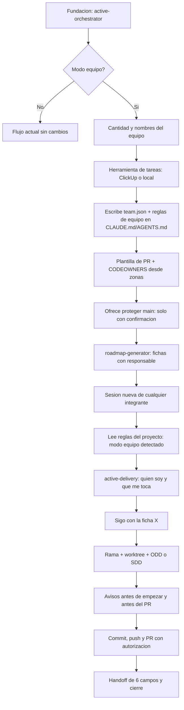

# Plan de implementación: Modo equipo automático (flujo de fundación y entrega)

**Estado:** propuesta lista para implementar · **Fecha:** 2026-11-19 · **Revisión 1**
**Modo de entrega:** criterios cortos por ficha y TDD estricto, **sin SDD** (decisión del responsable, 2026-11-19). Los tests `T-*` de cada fase son los criterios de aceptación. Se ejecuta con la [guía de implementación en equipo](guia-implementacion-equipo.md) y el [roadmap integrado](roadmap-implementacion-equipo.md). Al citarlo desde otros documentos, usar el prefijo **[EQ]**.
**Governance:** MEDIO en general; **ALTO** en la Fase 6 (`permissions`) y en toda escritura sobre archivos de instrucciones del proyecto destino (`filemerge`).
**OpenSpec:** no se usa para este trabajo salvo que un change ya esté iniciado o el responsable lo pida.
**Rama:** una por ficha del roadmap integrado (`feat/R-xx-slug`). **Partir de `main`** (ver H1).

**Fuentes:** (1) PDF "Trabajo en equipo con Active Stack: síntesis de las propuestas" (comparación de cuatro fuentes, filtrada contra lo que Active Stack es); (2) informe `docs/research/trabajo-en-equipo-active-stack-2026-11-18.md`; (3) guía del equipo `https://active-stack-guia-equipo.vercel.app/` (v0.8.1, 26 láminas); (4) lectura del catálogo y de las skills embebidas en `main`; (5) criterio del responsable.

---

## 1. Objetivo y no-objetivos

**Objetivo único.** Cuando alguien funda un proyecto con Active Stack y elige **modo equipo**, el equipo puede trabajar en paralelo, **de forma automática y sin explicarle nada al agente**: cada persona sabe qué le toca, retoma su ficha con una rama y un worktree propios, el trabajo se integra por PR chicos (nunca directo a `main`), y quien continúa trabajo ajeno lo hace desde un traspaso verificable. Primer alcance: **Claude y Codex**.

**Qué significa "automático".** El agente detecta el modo equipo al abrir una sesión en el proyecto y aplica el flujo sin que la persona se lo pida. Siguen pidiendo confirmación, por regla del proyecto y de la guía: commit, push, PR, escrituras en ClickUp y cualquier cambio de configuración en GitHub.

**No-objetivos (decisión firme):**

- No es un sistema de gestión de proyectos: no reemplaza a ClickUp, GitHub ni OpenSpec; los usa (reparto de autoridad en 3.1).
- No decide cómo se organizan las personas (subgrupos, rotación, pares fijos).
- No hay registro central de capacidades por integrante ni datos personales más allá de nombre y vínculos de cuenta (3.3).
- No hay GitHub Action de avisos, cola de integración, webhooks ni PR apilados nativos.
- No se toca el repo `active-stack` como proyecto (su CI, CODEOWNERS y tests) — ver Pendientes (sección 10).
- No se toca `sdd-orchestrator`, `design-mockups`, `backup`, `filemerge`, `pipeline`: se usan.
- Sin modo equipo, la instalación y la fundación son **idénticas a las actuales**.
- No reintroducir GGA, themes ni persona-marketing (CLAUDE.md §3).

**Límite declarado de entrada.** El flujo guiado es una **instrucción que el agente cumple**, no un candado: un agente apurado puede saltearla. Lo que no debe fallar se refuerza en dos capas técnicas: reglas `deny` del agente (Fase 6) y la protección de `main` en GitHub (Fase 3, solo con confirmación y según el plan de GitHub del proyecto). Un humano que pushea directo a `main` solo lo frena GitHub.

---

## 2. Hallazgos verificados

Leídos el 2026-11-19. El implementador debe reverificarlos antes de editar.

| # | Hallazgo | Dónde |
|---|---|---|
| H1 | La rama actual (`propose/codex-strict-compat`) está **por detrás de `main`** (`684ad50`, v0.8.1): no contiene `assets/skills/active-delivery` ni `active-roadmap`, y fija `active-orchestrator` en otro SHA (`63c5131…` vs `09c841e…` de la guía). Implementar desde `main`. | `git ls-tree main`, `harnesses.yaml` |
| H2 | `active-delivery` y `active-roadmap` son skills **embebidas** (`source: { method: embed }`), `agents: [codex, claude]`. `active-delivery` va en Lite y Full; `active-roadmap` solo en Full. Viven en `assets/skills/active-delivery/` (con `references/handoff.md`, `roadmap-reconciliation.md`) y `assets/skills/active-roadmap/` (con `roadmap.py`, `references/clickup-actions.md` y tests Python). | `harnesses.yaml` en `main` |
| H3 | `active-orchestrator` está declarado para **los cuatro agentes** (`claude, codex, opencode, antigravity`), `install_modes: [full]`, fijado por SHA. Un cambio ahí **llega a OpenCode y Antigravity**. | `harnesses.yaml:92-101` |
| H4 | `roadmap-generator` y `agent-instruction` están en `ref: latest` y **sin campo `agents`** (aplican a todos). Un cambio en sus repos llega a todos los usuarios en la siguiente instalación o actualización, **sin pasar por el test del catálogo**. | `harnesses.yaml:122-137` |
| H5 | `roadmap-generator` vive en `Group-Active-IA/roadmap-generator` y `agent-instruction` en `JuanCruzRobledo/agent-instruction`: repos externos, un PR en cada uno. | `harnesses.yaml` |
| H6 | `AGENTS.md` del **proyecto** lo leen Codex **y también OpenCode/Antigravity**. Si las reglas de equipo viven ahí, deben funcionar (con una convención manual) en clientes que no tienen `active-delivery`. | guía, lámina 24 |
| H7 | La guía declara: ODD con traspaso único por ficha en `knowledge-base/entrega/<id>.md`; roadmap en `CHANGES.md` + `.active-stack/roadmap.json` (modo y destino) + `roadmap-state.json` (vínculos y observaciones); estado de fundación en `.active-orchestrator-state.json`. | guía, láminas 11 y 14 |
| H8 | El coordinador `sdd-orchestrator` se **invoca explícitamente** (`/sdd-orchestrator` en Claude, `$sdd-orchestrator` en Codex) y se reinvoca tras `/compact`. **No sirve como disparador automático** del modo equipo. | guía, lámina 21; `~/.claude/CLAUDE.md` |
| H9 | La guía afirma que ramas, permisos y revisiones "siguen necesitando acuerdos del equipo" y que no hay cola automática. Quedará desactualizado (Fase 8). | guía, lámina 25 |
| H10 | `.github/` de este repo solo tiene `release.yml` (sin CODEOWNERS ni plantilla de PR). Es dato del repo del stack, **fuera de alcance** (Pendientes). | árbol del repo |
| H11 | `permissions` tiene overlays para Claude, Codex y OpenCode; en `estricto` no hay lista de permitidos y en `balanceado` no se permite `git branch` ni `gh`. | `internal/harness/config/permissions/overlays.go` |
| H12 | `.gitignore` del repo del stack no dice nada sobre `.active-stack/` ni `roadmap-state.json` del **proyecto destino**: no se sabe si esos archivos se versionan allí. | `.gitignore`; guía |

`(TBD)` a confirmar en la Fase 0: H12, el plan de GitHub del proyecto piloto y si `.active-orchestrator-state.json` se versiona.

---

## 3. Diseño

### 3.1 Reparto de autoridad (se hereda sin cambios)

| Dato | Fuente de verdad |
|---|---|
| Alcance, contratos, decisiones | Repo (fichas en `CHANGES.md`) y OpenSpec cuando se eligió SDD |
| Estado operativo, responsables, bloqueos humanos | ClickUp si se eligió; si no, la ficha y el PR |
| Revisión, checks, merge | GitHub |
| Equipo (cantidad, nombres, vínculos) | `.active-stack/team.json` (3.3) |
| Quién soy en esta máquina | Archivo local, fuera del historial (3.3) |

Cada dato tiene **una sola fuente**; lo demás se deriva de ella. La ficha es la fuente de las dependencias: el PR y ClickUp se derivan.

### 3.2 Flujo



### 3.3 Equipo e identidad

**Quién define el equipo.** La persona que funda el proyecto. El agente **nunca inventa** nombres.

| Dato | Regla |
|---|---|
| **Cantidad** | **Obligatoria** (entero ≥ 2). Es lo que orienta el reparto y el paralelismo máximo. |
| **Nombres** | Opcionales al fundar. Sin nombre, el lugar queda como `Integrante 1..N` (pendiente) y se completa después. |
| **Cuenta de GitHub** | Opcional por integrante. Sirve para identificar a la persona y para `CODEOWNERS`. |
| **Usuario de ClickUp** | Solo si se eligió ClickUp. Cada nombre se resuelve al usuario del workspace con las herramientas del conector (`find_member_by_name` / `resolve_assignees`) y se **confirma con la persona**; se guarda el ID numérico. Nombre sin coincidencia: queda sin vínculo, no se adivina. |

**Dónde se guarda.** `.active-stack/team.json` (contrato en la Fase 1):

```json
{
  "version": 1,
  "size": 6,
  "tracking": "clickup | local",
  "members": [
    { "id": "m1", "name": "Ana", "github": "ana-dev", "clickup_id": 12345 },
    { "id": "m2", "name": null }
  ],
  "names_versioned": true
}
```

**Privacidad.** Al fundar, el agente pregunta: *"¿Versionamos los nombres en el repo?"*. Si el repositorio es público, lo explica antes de preguntar. Con "no", en `team.json` solo viaja `size`, y los nombres y vínculos pasan a `.active-stack/team.local.json` (ignorado por Git, regla agregada con marcadores). El resto del flujo funciona igual.

**Quién soy.** Archivo **local**, nunca versionado: `.active-stack/me.local.json` con el `id` de integrante elegido. En la primera sesión del repo: (1) si la cuenta de GitHub (`gh api user`) o de ClickUp coincide con un integrante, se **sugiere** y la persona confirma; (2) si no, muestra la lista y pide elegir; (3) si nadie coincide, **modo consulta** (solo lectura) y explica cómo pedir una asignación. Se puede cambiar.

### 3.4 Fundación: qué hace el modo equipo

En `active-orchestrator`, como **fase opcional** (se elige, se difiere o se reutiliza como las demás, y se retoma desde evidencia):

1. Pregunta si es proyecto de equipo. Con "no" o "después" no se escribe nada.
2. Pide cantidad, nombres (opcionales), herramienta de tareas y quién revisa las zonas de riesgo (titular y suplente).
3. Muestra el **resumen previo** (archivos que escribirá, acciones externas) y espera aprobación, como el resto de la fundación.
4. Escribe `team.json`, la sección de reglas de equipo en el `CLAUDE.md`/`AGENTS.md` **del proyecto** (vía `agent-instruction`, con markers idempotentes) y las reglas de `.gitignore` de los archivos locales.
5. Genera `.github/pull_request_template.md` (campos del handoff) y `.github/CODEOWNERS` armado desde las `Zona` de las fichas y los titulares/suplentes. Si ya existen, **no pisa**: propone el merge.
6. Ofrece **una sola vez** proteger `main` (PR obligatorio, check requerido si existe, sin force-push). Muestra el comando de `gh` y solo lo ejecuta con confirmación; si el plan de GitHub no lo permite, lo dice y deja la convención escrita.
7. Registra la política y los motivos en el estado de fundación, para no repreguntar.

**Reglas de equipo en el archivo del proyecto** (sección corta; el detalle va en `references/` de la skill, cargado a demanda):

- Al iniciar sesión, si hay `team.json`, usar `active-delivery` para identificar a la persona y mostrar "qué me toca".
- Una rama y un worktree por ficha: `<id>-slug`. Nunca dos agentes en la misma rama o carpeta.
- Nada directo a `main`; PR chicos; commit, push y PR solo con autorización.
- **Fallback (H6):** *si la skill `active-delivery` no está disponible en este cliente*, aplicar la misma convención a mano (rama por ficha, PR, sin push a `main`, handoff en `knowledge-base/entrega/<id>.md`).

### 3.5 Ficha (`roadmap-generator`)

Campos de la ficha en `CHANGES.md` (markdown plano, sin dependencia de ningún agente):

| Campo | Regla |
|---|---|
| **ID** | Estable. Es la clave de rama, PR, ClickUp y traspaso. |
| **Resultado** | Verificable. Sin resultado no hay ficha válida. |
| **Depende de** | ID de ficha o `#PR`. `@SHA` **solo** si depende de un PR abierto. Máximo **2 PR encadenados**; cadena mayor ⇒ extraer la base común a un PR chico. |
| **Zona** | Rutas/paquetes que toca. **Recomendada**, no bloqueante. La usa el verificador y `CODEOWNERS`. |
| **Requiere** | Agente y sistema (ej. `claude o codex · windows y linux`). Describe la **tarea**, no a la persona. |
| **Modo** | `odd` o `sdd`. "Una ficha es un trabajo ODD o un change SDD". |
| **Responsable** | `id` de integrante (3.3), asignado por el **reparto acordado**. |

Las **olas se calculan** a partir de `Depende de`; no se escriben. Las fichas existentes, sin estos campos, **siguen funcionando** y el agente avisa qué falta sin bloquear.

**Verificador determinista** (script del propio repo del skill, sin red ni GitHub): zonas solapadas, ciclos, cadenas de más de 2 PR, ficha sin resultado, responsable inexistente en `team.json`. Un solapamiento de archivos es **una señal a revisar**, no una prueba de conflicto.

**Reparto.** Con la cantidad `N` y las dependencias reales, propone un reparto **editable** (puede haber menos paralelismo que `N`; las personas sobrantes revisan o adelantan la ola siguiente, no se inventa trabajo). Se guarda solo el reparto aprobado.

### 3.6 Entrega (`active-delivery`)

Disparador: la sesión nueva en un proyecto con `team.json`. Pasos:

1. **Quién soy** (3.3) y **qué me toca**: mis fichas y su estado, a quién espero, a quién bloqueo, qué PR me toca revisar. Cada dato lleva **fuente y fecha de lectura**; si una fuente no responde, lo dice.
2. **"Sigo con X"** (o "empezá esta tarea"): detecta rama y worktree existentes y revisa su estado. Si faltan, propone `<id>-slug` desde la base acordada (`origin/main` o la base de la dependencia) y un worktree hermano; **los crea al confirmar** y no duplica si el reintento llega a mitad de operación (lectura primero, releer antes de reintentar). Si el checkout tiene cambios, presenta la ruta y pide una decisión; no toca cambios ajenos.
3. Elige **ODD o SDD** como hoy (confirmación del modo). Con dependencia abierta, ofrece **arrancar encima con aviso** o esperar; elige el responsable.
4. **Avisos** (solo 5; los dispara el agente al empezar y antes del PR; ninguno escribe código):

| # | Aviso | Cómo se detecta |
|---|---|---|
| 1 | La ficha ya tiene responsable, rama o PR | `gh pr list`, ramas remotas, ClickUp |
| 2 | La base de la que depende cambió | Comparar `@SHA` con la punta actual |
| 3 | Solapamiento con un PR abierto | `gh pr diff --name-only` contra la zona |
| 4 | Trabajo ODD que toca algo cubierto por un change SDD de otra persona | PR abiertos que tocan `openspec/changes/` (no basta `openspec list`: solo ve el checkout local) |
| 5 | Requisito de la ficha que esta máquina no cumple | Autoevaluación con confirmación de la persona |

5. **Handoff de 6 campos, siempre en modo equipo** (cambia el comportamiento actual, que lo crea solo si alguien continúa): resultado, PR y SHA, cómo verificar, qué falta, quién sigue, qué lo bloquea. Archivo único por ficha: `knowledge-base/entrega/<id>.md`.
6. **PR en borrador** con plantilla, evidencia y enlace a la ficha. Commit, push y PR con autorización.
7. **Cierre:** verifica merge y SHA, registra evidencia y ofrece actualizar el seguimiento.

### 3.7 ClickUp (`active-roadmap`)

Solo si se eligió ClickUp. Se extiende lo que ya hace (vista previa y confirmación por fila):

- El **ID de la ficha va en el nombre de la rama**; el **enlace del PR** se agrega a la tarea; el **cierre** registra PR, SHA y traspaso.
- **Tomar = asignarse**, mostrando antes si la tarea ya tiene responsable.
- Los **responsables salen de `team.json`** (`clickup_id`): al publicar o reconciliar una ficha se asigna a su `Responsable`. Un integrante sin vínculo se publica sin asignar y se avisa.
- No se usan dependencias nativas de ClickUp (evitan una tercera copia de `Depende de`); si se necesita, va como texto con enlace.
- "Ver avance" no sincroniza por sí solo. Una herramienta expuesta no garantiza permiso de escritura: se verifica cuenta, workspace y lista, y se repite la verificación en Claude **y** en Codex por cada capacidad nueva.
- Sin ClickUp, el seguimiento es local (la ficha y el PR); todo el flujo funciona igual.

### 3.8 Actualizar el equipo

Acción **"actualizar equipo"** (en `active-orchestrator`, invocable también desde `active-delivery`), sin regenerar lo aprobado:

- Cambia cantidad, agrega o quita integrantes, completa nombres pendientes, vincula o corrige cuentas de GitHub/ClickUp, cambia el modo de seguimiento (local ⇄ ClickUp).
- Muestra una **vista previa del diff** de `team.json`, de `CODEOWNERS` y de las fichas cuyo `Responsable` queda huérfano (propone reasignarlas; nada se reasigna sin aprobación). Las fichas ya empezadas **no se tocan**.
- Es **idempotente**: repetirla no duplica ni cambia bytes; `version` de `team.json` permite migrar el formato.
- Una persona que se suma después: clona, abre su agente, elige su identidad (3.3) y se la **vincula** si está pendiente.
- La propia fundación puede **retomarse** y decir qué quedó pendiente (nombres sin completar, ClickUp sin vincular, `main` sin proteger).

### 3.9 Presupuesto de contexto

- Las reglas de equipo se escriben en el archivo **del proyecto**, no en el global: quien trabaja solo, o en otro proyecto, **no paga** tokens.
- La sección es corta y apunta a `references/`; el detalle se carga a demanda.
- El sobrecosto se **mide** en el piloto (sesión de referencia con y sin modo equipo). Tope numérico `(TBD)`; si se supera, se acorta la sección.

### 3.10 Compatibilidad con OpenCode, Antigravity y otros agentes (leer antes de implementar)

Esta modificación toca piezas que **comparten** otros agentes. Reglas para el implementador:

| Pieza | Quién la recibe | Qué hacer |
|---|---|---|
| `active-delivery`, `active-roadmap` | Solo Claude y Codex (H2) | Mantener `agents: [codex, claude]`. Un test fija que **no** se amplía sin cambio deliberado. |
| `active-orchestrator` | **Los cuatro agentes** (H3) | La fase de equipo no se oculta: en OpenCode/Antigravity registra equipo y convención, pero **avisa** que el flujo guiado de entrega no existe en ese cliente. No debe fallar ni exigir herramientas de Claude/Codex. |
| `roadmap-generator`, `agent-instruction` | Todos (H4) | Los campos de la ficha son markdown plano; el verificador no depende de ninguna herramienta de agente. Reglas de equipo del proyecto con el **fallback manual** de 3.4 (H6). Las fichas viejas siguen siendo válidas. |
| `permissions` | Claude, Codex, OpenCode | `deny` de push a `main` en Claude y Codex (primer alcance). OpenCode: mismo `deny` si su overlay lo soporta `(TBD)`; Antigravity `(TBD)` si tiene overlay. |
| Instalaciones sin modo equipo | Todos | **Byte a byte idénticas** a las actuales, en los cuatro agentes. |
| `ref: latest` (H4) | Todos | **Fijar ambos repos por SHA** antes de integrar este cambio, para que lo que reciben OpenCode/Antigravity sea revisable y tenga test de catálogo. |

Consecuencia declarada: quien use OpenCode o Antigravity **recibe las reglas y la convención**, pero no el flujo guiado. Su protección real es `deny`/protección de `main`. Extenderles el flujo es un change aparte (Pendientes).

### 3.11 Decisiones (aprobadas por el responsable, 2026-11-19)

| ID | Decisión |
|---|---|
| D1 | Modo equipo **opcional**, elegido en la fundación; sin él, nada cambia. |
| D2 | Primer alcance: **Claude y Codex**. |
| D3 | Reglas de equipo en el archivo **del proyecto**; no en el global. |
| D4 | Cantidad obligatoria; nombres opcionales; **la IA no inventa nombres**. |
| D5 | Nombres versionados **solo con aprobación**; si no, locales. Identidad personal siempre local. |
| D6 | ClickUp: responsables salen de `team.json` con IDs confirmados. |
| D7 | Zona **recomendada**; dependencia abierta: **permitir arrancar encima con aviso**. |
| D8 | Handoff **siempre** en modo equipo. |
| D9 | **5 avisos**, todos del agente; sin Action. |
| D10 | `deny` de push a `main` y force-push en `permissions` (ALTO). |
| D11 | Proteger `main` en GitHub solo ofrecido, con confirmación. |
| D12 | Equipo **actualizable** sin regenerar la fundación (3.8). |
| D13 | Éxito del piloto: **conteo de casos** contra línea base, no medianas ni metas del 20 %. |

---

## 4. Reglas de ejecución (obligatorias)

- **TDD estricto.** Test primero, verlo **fallar por la razón correcta**, implementar lo mínimo, verlo pasar, refactor.
- **Tests Go:** `go test ./<paquete>/... -count=1`; al cerrar cada fase `go test ./... -count=1` y `go vet ./...`. **Tests Python** de las skills embebidas: runner `(TBD)` (confirmar el existente en `assets/skills/active-roadmap/`).
- **NO ejecutar `go build` ni `active-stack install` real** salvo pedido explícito. Los tests usan `t.TempDir()` y los *seams* existentes; jamás tocan el home real ni un repo real. **Nunca** escribir en GitHub ni ClickUp reales en pruebas: lista descartable o dobles.
- **Catálogo:** toda edición de `harnesses.yaml` pasa por `catalog.Load()`.
- **Backup antes de escribir** (`internal/backup`) y **markers idempotentes** (`internal/filemerge`) en los archivos del proyecto destino. **Paths por el adapter.**
- **No modificar** `internal/backup`, `internal/filemerge`, `internal/pipeline`: se usan. Si una tarea lo exigiera, detenerse y pedir review.
- **`(TBD)`** donde una decisión no esté tomada; no inventar.
- **Commits:** conventional commits, sin coautoría de IA, solo con pedido explícito.
- **Espejos:** todo cambio en `CLAUDE.md` se replica en `AGENTS.md` en el mismo commit.
- **Limpieza:** sin rastro de `gentle-ai`, `gentle-stack` ni `Gentleman.Dots`.
- **Secretos:** ningún token ni credencial en `team.json`, en las reglas ni en los tests.

---

## 5. Fases (cada una cierra con su puerta de calidad)

### Fase 0 · Verificación de supuestos (sin código de producción)

Rama desde `main`. Entregable: `docs/research/trabajo-en-equipo-verificacion-<fecha>.md` con comandos, salidas y veredicto. **Sin él no se pasa a la Fase 1.**

| Prueba | Esperado | Si falla |
|---|---|---|
| **V1** `.active-orchestrator-state.json`, `roadmap.json` y `roadmap-state.json`: ¿se versionan en un proyecto fundado? ¿cuáles cambian con cada persona? | Documentado | Mover observaciones a archivo local; vínculos al roadmap compartido (evita conflictos de merge) |
| **V2** Cómo identifica `active-roadmap` hoy a la cuenta de ClickUp y si puede resolver miembros por nombre | Documentado | Resolución manual con confirmación |
| **V3** `gh` disponible y autenticado; `gh api user` devuelve el handle | Documentado | Elegir de la lista |
| **V4** Plan de GitHub del repo piloto: ¿rulesets o protección de rama disponibles? | Documentado | Solo convención + `deny` |
| **V5** `deny` de `git push` a `main` en Claude y Codex: ¿lo respeta el cliente? | Medido | Reforzar con el texto de las reglas |
| **V6** Una sesión de Claude y una de Codex con las reglas de equipo en el archivo del proyecto: ¿detectan el modo y llaman a `active-delivery` sin que se lo pidan? | Umbral de cumplimiento `(TBD)` en 5 corridas por agente | Endurecer el texto; mover el disparo a la skill |
| **V7** Cómo se comporta `active-orchestrator` en OpenCode y Antigravity con la fase de equipo (sin romper) | Documentado | Ocultar la fase en esos clientes |
| **V8** Tokens: misma sesión de referencia con y sin modo equipo | Sobrecosto dentro del tope `(TBD)` | Acortar la sección |

### Fase 1 · Contrato compartido (governance MEDIO)

Define y documenta: `team.json`, archivos locales, campos de ficha, handoff y reglas de equipo. Vive como referencia en `assets/skills/active-delivery/references/team-mode.md` y se valida con tests de esquema.

**Tests primero:** `T-F1-1` `team.json` válido y mínimo (solo `size`) · `T-F1-2` `size < 2` rechazado · `T-F1-3` miembros con `name: null` válidos · `T-F1-4` `clickup_id` solo con `tracking: clickup` · `T-F1-5` `version` desconocida → error claro · `T-F1-6` `names_versioned: false` ⇒ ningún nombre en el archivo compartido · `T-F1-7` ficha antigua (sin campos nuevos) sigue siendo válida · `T-F1-8` ningún campo admite credenciales.

### Fase 2 · `roadmap-generator` (repo externo; MEDIO)

Fichas con los campos de 3.5, verificador y reparto editable. **PR en el repo externo primero**; luego fijar el `ref` por SHA en `harnesses.yaml` en un commit propio con su test de catálogo (H4).

**Pruebas (repo externo):** fichas con dependencias reales (ciclo, zona solapada, cadena de 3 PR, ficha sin resultado, responsable inexistente) · ficha vieja intacta · `N` mayor y menor que el paralelismo real · replanificar sin tocar fichas empezadas · verificador sin red.

### Fase 3 · Fundación y actualización de equipo (`active-orchestrator` y `agent-instruction`, repos externos; MEDIO, escritura de instrucciones ALTO)

Fase opcional "modo equipo" (3.4), acción "actualizar equipo" (3.8), identidad (3.3), sección de reglas en el archivo del proyecto, plantilla de PR, `CODEOWNERS`, oferta de protección de `main`.

**Pruebas:** proyecto vacío, fundación parcial y repo clonado en sesión nueva · "no" y "después" no escriben nada · cantidad obligatoria; nombres vacíos → `Integrante N` · nombres con y sin versionado · repo público explica antes de preguntar · coincidencia por cuenta, elección manual y modo consulta · ClickUp: nombre resuelto y confirmado, sin coincidencia, conector caído · `CODEOWNERS` y plantilla existentes **no se pisan** · reinstalar no duplica la sección (markers) · "actualizar equipo": agregar, quitar, renombrar, cambiar cantidad, fichas huérfanas, sin cambios (idempotente) · protección de `main`: sin permiso, plan no soportado, confirmación · OpenCode y Antigravity (V7) · `agent-instruction` no duplica la sección y emite el fallback manual.

Cambios en repos externos → PR allá; luego bump del `ref` (SHA completo) en un commit propio con test de catálogo.

### Fase 4 · `active-delivery` (skill embebida; MEDIO)

Implementa 3.6. **Tests primero** (fixtures Git en `t.TempDir()`/Python según el runner):

- `T-F4-1` sin `team.json` el comportamiento es **idéntico al actual** · `T-F4-2` con `team.json` y sin identidad local → selección o modo consulta · `T-F4-3` "qué me toca" con fuente y fecha por dato, y fuente caída declarada.
- `T-F4-4` crea rama `<id>-slug` y worktree hermano al confirmar · `T-F4-5` reintento idempotente (rama ya existe, worktree ya existe) · `T-F4-6` checkout con cambios: pide decisión, no toca nada · `T-F4-7` jamás dos agentes en la misma rama o carpeta.
- `T-F4-8` dependencia abierta: ofrece arrancar encima o esperar · `T-F4-9` cada uno de los 5 avisos con su caso positivo y negativo · `T-F4-10` aviso 4 detecta PR abierto que toca `openspec/changes/` aunque `openspec list` local no lo vea · `T-F4-11` ningún aviso escribe código.
- `T-F4-12` handoff de 6 campos siempre en modo equipo; sin modo equipo, como hoy · `T-F4-13` PR en borrador solo con autorización · `T-F4-14` nunca `push` a `main` ni force-push · `T-F4-15` ODD→SDD no hace commits ni cambia de rama por su cuenta.
- `T-F4-16` traspaso entre Codex y Claude con las mismas fuentes compartidas.

**Puerta:** tests de la skill verdes y `go test ./internal/catalog/... -count=1`.

### Fase 5 · `active-roadmap` y ClickUp (skill embebida; MEDIO)

Implementa 3.7. **Tests primero:** `T-F5-1` ID de ficha en la rama · `T-F5-2` enlace del PR en la tarea con vista previa por fila · `T-F5-3` tomar = asignarse muestra antes el responsable actual · `T-F5-4` publicar asigna a `clickup_id` del `Responsable`; sin vínculo, sin asignar y con aviso · `T-F5-5` cierre con PR, SHA y traspaso · `T-F5-6` se escribe **solo** la fila aprobada; cambiar la selección invalida la vista previa · `T-F5-7` cuenta sin acceso → modo local de lectura · `T-F5-8` sin ClickUp, flujo local completo · `T-F5-9` ninguna escritura sin confirmación · `T-F5-10` verificación en Claude **y** Codex.

### Fase 6 · `permissions` (governance **ALTO**: proponer y esperar review antes de codificar)

**Alcance.** Agregar `deny` de `git push` a `main` y de force-push, y entradas **de solo lectura** (`gh pr list`, `gh pr diff`, `gh api user`) en `balanceado`, para que el flujo no pida confirmación en cada sesión. Claude y Codex primero; OpenCode `(TBD)`. `estricto` no gana entradas permitidas; `bypass` conserva su denegación final.

**Tests primero:** `T-F6-1` el `deny` aparece en todos los niveles de Claude y Codex · `T-F6-2` el **piso de denegación existente** queda intacto · `T-F6-3` las entradas de lectura solo en `balanceado` y sin argumentos libres de escritura · `T-F6-4` Codex: política válida, sin reintroducir `approval_policy = "untrusted"` · `T-F6-5` OpenCode: si se incluye, el orden "denegaciones al final" se mantiene.

**Puerta:** review humana; luego tests verdes.

### Fase 7 · Catálogo e instalación (MEDIO)

**Tests primero:** `T-F7-1` `active-delivery` y `active-roadmap` conservan `agents: [codex, claude]` y sus modos · `T-F7-2` **instalación sin modo equipo byte a byte idéntica** en los cuatro agentes (OpenCode y Antigravity no cambian) · `T-F7-3` los `ref` de `roadmap-generator`, `agent-instruction` y `active-orchestrator` son SHA completos · `T-F7-4` `update --skills-only` refresca las skills embebidas sin pisar archivos del proyecto · `T-F7-5` `verify` reconoce las skills actualizadas · `T-F7-6` cobertura Windows donde haya lógica específica.

**Puerta:** `go test ./internal/catalog/... ./internal/install/... ./internal/update/... ./internal/verify/... ./cmd/... -count=1`.

### Fase 8 · Documentación y guía (BAJO)

- `CHANGES.md`: ficha con ID estable y enlace al PR.
- `CLAUDE.md` y `AGENTS.md` (espejos): referencia al modo equipo y al fallback.
- Guía del equipo (`active-stack-guia-equipo`): actualizar las láminas 16 (roadmap), 24 (capacidades por cliente, aclarando OpenCode/Antigravity) y 25 (preguntas: quitar "no se administra ramas ni revisiones" y reemplazar por lo que ahora hace y no hace).
- `docs/equipo.md` o sección en la guía: cómo se funda un equipo, cómo se actualiza (3.8) y qué no garantiza el stack.
- Registrar D1-D13 y el resultado de la Fase 0 en la KB y en Engram.

### Fase 9 · Piloto de extremo a extremo

Solo con autorización del responsable; repo y lista de ClickUp **descartables**. Dos personas (o dos HOME), una máquina limpia, Claude **y** Codex.

1. Una persona funda el proyecto en modo equipo para 6, con nombres parciales; verificar `team.json`, reglas, plantilla y `CODEOWNERS`.
2. Otra clona en máquina limpia, abre el agente, se identifica y ve "qué me toca".
3. "Sigo con X": rama y worktree creados; ODD hasta el PR en borrador.
4. Dos fichas independientes en paralelo; una tercera dependiente (arrancar encima con aviso y con espera).
5. Un ODD que toca algo de un change SDD ajeno (aviso 4); dos personas intentando la misma tarea (aviso 1).
6. Traspaso de Codex a Claude desde el handoff, sin pedir contexto.
7. "Actualizar equipo": sumar un integrante, completar un nombre, cambiar la cantidad.
8. ClickUp: ciclo completo y ClickUp sin acceso; con seguimiento local.
9. Intento de push a `main` por el agente: bloqueado por `deny`.
10. Misma prueba de instalación en OpenCode: sin cambios y sin errores.

**Medición:** conteo de casos contra una línea base de dos semanas (conflictos, trabajo duplicado, tareas mal asignadas, PR sin revisión, análisis sobre versiones viejas), más tiempo hasta la primera revisión, avisos útiles frente a avisos ruidosos, traspasos retomados sin pedir contexto. **Criterio de éxito:** se completan los escenarios y baja al menos uno de los problemas contados sin que el ruido supere a lo útil. Sin rankings por persona, por commits ni por líneas.

---

## 6. Matriz de archivos

| Archivo / repo | Acción | Fase |
|---|---|---|
| `assets/skills/active-delivery/**` (embebida) | + flujo de equipo, avisos, handoff, `references/team-mode.md` | 1, 4 |
| `assets/skills/active-roadmap/**` (embebida) | + responsables, ID en rama, enlace de PR | 5 |
| `roadmap-generator` (repo externo) | + campos de ficha, verificador, reparto | 2 |
| `active-orchestrator` (repo externo) | + fase "modo equipo", "actualizar equipo" | 3 |
| `agent-instruction` (repo externo) | + sección de reglas de equipo con fallback | 3 |
| `internal/harness/config/permissions/overlays.go` (+ tests) | + `deny` push a `main`, lectura de `gh` | 6 |
| `internal/catalog/harnesses.yaml` (+ tests) | bump de `ref` por SHA; guardas de `agents` | 2, 3, 7 |
| `internal/install/*_test.go`, `internal/update/*_test.go`, `internal/verify/*_test.go` | + T-F7-* | 7 |
| `CHANGES.md`, `CLAUDE.md`/`AGENTS.md`, guía del equipo, `docs/` | docs y espejos | 8 |

**No se toca:** `sdd-orchestrator`, `design-mockups`, `engram-protocol.md`, `internal/backup`, `internal/filemerge`, `internal/pipeline`.

---

## 7. Riesgos y mitigaciones

| Riesgo | Mitigación |
|---|---|
| El agente se saltea el flujo (instrucción, no candado) | `deny` técnico (Fase 6), protección de `main` ofrecida, V6 mide el cumplimiento |
| Un humano pushea a `main` | Solo lo frena GitHub; se ofrece la protección y se avisa si falta |
| Cambios en repos externos llegan a todos los agentes sin revisión (`latest`) | Fijar por SHA antes de integrar (T-F7-3) |
| OpenCode/Antigravity leen reglas que mencionan skills que no tienen | Fallback manual en la sección (H6, 3.4) |
| Conflictos de merge por estado compartido (`roadmap-state.json`, `CHANGES.md`) | V1; estado derivado de rama/PR/ClickUp; observaciones locales; un archivo por ficha para el handoff |
| Nombres en un repo público | Pregunta explícita; modo local con solo la cantidad (D5) |
| Nombre de ClickUp ambiguo o inexistente | Confirmación por persona; sin vínculo no se adivina |
| `Depende de` queda en tres lugares y se desincroniza | La ficha es la fuente; PR y ClickUp se derivan |
| Sobrecosto de tokens | Reglas en el archivo del proyecto, detalle en `references/`, V8 |
| Alcance excesivo | Entrega por fases con puerta; si una fase no baja un problema contado, no se sigue |
| Avisos ruidosos | Solo 5, cada uno con acción concreta; el piloto cuenta útiles vs. ruido |
| Plan de GitHub sin protección de rama | V4; queda la convención y el `deny` |
| Rama de trabajo desactualizada respecto de `main` | H1: partir de `main`, rebasar antes de cada fase |

---

## 8. Criterios de aceptación globales

1. Tests de Go y de las skills verdes, `go vet ./...` limpio.
2. **Sin modo equipo**, la instalación y la fundación son idénticas a las actuales en los cuatro agentes.
3. Fundar con modo equipo escribe `team.json`, las reglas, la plantilla y `CODEOWNERS`, sin pisar lo existente, y reinstalar no duplica.
4. Una sesión nueva de Claude **y** de Codex detecta el modo equipo, identifica a la persona y muestra su trabajo sin que se lo pidan.
5. "Sigo con X" deja rama `<id>-slug` y worktree propios, sin duplicar en reintentos.
6. Un push a `main` por el agente queda bloqueado por `deny`; commit, push y PR siguen requiriendo autorización.
7. El equipo se puede **actualizar** (cantidad, nombres, vínculos) con vista previa e idempotencia, sin regenerar la fundación.
8. Con ClickUp, los responsables salen de `team.json` con IDs confirmados; sin ClickUp todo funciona en modo local.
9. OpenCode y Antigravity no reciben cambios en la instalación y no fallan en la fundación; la limitación está documentada.
10. Los `ref` externos tocados están fijados por SHA y con test de catálogo.
11. Veredicto de la Fase 0 por cada V, piloto completado y sobrecosto de tokens dentro del tope.
12. Espejos `CLAUDE.md`/`AGENTS.md` sincronizados, `CHANGES.md` y la guía actualizados.

---

## 9. Orden sugerido y paralelismo

```
Fase 0 ─> Fase 1 ─┬─> Fase 2 (roadmap-generator, ext) ─┐
                  ├─> Fase 3 (orchestrator + instruction, ext) ─┤
                  ├─> Fase 4 (active-delivery) ──────────┼─> Fase 7 ─> Fase 8 ─> Fase 9
                  ├─> Fase 5 (active-roadmap) ───────────┤
                  └─> Fase 6 (permissions, tras review ALTO) ┘
```

Tras la Fase 1, los frentes no se pisan: **(A)** Fase 2, **(B)** Fase 3, **(C)** Fases 4 y 5 (comparten `assets/skills/` pero no los mismos archivos), **(D)** Fase 6. Delegar a subagentes con alcance, rutas y verificación definidos. Una rama y un worktree por frente.

---

## 10. Pendientes (fuera de este change, para otros changes)

Quedan registrados para no perderlos; **no** se implementan acá.

**Del repo `active-stack` (higiene propia):**

- CI de PR con check estable (nivel obligatorio: Linux, Windows, Python; nivel completo: macOS, `-race`, `eval/*`, `govulncheck`), protección mínima de `main`, `CODEOWNERS` para `backup`/`filemerge`/`pipeline` con titular y suplente, plantilla de PR.
- Tests dependientes de la máquina (carrera en `tui`, test de Windows sin build tag, huella del fixture, tests no aislados o que dependen del orden, los que exigen `node`/`npm`); fijar el toolchain de Go en `go.mod`.
- Que `verify` falle si ejecutó 0 controles (hallazgo H03 de la evaluación, sin reverificar).
- Test que compare `CLAUDE.md` con `AGENTS.md` (hoy idénticos).
- Hallazgos H07 (estado del orquestador al reanudar) y H12 (KB aprobada modificada sin preguntar) de la evaluación técnica: revisar si afectan al flujo de equipo en el piloto.
- `starter add` puede ejecutar self-install del binario global (pendiente documentado en la guía).

**Diferido hasta que el piloto muestre necesidad:** GitHub Action de avisos de base, cola de integración, webhooks de ClickUp, PR apilados nativos de GitHub, registro central de capacidades por integrante, dependencias nativas de ClickUp, guardar el estado de rotación o subgrupos, menú completo de acciones de coordinación, Pact/flags/branch-by-abstraction como guía.

**Extensiones posteriores:** flujo guiado de entrega para OpenCode y Antigravity (hoy no se distribuye `active-delivery` ahí); memoria compartida del equipo (plan aparte, se integrará a este plan después).

---

## 11. Puntos abiertos `(TBD)`

- Nombre del change y de las ramas.
- Runner de tests Python de las skills embebidas.
- Dónde exactamente vive el estado de equipo respecto de `.active-orchestrator-state.json` y si se versiona (V1).
- Tope de tamaño de la sección de reglas y tope de sobrecosto de tokens (V8).
- Umbral de cumplimiento del disparador automático por agente (V6).
- `deny` de push a `main` en OpenCode y Antigravity.
- Umbrales para considerar viejo o atrasado un PR: los define el equipo con la línea base.
- Qué problemas entran a la línea base de dos semanas.
- Quién puede cambiar la configuración de `main` en el proyecto piloto y qué zonas llevan revisor y suplente.
