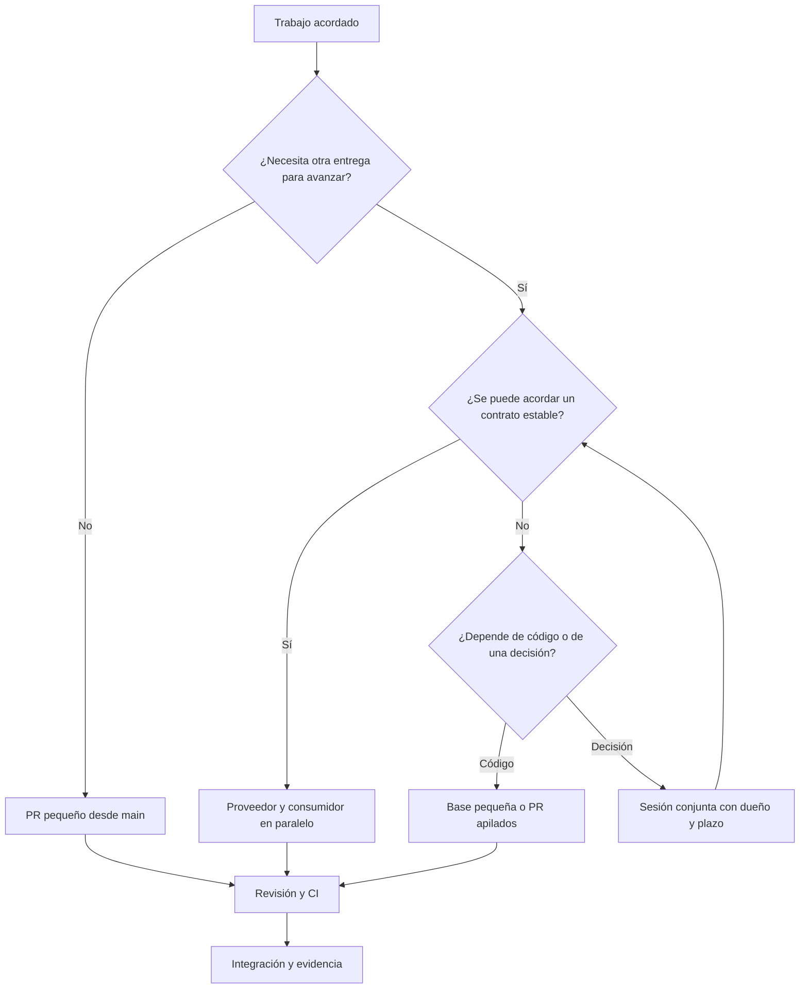

# Trabajo en equipo y desarrollo en paralelo con Active Stack

**Informe de investigación · 18 de noviembre de 2026**

**Base observada** · Active Stack v0.8.0, `origin/main` en `8562a85`.

**Alcance** · Equipos que comparten un repositorio y combinan trabajo humano con agentes. Propuesta para evaluación, con un piloto medible.

## 1. Resumen ejecutivo

El problema más costoso para un equipo grande aparece cuando una persona necesita el trabajo de otra para seguir, cuando un PR listo espera revisión o cuando cada merge obliga a volver a sincronizar y ejecutar pruebas. Los tres problemas requieren mecanismos distintos. Git resuelve el aislamiento del trabajo. Los contratos permiten avanzar mientras falta una implementación. GitHub coordina revisión e integración. La CI comprueba que los cambios funcionen juntos.

La última mejora que propondría para Active Stack es **coordinación de trabajo en equipo**. Su primera versión tendría dos piezas. Una guía operativa pequeña le permitiría a cada persona o agente ver qué puede tomar, quién trabaja en cada parte y cuál es la dependencia real. Una CI compartida automatizaría la verificación que hoy se hace localmente. Sobre esa base se puede probar una cola de integración si el equipo acumula merges y revalidaciones. El aprendizaje principal de DORA y de Google es reducir el tamaño del lote y el tiempo de feedback. Una herramienta que permite abrir más ramas puede aumentar las esperas si revisión y verificación se quedan con la misma capacidad. [DORA, lotes pequeños](https://dora.dev/capabilities/working-in-small-batches/) · [Google, cambios pequeños](https://google.github.io/eng-practices/review/developer/small-cls.html)

**Decisión propuesta.** Usar `main` como línea de integración y PR pequeños como flujo habitual. Para dependencias concretas, elegir entre un contrato temprano, PR apilados o trabajo conjunto acotado. Mantener GitHub como autoridad técnica y ClickUp como autoridad de seguimiento operativo cuando el proyecto lo usa. Active Stack ayudaría a navegar esas superficies y a retomar trabajo, aprovechando la fundación, ODD/SDD, el menú guiado de ClickUp y las visualizaciones ya entregadas.

## Especificación de la mejora pendiente

**Resultado de producto.** Después de instalar Active Stack, una persona puede decir «quiero hacer un sistema» o «me sumo a este proyecto». El agente detecta el contexto, recomienda la ruta adecuada y guía todo por conversación. El trabajo en equipo se ofrece durante la fundación. Cada módulo es elegible y la elección puede retomarse en otra sesión.

### Recorrido previsto

1. **Detectar y recomendar.** Identificar raíz, agente, estado Git y fundación existente. Si el proyecto requiere decisiones compartidas, recomendar fundación y explicar el beneficio en una frase. Para un pedido puntual, ofrecer la ruta directa. Una fundación parcial se lee y se completa por bloques elegidos.
2. **Elegir la fundación.** Mostrar qué aportan base de conocimiento, roadmap, instrucciones, colaboración, ClickUp y visualizaciones según dependencias y capacidades reales. Registrar elecciones y motivos. Aceptar «después» y dejar indicado cómo retomar. Presentar una vista previa antes de escribir instrucciones o vincular servicios.
3. **Preparar el equipo.** Preguntar cantidad de integrantes y si ya se conocen nombres, roles o disponibilidad. Con «somos seis», proponer seis lugares identificados por alias estables, con nombres pendientes si corresponde. Agrupar entregas por dependencia, equilibrar capacidad y ofrecer un reparto editable. La cantidad orienta la propuesta. Las dependencias reales pueden reducir el paralelismo. Guardar solo el reparto acordado.
4. **Incorporar a cada integrante.** Al abrir el repositorio en una sesión nueva de un agente compatible con Active Stack instalado, leer la fundación compartida. Si falta identidad local, mostrar la lista de integrantes y pedir que elija. Si la cuenta autenticada da una coincidencia verificable, sugerirla para confirmar. Si nadie coincide o solo hay alias pendientes, ofrecer modo de consulta y explicar cómo solicitar una asignación. Las identidades se guardan localmente por proyecto y se pueden cambiar.
5. **Encontrar mi trabajo.** Usar ClickUp cuando se eligió en la fundación. Guiar la conexión de esa persona, verificar workspace y lista y buscar por ID de cuenta. Si el conector falla, mostrar alcance y referencias locales con la fecha de la última observación, si existe. Si el seguimiento es local, consultar el reparto en Markdown. Distinguir qué puede empezar, qué depende de otra persona y dónde ya existe un PR.
6. **Empezar o retomar.** Detectar rama y worktree existentes y revisar su estado. Proponer una rama corta desde la base acordada y un worktree hermano si todavía faltan. Crear ambos al confirmar «empezá esta tarea». Iniciar ODD o SDD según la complejidad. Antes de compartir cambios, mostrar las pruebas, archivos, commit propuesto y destino. Ejecutar commit, push y PR con la autorización correspondiente. Mantener el proceso de revisión y merge que gobierna el repo.
7. **Cerrar y continuar.** Verificar merge y SHA, registrar evidencia, ofrecer actualizar el seguimiento elegido y compactar el contexto de entrega para retomar desde el estado verificado. La siguiente sesión abre las fuentes del proyecto y del PR.

El disparador es la primera sesión del agente en el repositorio, después de clonar. La persona necesita Active Stack instalado en ese cliente. Si no lo tiene, un apartado breve de incorporación en el README generado debe indicar dónde instalarlo y qué decir en el primer chat.

### Arneses y responsabilidades

| Componente | Cambio requerido | Verificación |
|---|---|---|
| `active-orchestrator` | Ofrecer ruta directa o fundación. Guiar selección de módulos, modo equipo, tamaño, integrantes y primera sesión. Detectar estado local y reanudar módulos pendientes. | Proyecto vacío, fundación parcial y sesión nueva en repo clonado. |
| `kb-creator` | Registrar decisiones conocidas sobre producto, equipo y dependencias cuando se elija base de conocimiento. | La persona incorporada encuentra la decisión y su fuente sin acceder a memoria privada. |
| `roadmap-generator` | Proponer fichas con ID estable, resultado, dependencia, responsable acordado y estado inicial. Mostrar frentes paralelos y documentar supuestos. | Seis lugares con nombres opcionales, dependencias reales, cambio de capacidad y revisión del reparto. |
| `active-roadmap` | Consultar «qué me toca», vincular cada ficha al seguimiento elegido y conservar vista previa por fila. Verificar cuenta, workspace y lista. | Tareas propias, sin asignar, bloqueo, acceso denegado y modo local. |
| `active-delivery` | Preparar o recuperar rama y worktree, continuar ODD/SDD, preparar pruebas, handoff y PR. Informar con evidencia cuándo se integró. | Reintento idempotente, worktree con cambios, dependencia de código y PR borrador. |
| `agent-instruction` y adaptadores | Instalar el punto de entrada de sesión nueva mediante los mecanismos soportados. Mantener una rutina breve y diferir detalles a las skills. | Sesión nueva en máquina distinta. Inventario real de plataformas, selector nativo o lista numerada. |
| GitHub y CI | Proveer una plantilla de PR, un check estable y reglas acordadas para revisión y merge. Mantener release separada. | Un fallo impide integrar bajo las reglas del piloto, y el flujo válido llega a main. |

### Estado, permisos y concurrencia

- **Compartido.** Versionar en el repo las decisiones de fundación, los módulos elegidos, alias de equipo, referencias de tareas y convenciones Git. Si el repositorio es público, el equipo aprueba qué datos de personas pueden versionarse. Reutilizar los registros de fundación y roadmap donde encajen.
- **Local.** Guardar la identidad elegida y preferencias de sesión fuera del historial. La cuenta OAuth queda bajo el control del cliente. Usar IDs verificados para asociar al integrante y mostrar discrepancias antes de aplicar cambios.
- **Lectura primero.** Repetir incorporación, consulta o vista previa debe recuperar y mostrar el estado existente. Si una rama está en uso o un checkout tiene cambios, presentar la ruta y pedir una decisión concreta. No crear una rama duplicada ni tocar cambios ajenos.
- **Escrituras acordadas.** Una propuesta de reparto se revisa antes de guardar o asignar fichas. Publicar en ClickUp conserva la confirmación por fila. Un comentario de revisión, publicación o merge debe sujetarse a las autorizaciones y reglas del equipo. Si se corta una operación, releer los sistemas antes de reintentar.
- **Compatibilidad.** Primera implementación y piloto en Codex como decisión propuesta. Agregar clientes que el equipo requiera y verificar cada superficie contra sus herramientas reales. En todos los clientes compatibles, la navegación conversacional y las explicaciones breves comparten el mismo contrato.

### Fichas de implementación y aceptación

1. **Fundación e incorporación.** Definir el contrato compartido y local. Probar proyecto nuevo y existente. Un integrante que clona en otra máquina elige identidad una vez y recupera las decisiones compartidas.
2. **Roadmap y seguimiento.** Descomponer un caso para seis personas. Verificar propuesta de reparto, consulta local y lectura de asignaciones propias por cuenta ClickUp. Simular una cuenta sin acceso y continuar en modo de lectura local.
3. **Rama, worktree y entrega.** Preparar dos trabajos independientes y un tercero dependiente. Retomar una rama existente sin duplicarla. Abrir PR con evidencia a partir de una autorización concreta. Probar el camino de un cambio liviano y el de un cambio con OpenSpec.
4. **CI e integración.** Probar un fallo y una aprobación válida con reglas de GitHub. Integrar los dos PR, comprobar el estado del tercero y producir un handoff que otra persona pueda retomar. Evaluar cola solo si la evidencia muestra revalidaciones costosas.
5. **Piloto completo.** Una persona funda el proyecto para seis. Otra clona en una máquina limpia, abre el agente, se identifica, encuentra su tarea, crea o recupera espacio, pasa pruebas y llega a un PR. Repetir con seguimiento local y con ClickUp. Registrar evidencias, errores detectados y pasos que todavía requieren intervención.

### Preguntas para la implementación

- ¿Qué agentes usa realmente el equipo y cuáles deben aprobar el piloto inicial?
- ¿Qué repositorios son públicos y qué datos del equipo se pueden compartir en Git?
- ¿Quién confirma la propuesta de reparto, quién revisa cambios sensibles y quién puede fusionar?
- ¿Cómo se identifica a cada persona cuando una cuenta externamente verificada todavía no está vinculada?
- ¿Qué reglas y plan de GitHub tiene el repo piloto y qué pruebas entran en el check obligatorio?
- ¿Qué pasos autoriza el equipo con una instrucción directa y cuáles exigen mostrar un plan antes de ejecutar?

Hasta que se acuerden, el diseño conserva estos valores iniciales: Codex como primer cliente, alias aceptados, propuesta de reparto revisable, selección de identidad confirmada, publicación explícita y CI antes de habilitar cola.

## 2. Método y diagnóstico de Active Stack

Contrasté el cierre del roadmap y el historial reciente con documentación primaria de proveedores, investigación empírica y prácticas publicadas por sus autores. Revisé `CHANGES.md`, `.github/workflows/release.yml`, las skills `active-roadmap` y `active-delivery`, el piloto Mermaid y los metadatos de merges recientes. La observación del repositorio corresponde a la revisión citada. Las recomendaciones organizacionales y los umbrales del piloto son hipótesis locales.

| Observación comprobable | Implicancia |
|---|---|
| F1, F3, F4 y F5 quedaron integradas por los PR #18 a #22. | Ya hay puntos de entrada para acordar alcance, planificar, seguir tareas y explicar dependencias. |
| Los cambios de F5 y del menú ClickUp se trabajaron en worktrees distintos, pero ambos tocaron `active-roadmap/SKILL.md` y `active-delivery/SKILL.md`. | El aislamiento permitió avanzar a la vez. Al unirlos hubo que combinar los dos cambios sobre los mismos archivos. |
| La suite Go del checkout combinado encontró un inventario generado desactualizado. Tras regenerarlo, pasaron Go, Python y OpenSpec. | Una CI de PR puede detectar desajustes de artefactos compartidos antes del merge. |
| En la revisión observada, el único workflow versionado es `release.yml`. El PR #22 no mostraba checks de GitHub. | La verificación local funcionó en ese cierre. Para varios autores hace falta una señal común, reproducible y visible en el PR. |
| La consulta a GitHub devolvió `protected: false` para `main` y una lista vacía en el endpoint de rulesets consultado. | La protección de `main` debe comprobarse con la administración antes de proponer cambios. La observación no prueba que todas las políticas de organización sean visibles. |
| Los PR #18–#22 se abrieron entre 9 segundos y unos 23 minutos antes de su merge. | Eso mide el tramo público del PR. Hubo trabajo previo fuera de esa ventana. La muestra no sirve para estimar cuánto esperó el equipo ni cuánto tardó en entregar. |

Evidencia del caso local. [Roadmap en la revisión de cierre](https://github.com/Group-Active-IA/active-stack/blob/8562a85/CHANGES.md) · [Workflow de release](https://github.com/Group-Active-IA/active-stack/blob/8562a85/.github/workflows/release.yml) · [PR #22](https://github.com/Group-Active-IA/active-stack/pull/22) · [Release v0.8.0](https://github.com/Group-Active-IA/active-stack/releases/tag/v0.8.0) · [Evidencia F5](https://github.com/Group-Active-IA/active-stack/blob/8562a85/openspec/changes/f5-transversal-diagrams/pilot-evidence.md)

## 3. En qué situaciones se puede avanzar a la vez

| Situación | Flujo recomendado | Qué puede avanzar en paralelo | Punto de coordinación |
|---|---|---|---|
| Dos cambios independientes | Un PR pequeño por cambio desde `main` | Implementación, pruebas y revisión de ambos | CI comprueba cada cambio y la integración |
| Un consumidor espera una API o interfaz | Acordar un contrato con ejemplo, errores y compatibilidad | Proveedor con pruebas de implementación. Consumidor con un doble basado en el contrato | Prueba conjunta contra el proveedor real |
| El cambio B necesita código de A | PR apilados, o A como PR base chico que se integra temprano | B puede empezar y recibir revisión con su diff propio | A debe cumplir sus requisitos antes de integrar B |
| Dos personas deben modificar la misma decisión de diseño o la misma función | Breve sesión conjunta y un responsable de escritura en esa zona | Investigación, casos de prueba y tareas vecinas | Una decisión compartida y un orden de integración |
| Migración incompatible de interfaz o formato | Expandir, migrar consumidores y retirar soporte anterior en cambios separados | Implementaciones y consumidores compatibles durante la transición | La retirada espera evidencia de adopción y plan de recuperación |
| El merge se demora por revalidar repetidamente contra `main` | Cola de GitHub después de estabilizar CI | Los autores avanzan a otro trabajo mientras la cola prueba la combinación | La cola puede expulsar el PR si falla la combinación |
| El código puede integrarse antes de habilitar la función | Cambio compatible detrás de una configuración o flag con dueño | Validación de ambos estados y entrega de componentes | Habilitación, monitoreo y retirada de la flag |

**Contrato temprano en concreto.** Para otro cambio de ClickUp, una persona podría definir el resultado de un diagnóstico con ejemplos de conexión lista, acceso denegado y herramienta ausente. Una segunda podría preparar el flujo de elección sobre esos ejemplos. Una tercera podría verificar la publicación sin tocar el módulo de diagnóstico. El contrato incluye campos, significado de los errores y qué ocurre cuando falta un dato. La prueba final usa el MCP real. Para interfaces Go internas, fixtures y pruebas de tabla suelen alcanzar. Para consumidores desplegados por separado, Pact documenta cómo publicar resultados de verificación y consultar compatibilidad antes de desplegar. Adoptarlo tendría sentido cuando exista esa separación real. [Pact, resultados de verificación](https://docs.pact.io/pact_broker/advanced_topics/provider_verification_results)

**Migraciones.** El patrón expandir–migrar–contraer permite que el código nuevo y el anterior convivan. Ejemplo hipotético en Active Stack: un nuevo campo opcional de configuración se lee con un valor predeterminado, los productores migran, y solo cuando los consumidores fueron verificados se piensa en volverlo obligatorio. La abstracción permite modificar internamente un componente durante varios PR conservando su interfaz pública. Los cambios sobre configuración del usuario siguen sujetos a la gobernanza y a las reglas de respaldo existentes. [Martin Fowler, Parallel Change](https://martinfowler.com/bliki/ParallelChange.html) · [Branch by Abstraction](https://martinfowler.com/bliki/BranchByAbstraction.html)

**Dependencia de producto, de código y de integración.** Que dos tareas compartan una entrega comercial no implica que deban compartir rama. Que B compile sobre A sí exige una base común o un contrato compatible. Que dos PR verdes fallen al combinarse es un problema de integración. La ficha debe expresar cuál es la dependencia y la condición que la da por resuelta. GitHub Issues ofrece sub-issues para descomponer alcance y dependencias para declarar bloqueos. Si ClickUp ya gobierna las tareas del equipo, sus IDs pueden enlazarse en PR y fichas sin levantar manualmente un segundo backlog completo. [GitHub, sub-issues](https://docs.github.com/en/issues/tracking-your-work-with-issues/using-issues/adding-sub-issues) · [GitHub, dependencias de issues](https://docs.github.com/en/issues/tracking-your-work-with-issues/using-issues/creating-issue-dependencies)

## 4. Flujo diario para humanos y agentes

### Alternativas de integración

| Enfoque | Cuándo aporta | Costo y límite para Active Stack |
|---|---|---|
| Ramas cortas desde `main` | Cambios pequeños y compatibles que pueden verificarse e integrarse por separado | Depende de revisión disponible y CI rápida. Es el punto de partida más simple para este repositorio. |
| Ramas de release | Varias versiones mantenidas en paralelo o estabilización contractual que requiera esa separación | Los arreglos pueden necesitar backports y pruebas repetidas. El flujo de tags actual ya cubre publicaciones normales. |
| Rama de integración larga por iniciativa | Experimento desechable o entorno temporal donde se quiere validar una combinación antes de comprometer el diseño | La divergencia aumenta con la duración. Definir cuándo se descarta y cómo llegarán cambios pequeños a `main`. |
| PR apilados | Dependencia de código inevitable dentro del mismo repo | Conserva revisiones por capa. Actualizar una base repercute sobre los niveles superiores. |
| Trabajo conjunto breve | Un contrato es incierto o varias personas chocan en los mismos componentes | Consume capacidad simultánea durante la decisión. Puede reducir retrabajo si termina con responsables y límites claros. |

Una rama larga puede dar sensación de independencia durante varios días y concentrar el costo al final. El flujo de ramas cortas tiene el efecto inverso: hace visibles los choques antes y exige capacidad de resolución cotidiana. El tamaño y la frecuencia sugeridos por DORA sirven como orientación, sin imponer un máximo universal de ramas en un equipo de varias personas. [DORA, trunk-based development](https://dora.dev/capabilities/trunk-based-development/) · [GitHub Flow](https://docs.github.com/en/get-started/using-github/github-flow)

### Recorrido

1. **Tomar un trabajo disponible.** Consultar responsable, alcance, estado y dependencia. Registrar quién lo toma en el sistema operativo del proyecto. Si el trabajo se dice bloqueado, dejar un enlace al bloqueo, la condición que lo resuelve y qué parte se puede avanzar hoy.
2. **Acordar una entrega revisable.** En ODD, una ficha con resultado, límites y verificación. En SDD, nombrar el change explícito y acordar qué requisitos modifica. La decisión cabe en el PR o en el artefacto de alcance, con enlaces desde la tarea.
3. **Separar el checkout.** Una rama por entrega y un worktree por ejecución local son útiles cuando se usan dos agentes o se atiende una revisión en paralelo. En clones distintos cada persona ya tiene su propio árbol. Los worktrees comparten objetos y referencias de Git en la misma máquina. Rutas, puertos, procesos, temporales y bases de datos de prueba requieren aislamiento adicional. Evitar usar dos agentes para editar la misma rama o carpeta al mismo tiempo. [Git, worktree](https://git-scm.com/docs/git-worktree)
4. **Abrir un borrador temprano cuando aporte.** Comunicar qué toca el cambio, cuál es su base, qué revisiones necesita y qué falta. Marcarlo listo cuando haya un diff revisable y evidencia. Toda actualización importante de alcance debe quedar en el PR o artefacto enlazado. [GitHub Flow](https://docs.github.com/en/get-started/using-github/github-flow)
5. **Revisar por dominio.** Tener un titular y un suplente por zona importante. Hacer visibles los comentarios que bloquean, buscar revisiones cortas y reservar evaluación amplia para decisiones transversales. Para siete integrantes, se podrían pilotear dos o tres frentes pequeños con responsabilidades de punta a punta, según el trabajo disponible. Conviene evitar partir sistemáticamente por capas si cada entrega termina pasando por los mismos siete. [Google, velocidad de revisión](https://google.github.io/eng-practices/review/reviewer/speed.html) · [Team Topologies, modos de interacción](https://teamtopologies.com/key-concepts-content/team-interaction-modeling-with-team-topologies)
6. **Integrar y dar continuidad.** Registrar PR, SHA, checks, resultado y tarea enlazada. Tras merge, recuperar `main` para iniciar lo siguiente, o actualizar la base de un dependiente según el método acordado. Una falla se clasifica como nueva, preexistente o de infraestructura con evidencia. El siguiente responsable recibe una instrucción breve y reproducible.

Un handoff mínimo puede tener seis campos: **resultado**, **PR y SHA**, **cómo verificar**, **qué falta**, **quién sigue** y **qué evita que siga**. Adjuntar únicamente la evidencia que cambia una decisión. Si hay varias ramas dependientes, Mermaid puede mostrar su orden en un documento o en una tarea, tal como quedó disponible en F5.

**Cuándo coordinar en vivo.** Usar comunicación asincrónica para avances, solicitudes de revisión y cambios de estado. Si hay una decisión difícil de resolver por escrito, convocar a las personas que pueden tomarla, acotar la reunión a esa decisión y devolver al artefacto compartido el resultado y quién sigue. El manual de GitLab sirve como caso operativo de una organización distribuida. DORA aporta criterios para evaluar si los equipos pueden probar y entregar cambios con independencia. En Active Stack esto se puede ensayar delimitando responsabilidades entre catálogo, instaladores y experiencia de agente, sin imponer un equipo permanente por paquete. [GitLab, comunicación síncrona y asíncrona](https://handbook.gitlab.com/handbook/communication/sync-vs-async-culture/) · [DORA, equipos débilmente acoplados](https://dora.dev/capabilities/loosely-coupled-teams/)

**Cuándo tomar otra tarea.** Como regla experimental, revisar primero los PR que ya estén listos y los bloqueos donde se puede ayudar. Tomar un nuevo trabajo cuando haya capacidad de terminarlo o cuando la dependencia anterior deje una ventana clara. El equipo puede acordar un límite de trabajo en curso por frente y ajustarlo según lo que vea. El límite cuenta entregas abiertas, incluidas las que esperan review. Si siempre se llega al límite en revisión, dividir mejor el trabajo o ampliar la cobertura de revisores antes de abrir más ramas. [The Kanban Guide](https://kanbanguides.org/the-kanban-guide/)

### OpenSpec en paralelo

Los changes independientes viven en carpetas separadas, con deltas que luego se integran en las specs. Eso reduce conflictos de archivos mientras se diseña. Dos cambios que alteran el mismo requisito semántico necesitan acordar el comportamiento conjunto aunque Git pueda fusionar el Markdown. Si un delta necesario ya está listo y otros requieren la nueva base, evaluar `sync` explícito y comprobar el resultado antes de seguir sobre él. Los nombres de comandos y disponibilidad se validan contra la versión instalada. `openspec status` describe artefactos del change, GitHub muestra integración, y el sistema de tareas muestra quién trabaja y qué está bloqueado. [OpenSpec, conceptos](https://github.com/Fission-AI/OpenSpec/blob/main/docs/concepts.md) · [Flujos paralelos](https://github.com/Fission-AI/OpenSpec/blob/main/docs/workflows.md) · [Comandos](https://github.com/Fission-AI/OpenSpec/blob/main/docs/commands.md)

### PR apilados

Un PR A introduce una base útil, B parte de A y C parte de B. GitHub muestra el diff de cada nivel respecto del nivel inferior. Solo usar la cadena donde el código la exige. Intentar que la base sea estable, que cada PR se pueda revisar por su propósito y que el stack tenga pocos niveles. Si A cambia, revalidar la descendencia y avisar a sus responsables. Un rebase de una rama compartida requiere coordinación para evitar pisar commits de otra persona.

La documentación vista describe soporte nativo de GitHub, extensión `gh stack`, repositorio común, historial lineal entre niveles y evaluación de reglas contra la base del stack. También describe exclusión de stacks entre forks y ausencia de soporte en GitHub Desktop. La disponibilidad real en la organización y los clientes que usa el equipo requiere una prueba de alta antes de adoptarlo. Mientras tanto, PR independientes o una base pequeña contra `main` cubren la mayoría de los casos. Usar ramas base manuales sigue siendo posible, pero alguien debe mantener orden, bases, revisiones y retarget tras merge. [GitHub, introducción a stacks](https://docs.github.com/en/pull-requests/get-started/about-stacked-prs) · [Referencia de stacks](https://docs.github.com/en/pull-requests/reference/stacked-pull-requests) · [Despliegue organizacional](https://docs.github.com/en/pull-requests/tutorials/roll-out-stacked-prs)

## 5. Diseño recomendado en GitHub

| Etapa | Cambio candidato | Criterio para activarlo |
|---|---|---|
| 1. Verificación compartida | Workflow en PR con resultado identificable, Go, pruebas Python de roadmap y OpenSpec cuando corresponda | El nombre del check es estable y el equipo puede reproducirlo localmente |
| 2. Integración protegida | Ruleset sobre `main`, PR obligatorio, check requerido, revisión acorde a riesgo | Una simulación de fallo impide merge y un PR válido puede atravesar el flujo |
| 3. Revisión por zonas | CODEOWNERS para paquetes sensibles, con equipo y suplencia operativa | Revisores cuentan con acceso y hay cobertura real |
| 4. Cola de integración | Check en `pull_request` y `merge_group`, tiempos y concurrencia calibrados | Se observan revalidaciones repetidas o incompatibilidades entre PR verdes |
| 5. Distribución | Release por tag conservada como proceso aparte | El artefacto, SHA y verificación de instalación quedan trazables al merge |

**CI propuesta.** Mantener un feedback rápido de sintaxis, pruebas focalizadas y validación de specs, más un check estable para el conjunto requerido. Usar Go y Python según sus archivos o dependencias reales. Incluir Windows por instalación y PowerShell, y Linux para verificar portabilidad. El repositorio ya tiene tests cuya duración puede ser sensible al disco y la carga. Medir en runner y distinguir pruebas lentas de las intermitentes antes de separar checks que bloquean merge. Dejar el instalador completo para el flujo de release o para cambios que afectan empaquetado, según la evidencia que se necesite.

**Check estable y concurrencia.** Una opción para evitar estados pendientes es que el workflow requerido se dispare siempre y que el check agregador determine qué jobs eran aplicables. Validar un PR que solo toca docs, uno Go y uno que toca dos dominios. Cancelar ejecuciones superadas dentro del mismo PR según el comportamiento del grupo de concurrencia. Mantener grupos independientes por ejecución relevante de la cola y probarlos antes de exigir el check. Separar credenciales y permisos de release del contexto que ejecuta código de PR. Para contribuciones desde forks, usar el modelo de permisos de `pull_request`; reservar eventos privilegiados para operaciones que no ejecuten código del PR. [GitHub, sintaxis de workflows](https://docs.github.com/en/actions/reference/workflows-and-actions/workflow-syntax) · [Concurrencia](https://docs.github.com/en/actions/how-tos/write-workflows/choose-when-workflows-run/control-workflow-concurrency) · [Uso seguro de pull_request_target](https://docs.github.com/en/actions/reference/security/securely-using-pull_request_target)

**Rulesets y CODEOWNERS.** Empezar con la regla más pequeña que asegure el flujo. Probar la revisión por cambios de alto impacto y la disponibilidad de los suplentes. GitHub usa reglas asociadas a la rama base, y CODEOWNERS puede enrutar solicitudes automáticamente. Si hay varios propietarios en una misma regla, comprobar la semántica de aprobación antes de asumir que constituye doble control. Configurar excepciones administrativas solo con el equipo y dejar registro de cuándo se usan. [GitHub, reglas disponibles](https://docs.github.com/en/repositories/configuring-branches-and-merges-in-your-repository/managing-rulesets/available-rules-for-rulesets) · [CODEOWNERS](https://docs.github.com/en/repositories/managing-your-repositorys-settings-and-features/customizing-your-repository/about-code-owners)

**Cola.** GitHub documenta su disponibilidad para repositorios públicos de organizaciones y privados en Enterprise Cloud. El repositorio observado es público y organizacional. El uso requiere administración y validación de configuración. Al encolar, GitHub construye una combinación con la punta de la rama y los PR anteriores en cola, y vuelve a ejecutar checks. Conviene empezar conservador, medir tiempo en cola y reintentos, y probar un conflicto deliberado en un entorno de ensayo. Si falla, separar error de producto, incompatibilidad combinada y problema del runner. Una cola agrega trabajo de CI, así que su valor depende de cuánto tiempo ahorra a los autores y del costo de esas ejecuciones. [GitHub, configuración de merge queue](https://docs.github.com/en/repositories/configuring-branches-and-merges-in-your-repository/configuring-pull-request-merges/managing-a-merge-queue) · [Caso operativo de GitHub](https://github.blog/engineering/how-github-uses-merge-queue-to-ship-hundreds-of-changes-every-day/)

## 6. Qué incorporaría a Active Stack

### Primera versión propuesta

- **Un punto de entrada de equipo.** Ante «¿qué puedo hacer para avanzar?» o «retomá esta tarea», ofrecer **Ver trabajo disponible**, **Ver quién trabaja en esto**, **Preparar mi espacio**, **Ver qué me bloquea** y **Preparar el traspaso**, según el cliente y las herramientas conectadas. Usar la misma ayuda por acción de F4, con una frase breve y detalle.
- **Un perfil por proyecto.** En la fundación, acordar el repositorio, rama de integración, sistema de tareas y reglas de revisión. En un repo ya configurado, detectar y mostrar la convención existente. Las asignaciones, creación de ramas y escrituras externas se ejecutan dentro del alcance explícito.
- **Una guía invocable desde entrega.** Extender el punto de entrada de ODD/SDD con lógica de dependencias y relevo. Considerar una skill separada si tiene recorrido y referencias propios. Mantener instrucciones cortas y cargar los ejemplos o detalles por demanda. `allowed-tools` es experimental y su compatibilidad depende del cliente. La skill debe basarse en las herramientas y permisos efectivos de la sesión. [Agent Skills, especificación](https://agentskills.io/specification)
- **Un informe de situación verificable.** Mostrar ID de tarea, PR, rama base, SHA observado, estado de checks, dependencia, responsable y siguiente paso. Vincular cada afirmación a su origen. Frente a diferencias entre ClickUp y GitHub, mostrar ambas señales y pedir decisión solo si hay que escribir o redefinir el alcance.
- **Una detección simple de solapamiento.** Comparar rutas y requisitos declarados de los cambios vigentes. Un solapamiento de archivos es una señal a revisar, no una prueba de conflicto. Un contrato de API, formato persistido o spec compartida puede entrar en conflicto aunque cambien archivos distintos.

### Reparto de autoridad y compatibilidad

| Dato | Autoridad | Cómo retomarlo |
|---|---|---|
| Alcance, contratos y decisiones versionadas | Repo y artefactos OpenSpec cuando se eligió SDD | Leer el change y la base exacta |
| Estado operativo, asignación y bloqueos humanos | ClickUp si fue elegido, o el sistema de tareas del proyecto | Consultar tarea y fecha observada |
| Revisión, checks, merge, release | GitHub | Leer PR, SHA, workflow y tag |
| Continuidad privada entre sesiones | Engram o memoria del agente, según configuración | Recuperar contexto y revalidarlo contra fuentes compartidas |
| Acciones disponibles y UI | Herramientas y permisos de la sesión real | Selector nativo cuando exista, lista numerada como alternativa |

El piloto debería empezar en Codex, donde ya se verificó la interacción de roadmap con ClickUp, e incluir un traspaso a otro agente con fuentes compartidas. Si se distribuye a Claude, OpenCode y Antigravity, validar cada superficie que se anuncie. El caso F5 mostró que autenticar un conector y tener acceso al workspace correcto son comprobaciones distintas. Los permisos GitHub, ClickUp y UI de selección también se comprueban por separado.

La integración inicial puede mantenerse a demanda. Un webhook tendría sentido cuando exista una necesidad demostrada de reacción automática. En ese caso, diseñar firma, reintentos, idempotencia, origen de eventos, cambios fuera de orden y resolución de discrepancias antes de considerar sincronización bidireccional. Para el piloto, el enlace de tarea, una lectura fresca y la confirmación ya resuelven el núcleo del problema. [ClickUp, webhooks](https://developer.clickup.com/docs/webhooks) · [Firma de webhooks](https://developer.clickup.com/docs/webhooksignature)

### De la ficha al PR

El roadmap incorporaría un ID estable, un resultado verificable, dependencias y un enlace al PR. El alcance queda versionado en el repo. Cuando se usa ClickUp, el responsable, el avance y los bloqueos se consultan allí. GitHub aporta rama, estado de revisión y checks. Así el equipo puede consultar tres señales distintas desde el mismo punto de entrada.

| Paso | Qué automatizaría Active Stack | Qué decide el equipo |
|---|---|---|
| Elegir trabajo | Mostrar las fichas disponibles, sus dependencias y quién las lleva. Detectar si ya hay una rama o un PR para la ficha. | Qué ficha toma la persona y si la dependencia permite empezar. |
| Preparar el espacio | Con una ficha elegida, proponer una rama desde `origin/main` y crear un Git worktree al lado del checkout actual. Si ya existen, mostrar sus rutas y reutilizarlos cuando correspondan. | Qué base usar si hay una dependencia de código y quién trabaja en esa rama. |
| Preparar revisión | Ejecutar las verificaciones acordadas, preparar el texto del PR y enlazar ficha, rama y evidencia. Con autorización para publicar, subir la rama y abrir el PR en borrador mediante GitHub CLI. | Qué cambios van al commit y cuándo el PR está listo para revisión. |
| Integrar | GitHub Actions ejecuta los checks que exige el repositorio. Si se habilita una cola, GitHub prueba también la combinación antes del merge. | Quién revisa, qué aprobación exige el riesgo y cuándo integrar. |
| Retomar y cerrar | Mostrar el PR y su estado al retomar. Tras el merge, consultar y presentar el resultado del cierre. Proponer el cambio operativo en ClickUp cuando se haya acordado esa acción. | Cuándo actualizar el seguimiento externo y si queda un paso de entrega. |

Ejemplo. Si Ana toma «Agregar diagnóstico de conexión» y Bruno toma «Mejorar el menú», Active Stack puede preparar un worktree por ficha. Si acuerdan primero qué devuelve el diagnóstico, Bruno puede probar contra un fixture mientras Ana lo implementa. Cada uno publica su propio PR y la CI verifica el resultado. Si Bruno necesita necesariamente código de Ana, se usa una base pequeña o un PR apilado.

Para el piloto usaría **Markdown y Mermaid** para alcance y dependencias, **Git y Git worktree** para separar ramas localmente, **GitHub CLI, PR y Actions** para revisión y checks, y **ClickUp MCP** si el proyecto usa ClickUp. La guía se entrega como una skill de Active Stack, con ODD para trabajos acotados y SDD/OpenSpec para los que necesitan acordar cambios de contrato. El método de integración es trunk-based con PR pequeños. La primera automatización conviene probarla en Codex y medir si reduce espera antes de extenderla a más clientes.

## 7. Piloto y medición

**Duración propuesta.** Una ventana corta de línea base seguida de dos semanas de piloto, o hasta reunir suficientes entregas comparables. Para muestras pequeñas usar casos individuales y medianas. Un percentil alto con pocos datos se informa como exploratorio.

### Escenarios

| Escenario | Ensayo | Evidencia esperada |
|---|---|---|
| Dos cambios independientes | Dos responsables preparan PR desde `main` y reciben revisión en paralelo | Dos diffs separados, checks reproducibles e integración de ambos |
| Dependencia con contrato | El consumidor arranca con un fixture y el proveedor implementa por separado | Ambos avanzan antes del primer merge y pasan prueba conjunta |
| Dependencia real | Crear una base pequeña y un PR dependiente | Diffs separados y orden de integración visible. Un cambio de base obliga a revalidar |
| Choque al integrar | Simular dos cambios verdes por separado que no pasan juntos | Detección antes de integrar la combinación y responsable claro |
| Traspaso humano/agente | Otra persona abre el PR y retoma a partir del handoff | Reconoce el estado, reproduce la última prueba y encuentra el siguiente paso sin pedir todo el contexto |
| Permisos y modo local | Repetir el menú sin conector, sin acceso al destino y con tarea accesible | Motivo concreto, opción local y acciones coherentes con la sesión |
| Confirmación de escritura | Mostrar una vista previa con dos fichas y confirmar una | Se escribe solo la ficha elegida y se guarda el enlace correcto |

### Qué medir

| Métrica | Definición para el piloto | Interpretación |
|---|---|---|
| Espera por dependencia | Tiempo entre declarar un bloqueo y registrar la condición que lo resuelve | Mayor espera sugiere falta de autonomía o contratos tardíos |
| Primera revisión humana | Tiempo desde «listo para revisión» a la primera revisión sustantiva | Mide capacidad de revisión, con horarios de trabajo acordados |
| Tiempo de integración | Desde primera aprobación y checks verdes hasta merge, registrando revalidaciones | Separa problemas de revisión de los de integración |
| Tiempo hasta entrega | Desde commit hasta disponibilidad del artefacto que se acordó medir | En un instalador, la release publicada puede ser el proxy de entrega. Registrar el alcance del proxy |
| Calidad y capacidad | PR revertidos, correcciones por integración, fallos intermitentes, tiempo de CI | Aumentar cantidad de PR con más correcciones puede empeorar el flujo |
| Experiencia del equipo | Preguntar si fue fácil saber qué tomar, quién tenía la decisión y cómo retomar | Muestra fricción que no aparece en actividad de GitHub |

La medición de PR complementa DORA. La guía actual distingue lead time de cambio, frecuencia de despliegue, tiempo de recuperación de despliegues fallidos, proporción de fallos y proporción de retrabajo de despliegue. Para Active Stack, usar definiciones explícitas y comparar el mismo producto consigo mismo. SPACE aporta dimensiones para contrastar actividad y rendimiento con satisfacción, colaboración y fluidez. Por ejemplo, acompañar el tiempo de revisión con una pregunta sobre si fue fácil conseguir ayuda y con el recuento de interrupciones por revalidación. Evitar rankings por persona, por commits o por líneas. [DORA, métricas de entrega](https://dora.dev/guides/dora-metrics/) · [DORA, visibilidad del flujo](https://dora.dev/capabilities/work-visibility-in-value-stream/) · [Forsgren y otros, SPACE](https://www.microsoft.com/en-us/research/publication/the-space-of-developer-productivity-theres-more-to-it-than-you-think/)

**Criterio de aceptación propuesto.** Completar los escenarios de piloto, reducir al menos uno de los tiempos de espera observados y mantener la estabilidad de integración. Como hipótesis a discutir, buscar una reducción del 20 % en la mediana de espera dominante si el volumen permite comparar. Con poca muestra, contar casos en que un contrato permitió seguir, revisiones que se resolvieron dentro de la jornada y fusiones que dejaron de requerir un rebase manual. Revisar casos fallidos y estimar el costo de sostener la práctica antes de hacerla predeterminada para todos.

## 8. Orden de implementación y decisiones abiertas

| Orden sugerido | Entrega | Decisión antes de extender |
|---|---|---|
| 1 | Acordar el formato de ficha, bloqueo y handoff con un piloto manual | Qué sistema gobierna tareas y qué unidad de entrega usa el equipo |
| 2 | CI compartida y reglas de integración mínimas | Qué checks son rápidos, reproducibles y obligatorios |
| 3 | Punto de entrada en Active Stack y guía reutilizable | Qué acciones necesita el equipo y qué adaptadores las ofrecen de verdad |
| 4 | Prueba de contratos, PR apilados y cola donde haya casos reales | Qué fricción elimina cada mecanismo y cuánto mantenimiento agrega |
| 5 | Evaluación del piloto | Qué entra en el stack base, qué queda optativo y qué se descarta |

Quedan por acordar el tamaño real del equipo, el reparto de dominios, los repositorios que comparten entrega, la disponibilidad de revisores, los horarios de solapamiento y el plan de GitHub de los proyectos donde se usará. Estas decisiones afectan la configuración del piloto. El modelo inicial funciona con un repo, dos frentes reales y una persona que pueda retomar el trabajo de otra con evidencia.

## 9. Qué respalda la evidencia y qué queda por comprobar

- **Dirección respaldada por investigación.** DORA vincula integración frecuente, CI y lotes pequeños con resultados de entrega. El estudio de revisión de Google combina entrevistas, encuesta y registros de cambios de esa organización. Sirve como evidencia de un flujo practicable, con límites de generalización. [DORA, trunk-based development](https://dora.dev/capabilities/trunk-based-development/) · [DORA, CI](https://dora.dev/capabilities/continuous-integration/) · [Modern Code Review at Google](https://storage.googleapis.com/gweb-research2023-media/pubtools/pdf/80735342aebcbfc8af4878373f842c25323cb985.pdf)
- **Capacidades verificadas en documentación.** Git, GitHub, OpenSpec, ClickUp, Pact y Agent Skills documentan las funciones citadas. Las capacidades que dependen de plan, permisos, cliente y versión requieren prueba en la organización que las va a usar.
- **Inferencia para Active Stack.** Una CI compartida aborda la brecha más clara observada. El valor adicional del menú de coordinación y de la cola dependerá de la espera medida y del uso real. No se midió aún un aumento de productividad en este equipo.
- **Propuesta de cierre.** Priorizar una mejora que haga visible el siguiente trabajo disponible y deje una verificación común. Extender con automatización de coordinación únicamente allí donde el piloto muestre una espera efectiva que desaparece.
