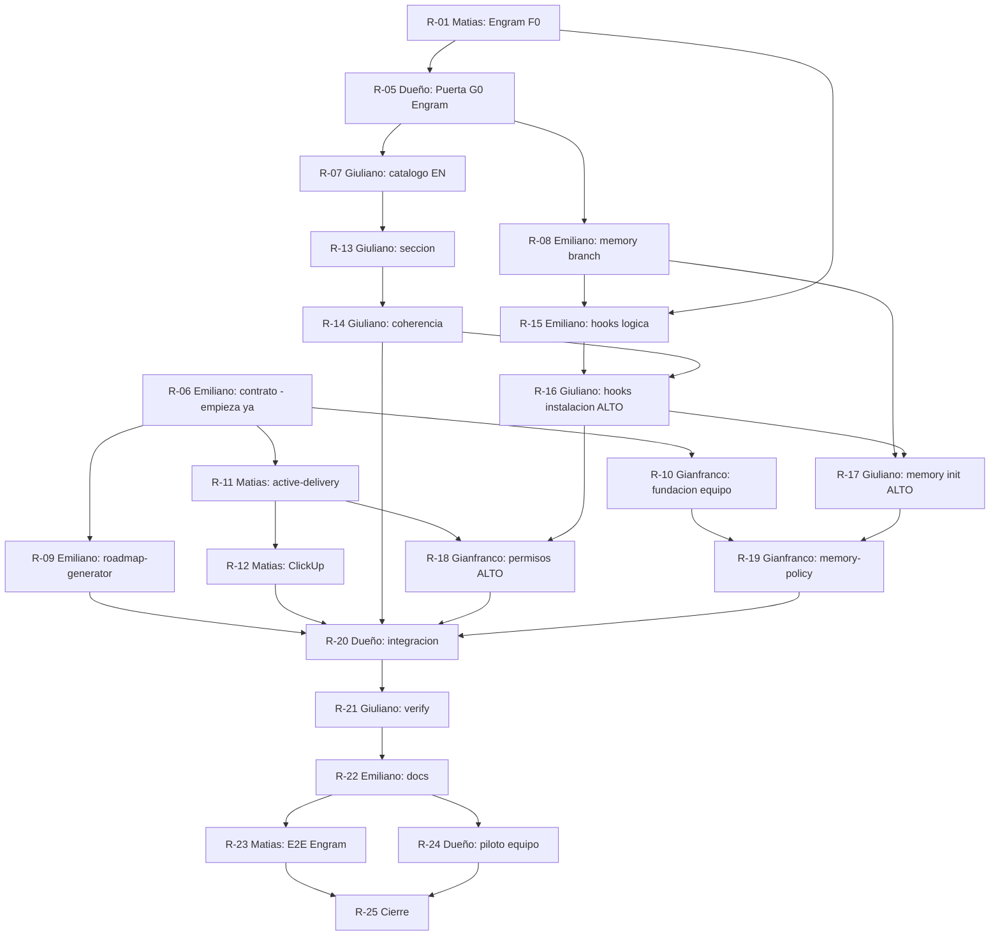

# Roadmap integrado: modo equipo + Engram Cloud

**Fecha:** 2026-11-19 · **Revisión 1** · **Dueño y revisor de todo PR:** Juan Cruz Robledo
**Qué es:** el orden secuencial en que cuatro personas implementan los dos planes: [plan de trabajo en equipo](plan-trabajo-en-equipo.md) (**[EQ]**) y [plan de Engram Cloud](plan-engram-cloud-equipo.md) (**[EN]**). Los dos planes dicen *qué* construir y con qué pruebas; este documento dice *quién*, *en qué orden* y *tras qué*.
**Cómo se usa:** quien implementa abre el repo y dice «soy <nombre>, quiero implementar lo mío». El agente sigue la [guía de implementación en equipo](guia-implementacion-equipo.md). El estado vive en [estado-equipo.md](estado-equipo.md).

**Reglas de lectura**

- Los IDs de tareas y decisiones de los planes **chocan** entre sí (ambos tienen `T-F1-1`, `D1`, `V1`…). Siempre se citan con prefijo: `[EQ] T-F4-3`, `[EN] Q3`, `[EN] D4`. En el equipo, las verificaciones se llaman **VE-1…VE-8** (las `V1…V8` del plan [EQ]); la matriz `V1…V13` de [EN] conserva su nombre.
- Sin SDD: cada ficha se ejecuta con **criterios cortos** (los `T-*` de la fase indicada) y TDD estricto.
- Una **ficha** = una rama `feat/R-xx-slug` = un PR. Si toca un repo externo, el PR va a ese repo (ver guía, sección 6).
- Rama de partida: siempre `origin/main` actualizado (la rama `propose/codex-strict-compat` está por detrás de `main`).

---

## 1. Reparto por funcionalidad

| Persona | Funcionalidad que posee | Fichas |
|---|---|---|
| **Matías** | Verificación completa de Engram Cloud (servidor ya configurado por él, con apoyo de Giuliano); flujo de entrega por ficha; ClickUp | R-01, R-11, R-12, R-23 |
| **Emiliano** | Contrato compartido; fichas y verificador de roadmap; motor Go de memoria (rama, marcador, lógica de hooks); documentación | R-06, R-08, R-09, R-15, R-22 |
| **Giuliano** | Apoyo en R-01; instrucciones y catálogo de Engram; instalación de hooks y `memory init` (ALTO); verify | R-07, R-13, R-14, R-16, R-17, R-21 |
| **Gianfranco** | Fundación en modo equipo y su actualización; **change único de permisos** (ALTO); repos externos de la fundación | R-10, R-18, R-19 |
| **Juan Cruz (dueño)** | Puertas de revisión, integración de catálogo, pilotos con autorización, cierre | R-05, R-20, R-24, R-25 |

Nadie edita el mismo archivo que otro a la vez: `permissions` es solo de Gianfranco, `active-delivery` y `active-roadmap` solo de Matías, `harnesses.yaml` de la integración (R-20) salvo la entrada de catálogo de R-07.

---

## 2. Secuencia

Estados válidos: `pendiente` · `en curso` · `PR abierto` · `mergeada` · `bloqueada` · `omitida`. Una ficha solo puede empezar cuando **todas** sus dependencias están `mergeada` en [estado-equipo.md](estado-equipo.md); las `omitida` no cuentan como dependencia.

### Ola 0 · Verificación de Engram (solo [EN]; el modo equipo [EQ] no espera)

> **R-02, R-03 y R-04 se omiten.** Eran las verificaciones VE-1 a VE-8 del plan [EQ]: cada una pasa a ser el **primer paso** de la ficha que la necesita (tabla siguiente) o se hace en el piloto. El modo equipo no depende de Engram, así que **R-06 arranca desde el primer día**, en paralelo con R-01.

| ID | Responsable | Qué | Depende de | Entregable |
|---|---|---|---|---|
| **R-01** | Matías (apoya Giuliano) | [EN] Fase 0 completa: Q1–Q15, prototipo del hook en Claude **y** Codex, matriz V1–V13 en versión prototipo. Usa el servidor Cloud de prueba que ya configuró. Leer `DOCS.md` completo antes. | — | `docs/research/engram-cloud-piloto-<fecha>.md` |
| ~~R-02~~ · ~~R-03~~ · ~~R-04~~ | — | **Omitidas** (verificaciones absorbidas por otras fichas) | — | — |
| **R-05** | Juan Cruz | **Puerta G0 (solo Engram).** Revisa el informe de R-01; decide si Q3, Q6 y Q11 pasan (si no, escalera E4 de [EN] 4.1) y resuelve DA-02 (parte Engram), DA-05, DA-09 y DA-12. Habilita R-07 y R-08 | R-01 | Estado actualizado + decisiones registradas |

**Dónde quedan las verificaciones omitidas** (el resultado se anota en el traspaso de la ficha; si una prueba falla se avisa al grupo, guía sección 8, y no se sigue):

| Verificación [EQ] | Se hace en |
|---|---|
| VE-1: ¿se versionan los archivos de estado de un proyecto fundado? | Primer paso de R-06 (Emiliano) |
| VE-2: ¿ClickUp resuelve miembros por nombre? | Primer paso de R-12 (Matías) |
| VE-3: `gh` disponible y `gh api user` | Primer paso de R-11 (Matías) |
| VE-4: plan de GitHub del proyecto piloto | Lo responde el dueño antes de R-10 (DA-04) |
| VE-5: ¿se respeta el `deny` de push a `main` en Claude y Codex? | Primer paso de R-18 (Gianfranco) |
| VE-6: ¿detecta el agente el modo equipo sin que se lo pidan? | Piloto R-24 |
| VE-7: fase de equipo de la fundación en OpenCode y Antigravity | Primer paso de R-10 (Gianfranco) |
| VE-8: tokens de una sesión de referencia con y sin modo equipo | Piloto R-24 |

### Ola 1 · Contrato y cimientos (en paralelo)

| ID | Responsable | Qué | Depende de |
|---|---|---|---|
| **R-06** | Emiliano | [EQ] Fase 1: contrato compartido (`team.json`, archivos locales, campos de ficha, handoff, reglas de equipo) con sus tests de esquema **Primer paso:** VE-1 (¿se versionan los archivos de estado de un proyecto fundado?), que decide DA-01. | — |
| **R-07** | Giuliano | [EN] Fase 1: entrada `engram-cloud` en el catálogo (`agents` exactamente `[claude, codex]`) | R-05 |
| **R-08** | Emiliano | [EN] Fase 4: `internal/memory` y `active-stack memory branch` (detección de rama, slug, marcador `.engram/active-stack.json`) | R-05 |

### Ola 2 · Implementación por carriles (en paralelo, cada carril en orden)

| ID | Responsable | Qué | Depende de |
|---|---|---|---|
| **R-09** | Emiliano | [EQ] Fase 2: `roadmap-generator` (repo externo): campos de ficha, verificador, reparto. **Antes:** fijar su `ref` por SHA | R-06 |
| **R-10** | Gianfranco | [EQ] Fase 3: `active-orchestrator` y `agent-instruction` (repos externos): fase de modo equipo, «actualizar equipo», identidad, plantilla de PR y `CODEOWNERS` **Primer paso:** VE-7 (fase de equipo en OpenCode y Antigravity). Antes, el dueño responde el plan de GitHub (DA-04). | R-06 |
| **R-11** | Matías | [EQ] Fase 4: `active-delivery` (rama y worktree por ficha, qué me toca, 5 avisos, handoff siempre) **Primer paso:** VE-3 (`gh` y `gh api user`). | R-06 |
| **R-12** | Matías | [EQ] Fase 5: `active-roadmap` y ClickUp (ID en la rama, responsables desde `team.json`, cierre) **Primer paso:** VE-2 (miembros de ClickUp por nombre). | R-11 |
| **R-13** | Giuliano | [EN] Fase 2: sección propia `active-stack:engram-cloud`. **Primer commit: el golden de `Compose`** (antes de cambiar nada) | R-07 |
| **R-14** | Giuliano | [EN] Fase 3: coherencia con el protocolo y el orquestador (golden sin diferencias) | R-13 |
| **R-15** | Emiliano | [EN] Fase 5: lógica de los hooks (`pre-save`, `pre-read`, `session-start`) con las entradas capturadas en R-01 | R-08, R-01 |

### Ola 3 · Cambios de governance ALTO (propuesta primero, review del dueño antes de codificar)

| ID | Responsable | Qué | Depende de |
|---|---|---|---|
| **R-16** | Giuliano | [EN] Fase 6: instalación de hooks en `~/.claude/settings.json` y `~/.codex/config.toml` (nivel usuario) | R-15, R-14 |
| **R-17** | Giuliano | [EN] Fase 7: `memory init` (`.engram/config.json`, marcador, `.gitignore`; solo **propone** el commit) | R-08, R-16 |
| **R-18** | Gianfranco | **Change único de `permissions`:** [EQ] Fase 6 (`deny` de push a `main` y lectura de `gh`) **más** [EN] Fase 8 solo si Q9 lo exigió. Test de coexistencia con los hooks de R-16 en `settings.json` **Primer paso:** VE-5 (¿se respeta el `deny` de push a `main`?). | R-11, R-01, R-16 |
| **R-19** | Gianfranco | [EN] Fase 11: `active-orchestrator` fase «memory-policy» y `agent-instruction` sin duplicar la sección de Engram | R-10, R-17 |

### Ola 4 · Integración

| ID | Responsable | Qué | Depende de |
|---|---|---|---|
| **R-20** | Juan Cruz | [EQ] Fase 7 + [EN] Fase 9: catálogo (SHA completos), install/update/uninstall, instalación sin las funciones **byte a byte idéntica** en los cuatro agentes | R-09, R-10, R-12, R-14, R-16, R-17, R-18, R-19 |
| **R-21** | Giuliano | [EN] Fase 10: checks de `verify` | R-20 |

### Ola 5 · Documentación

| ID | Responsable | Qué | Depende de |
|---|---|---|---|
| **R-22** | Emiliano | [EQ] Fase 8 + [EN] Fase 12: `ARCHITECTURE.md`, guías de equipo, láminas 16/24/25 y la de Engram de `active-stack-guia-equipo`, espejos `CLAUDE.md`/`AGENTS.md` | R-20, R-21 |

### Ola 6 · Pruebas de extremo a extremo y cierre (requieren autorización del dueño)

| ID | Responsable | Qué | Depende de |
|---|---|---|---|
| **R-23** | Matías | [EN] Fase 13: E2E de Engram y **matriz V1–V13 completa** en Claude y Codex, con evidencia | R-22 |
| **R-24** | Juan Cruz | [EQ] Fase 9: piloto de equipo, con VE-6 (detección automática del modo equipo, 5 corridas por agente) y VE-8 (tokens con y sin modo equipo) (participan Emiliano y Gianfranco; repo y lista de ClickUp descartables) | R-22 |
| **R-25** | Juan Cruz | Cierre: `CHANGES.md`, versión, archivo de este roadmap | R-23, R-24 |

---

## 3. Decisiones abiertas

Regla: antes de implementar, el agente lista las decisiones que afectan a la ficha, **las explica en detalle** (contexto, opciones, consecuencias, recomendación) y espera la respuesta. «Decide» indica quién resuelve; si dice **dueño**, el implementador **no** puede decidirla: la presenta en su informe y espera. Todas se registran en el traspaso de la ficha.

Los diseños [EQ] D1–D13 y [EN] D1–D13 están **cerrados**: no se reabren sin aviso al dueño. Lo que sigue son los puntos que **siguen abiertos** (`(TBD)` de los planes).

| ID | Decisión | Afecta | Decide | Cuándo |
|---|---|---|---|---|
| **DA-01** | **¿Dónde viven y se versionan los archivos de estado de equipo?** Contexto: el plan [EQ] guarda el equipo en `.active-stack/team.json`, pero no se sabe si `roadmap-state.json` y `.active-orchestrator-state.json` ya se versionan en un proyecto fundado. Opciones: (a) vínculos compartidos y observaciones locales (recomendada: evita conflictos de merge entre personas que sincronizan ClickUp); (b) todo local (el equipo no comparte nada); (c) todo versionado (más simple, conflictos frecuentes). Consecuencia: cambia dónde escriben R-09, R-10 y R-12. | R-06, R-09–R-12 | implementador de R-06 propone; **dueño** decide | al empezar R-06 |
| **DA-02** | **Tope de tamaño de la sección de reglas y tope de sobrecosto de tokens.** Contexto: nadie midió todavía el costo real; la evaluación previa habla de ~19–20k tokens extra por sesión con 2 muestras. Opciones: fijar un tope numérico tras medir [EQ] VE-8 y [EN] Q11, o declarar «no peor que la línea base + X %». Consecuencia: si se supera, se acorta la sección (T-F2-9 y similares fallan). | R-01, R-13, R-24 | **dueño** (parte Engram en R-05; parte equipo en R-24) | R-05 y R-24 |
| **DA-03** | **Umbral de cumplimiento del disparador automático** (sesiones de 5 en las que el agente detecta el modo equipo sin pedírselo). Opciones: 5/5 (estricto), ≥4/5, o mover el disparo a la propia skill. Consecuencia: define si el diseño «reglas en el archivo del proyecto» alcanza o hay que cambiarlo. | R-24 | **dueño** | R-24 |
| **DA-04** | **Plan de GitHub del proyecto piloto.** Contexto: la protección de rama y los rulesets dependen del plan (en repos privados gratuitos pueden no existir). Opciones: protección real; solo convención + `deny` del agente. Consecuencia: define qué le ofrece la fundación a un equipo y qué garantía puede prometer. | R-10 | **dueño** (cuenta de GitHub) | antes de R-10 (respondelo ya) |
| **DA-05** | **Si [EN] Q3, Q6 o Q11 fallan.** Contexto: son bloqueantes. Opciones (escalera E4 de [EN] 4.1): A ajustar el hook; B proxy MCP; C cambio en Engram; D respaldo por protocolo (**sin garantía**); E dos proyectos con promoción. Consecuencia: puede cambiar el diseño de toda la Ola 2–3 de Engram. Nada se aplica sin aprobación. | R-01, R-05 | **dueño** | G0 |
| **DA-06** | **Fijar por SHA `roadmap-generator` y `agent-instruction`.** Contexto: hoy están en `ref: latest` y sin campo `agents`: cualquier cambio llega a **los cuatro agentes**, OpenCode incluido, sin test de catálogo. Recomendación: fijarlos antes de integrar (R-09 y R-10 lo hacen en su primer commit). Alternativa: mantener `latest` y aceptar el riesgo. | R-09, R-10, R-20 | **dueño** | al empezar R-09 |
| **DA-07** | **¿La política de memoria («memory-policy») se guarda también en `roadmap.json` o solo en `.active-orchestrator-state.json`?** Opciones: solo estado de fundación (recomendada: es una elección de fundación); también roadmap (duplicado, riesgo de desincronía). | R-19 | implementador de R-19 | al empezar R-19 |
| **DA-08** | **`deny` de push a `main` en OpenCode y Antigravity.** Contexto: el primer alcance es Claude y Codex. Opciones: solo Claude y Codex (recomendada); agregar OpenCode si su overlay lo soporta; Antigravity si tiene overlay. Consecuencia: quien use esos agentes queda protegido solo por GitHub. | R-18 | implementador de R-18 propone; **dueño** | al empezar R-18 |
| **DA-09** | **[EN] Fase 8 (permisos del cierre de ficha): ¿se hace?** Contexto: solo hace falta si Q9 muestra que el cierre pide confirmación en cada sesión. Si no hace falta, se omite. | R-01, R-18 | **dueño** con el resultado de Q9 | G0 |
| **DA-10** | **Canal y aprobador de los avisos de [EN] 4.1.** Ya definido por el responsable: canal = **grupo de WhatsApp del equipo**; aprueba cambios de diseño = **Juan Cruz**. Queda registrado; no requiere acción. | todas | — (cerrada) | — |
| **DA-11** | **Existencia real del módulo `engram-opsx-git-sync`** (la propuesta de Giuliano revisó `C:\tools\active-stack`). Contexto: en este repo no existe. Si existe en otra versión puede contradecir el modo Cloud. | R-14 | Giuliano verifica y reporta; **dueño** decide | al empezar R-14 |
| **DA-12** | **Umbral de cumplimiento del etiquetado por agente ([EN] Q6/V1–V13).** Contexto: el plan pide que V1–V13 pasen por agente; lo que no pase se declara como límite, no se oculta. Si Codex pasa y Claude no (o al revés), se declara **por agente**. | R-01, R-23 | **dueño** | G0 y R-23 |

**Qué se decidió ya (no volver a preguntar):** sin SDD; Claude y Codex primero; equipo con cantidad obligatoria y nombres opcionales; versionado de nombres solo con aprobación; permisos en un único change a cargo de Gianfranco; trabajo paralelo cuando es independiente; el servidor Cloud de prueba ya existe y lo usa Matías. Ola 0 reducida a R-01: R-02, R-03 y R-04 se omiten (sus verificaciones pasan a las fichas que las necesitan) y el modo equipo no espera a Engram.

---

## 4. Pendientes que NO entran en este roadmap

Quedan registrados para otros changes (detalle en la sección 10 de [plan-trabajo-en-equipo.md](plan-trabajo-en-equipo.md)):

- CI de PR, `CODEOWNERS`, ruleset y plantilla de PR **del repo `active-stack`**; arreglar tests dependientes de la máquina; fijar el toolchain de Go; `verify` que falle con 0 controles; test que compare `CLAUDE.md` y `AGENTS.md`; hallazgos H07 y H12 de la evaluación técnica; `starter add` con self-install.
- Diferido hasta evidencia: GitHub Action de avisos de base, cola de integración, webhooks, PR apilados nativos, registro central de capacidades, dependencias nativas de ClickUp, subgrupos y rotación.
- Extensiones: flujo guiado para OpenCode y Antigravity; barrido de ramas abandonadas y eje `org` de Engram.
