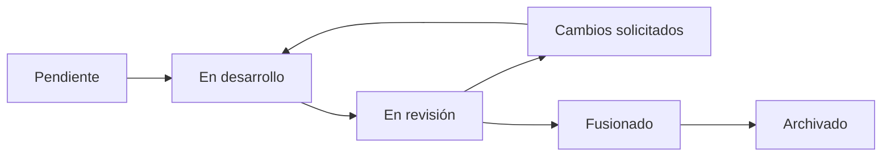

## Decisions

- Foundation asks about ClickUp even when a connector is unavailable. A recorded affirmative choice with incomplete setup remains pending. ClickUp provides custom status setup in its UI. An operator with list permissions can create the proposed statuses and verify them before delivery uses them.
- Use existing ClickUp task links, preview and reconciliation. Stage transitions update only the status on a fresh task observation. The configured list supplies the status labels.
- Use the sequence in the team roadmap. If the next change is assigned to the author, the assignee is unavailable or there is no successor, the team approves an independent fallback. A returned PR remains open while the author fixes the same branch.
- Preserve an auditable summary with the delivery handoff or OpenSpec change. Use measured, deduplicated intervals and token counts partitioned by actual provider billing bucket. Compute USD with exact decimal arithmetic from the dated price for each model and tier. For subscription sessions label the sum as API-equivalent. Retain the GitHub merge evidence before marking the archive complete.
- Decision: no (no UI)

